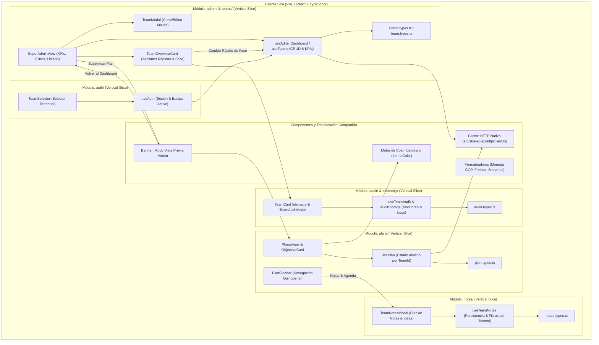

# 🏛️ Documento de Arquitectura de Software (ADR & Diseño de Sistema)
**Proyecto:** Plan Ministerial Misincol (Misiones Indígenas en Colombia) - Sistema PDM y Gestión Territorial Dinámica  
**Versión:** 2.0.0  
**Autor:** Agente 2 (Staff Software Architect) & Agente 1 (Chief Architect)  
**Estado:** Aprobado

---

## 1. Resumen Ejecutivo
El sistema **Plan Ministerial Misincol** evoluciona hacia una arquitectura multi-equipo inspirada en el patrón de gestión de proyectos y portales de clientes de alto rendimiento (`PortalClientes-`). 

Bajo este modelo, los componentes del sistema (fases PDM, fichas de objetivos, matrices de iniciativas, cálculos presupuestarios y líneas de tiempo) son modulares y reutilizables, mientras que el **Administrador Central (Super Admin)** tiene la autoridad de aprovisionar, configurar y organizar los equipos territoriales:
1. **Creación y Edición Dinámica de Misiones/Equipos**: Asignación de etnia, territorio, pastor líder, contacto directo por WhatsApp, presupuesto por fase, estado de salud operativa y paleta de color identitaria (`themeColor`).
2. **Espacio Territorial Aislado (Team Space)**: Cada equipo cuenta con su propio Plan de Desarrollo Ministerial (PDM) independiente, cálculos automatizados y cronogramas adaptativos.
3. **Modo Vista Previa Administrador (Admin Preview Mode)**: El director nacional puede inspeccionar e interactuar con el espacio operativo de cualquier equipo en terreno con un banner de retorno instantáneo al tablero central.

---

## 2. Diagrama de Componentes e Interacción (Mermaid)

---

## 3. Principios SOLID y Subcapas por Vertical Slicing

### 3.1. Estructura de Subcapas
- **`domain/`**: Entidades inmutables (`TeamSupervisionSummary`, `MissionaryTeam`, `PhasePlan`, `Activity`). Sin dependencias de terceros ni frameworks de red. *(SRP & DIP)*.
- **`application/`**: Casos de uso (`useAdminDashboard`, `usePlan`, `useAuth`). Controlan la orquestación de datos, persistencia reactiva por `teamId`, validación de reglas de negocio y cálculo de KPIs nacionales. *(OCP)*.
- **`ui/`**: Componentes visuales desacoplados (`TeamModal`, `TeamOverviewCard`, `SuperAdminView`, `PhaseView`). No ejecutan lógica directa de persistencia, sino que interactúan mediante contratos de callback y hooks de aplicación.

---

## 4. Registro de Decisiones de Arquitectura (ADR)

### ADR-005: Aprovisionamiento y Ciclo de Vida Dinámico de Equipos (Inspirado en PortalClientes)
- **Estado:** Aprobado.
- **Contexto:** Anteriormente, los equipos misioneros estaban cableados en constantes estáticas en el cliente, impidiendo añadir nuevas misiones o ajustar variables de campo.
- **Decisión:** Implementar el flujo de `PortalClientes-` adaptado al contexto misional: formulario modal completo con validación previa en cliente, selector de paleta de color (`themeColor`), teléfono para enlace directo a WhatsApp (`https://wa.me/...`), y almacenamiento reactivo.
- **Consecuencias:** Los directores pueden registrar inmediatamente misiones como "Misión Misak - Silvia" o "Misión Kogui - Sierra Nevada" sin necesidad de re-desplegar código.

### ADR-006: Espacios PDM Aislados por `teamId` (Multi-Tenancy Ligero en Cliente)
- **Estado:** Aprobado.
- **Contexto:** Cada equipo territorial tiene su propio ritmo y avances en las 5 fases del PDM.
- **Decisión:** Indexar los planes en la capa de persistencia bajo la clave `misincol_pdm_plans_[teamId]`. Si un equipo nuevo no cuenta con un plan previo, se genera dinámicamente una plantilla PDM inicial adaptada a su fase y etnia.
- **Consecuencias:** Integridad de datos garantizada; los cambios en la Misión Wayuu no afectan a la Misión Nasa ni a nuevas misiones creadas.

### ADR-007: Modo Vista Previa del Administrador con Navegación Bidireccional
- **Estado:** Aprobado.
- **Contexto:** El Super Administrador necesita supervisar o auditar el plan de cualquier misión sin perder el contexto de su sesión central.
- **Decisión:** Implementar un estado de navegación `isAdminPreview`. Al ingresar a un equipo desde el panel administrativo, se muestra un banner superior visualmente destacado que permite interactuar con el plan y regresar al tablero nacional con un solo clic.

### ADR-008: Gestión Dinámica de Objetivos Estratégicos (Cota Máxima de 4 por Fase)
- **Estado:** Aprobado.
- **Contexto:** Los equipos misioneros y supervisores requieren adaptar los objetivos estratégicos de cada fase según la realidad del pueblo indígena, permitiendo editar títulos y descripciones, y crear nuevos objetivos sin sobrepasar la estructura metodológica cuadrangular del PDM.
- **Decisión:** Habilitar creación y edición de objetivos en la capa de aplicación (`usePlan.ts`) y UI (`ObjectiveModal.tsx`, `ObjectiveCard.tsx`, `PhaseView.tsx`). Restricción estricta de negocio: $\text{cantidad de objetivos} \leq 4$. Si una fase ya cuenta con 4 objetivos, la opción de crear nuevo objetivo se deshabilita preventivamente.
- **Consecuencias:** Flexibilidad contextual total en campo respetando la arquitectura física de base de datos relacional (`chk_objective_number CHECK (1..4)`).

### ADR-009: Rediseño Visual de Alta Fidelidad del Portal de Acceso (Split-Card Hero & Matriz Predefinida)
- **Estado:** Aprobado.
- **Contexto:** El usuario solicitó modernizar el portal de autenticación adaptándolo al patrón de diseño editorial "Split-Card Hero", integrando la fotografía institucional de siembra territorial y eliminando botones de proveedores externos comerciales.
- **Decisión:** Implementar `LoginView.tsx` con arquitectura de contenedor dividido de alta fidelidad: panel izquierdo con fondo oscuro (`#0F0F11`), tipografía `Outfit`, badge institucional PDM, marco con glow sutil para la imagen de siembra y cita bíblica; panel derecho con logotipo Misincol centrado y amplio, selector fluido de roles, botón principal y matriz interactiva de acceso rápido.
- **Consecuencias:** Eleva sustancialmente el estándar estético de la aplicación, mantiene total congruencia temática y preserva la integridad de las rutas y parámetros de URL para deep-linking.

### ADR-010: Bus de Servicios de Aplicación (Service Bus) y Aceleración por Hardware (Fluidity & Caching Layer)
- **Estado:** Aprobado.
- **Contexto:** El sistema requería máxima ligereza y fluidez (60/120fps) en todas las transiciones, navegación entre misiones, despacho de notificaciones y renderizado, desacoplando los componentes para prevenir cascadas de re-renderizados en React y latencias de red.
- **Decisión:**
  1. Implementar el patrón **Service Bus** en `src/core/bus/` (`ServiceBus.ts`, `bus.types.ts`, `useServiceBus.ts`) con despacho asíncrono en cola de microtareas (`queueMicrotask`), contratos tipados (`auth:*`, `team:*`, `plan:*`, `ui:*`, `perf:*`) y aislamiento de excepciones por suscriptor.
  2. Implementar un **Service Worker nativo** (`public/sw.js` y `src/core/workers/registerServiceWorker.ts`) que pre-almacena en caché activos estáticos críticos (fuentes, logo en alta resolución, bundles JS y estilos) logrando 0ms de latencia en memoria caché sin dependencias de SDKs comerciales.
  3. Acelerar el pipeline visual con CSS GPU compositing (`src/styles/fluidity.css`: `gpu-layer`, `transform-gpu`, `will-change: transform`, `backface-visibility: hidden`) y curvas de aceleración elásticas (`cubic-bezier(0.16, 1, 0.3, 1)`).
  4. Optimizar componentes visuales de alto tráfico (`TeamOverviewCard`, `ObjectiveCard`, `LoginQuickAccessChips`) mediante `React.memo` para eliminar re-renderizados innecesarios del árbol de componentes.
- **Consecuencias:** Desacoplamiento total de módulos, transiciones táctiles ultra-fluidas, erradicación de cuellos de botella en repainting y adherencia inmaculada al Contrato de Gobernanza Técnica.

### ADR-011: Módulo Desacoplado de Notas y Agenda Territorial para Equipos Misioneros
- **Estado:** Aprobado.
- **Contexto:** Los pastores líderes y supervisores en campo requieren un espacio ágil para anotar ideas espontáneas, peticiones de oración, borradores de iniciativas y recordatorios sobre actividades sin alterar formalmente la matriz de objetivos hasta que se consoliden.
- **Decisión:**
  1. Implementar una nueva vertical slice en `src/modules/notes/` (`domain/`, `application/`, `ui/`) aislada e independiente.
  2. Persistir notas de manera segmentada por `teamId` (`misincol_team_notes_[teamId]`), con categorización (`idea`, `actividad`, `oracion`, `urgente`, `general`), pines prioritarios y marcas temporales.
  3. Integrar un acceso directo en el sidebar del equipo (`SidebarFooterActions.tsx`) con el botón "Notas & Agenda", abriendo el modal `TeamNotesModal.tsx` con soporte para creación rápida, edición, borrado y filtrado.
- **Consecuencias:** Mayor productividad en terreno, registro continuo de insights misionales y cero acoplamiento con la estructura troncal del PDM.

### ADR-012: Sistema de Telemetría y Monitoreo de Auditoría Territorial para Supervisión Nacional
- **Estado:** Aprobado.
- **Contexto:** La Dirección Nacional requería monitorear de forma regulada y transparente la actividad de cada equipo misionero en terreno (hora del último ingreso de las personas del equipo, qué modificaciones realizaron dentro del PDM, actividades agregadas, objetivos ajustados o notas creadas), optimizando los canales de comunicación entre el liderazgo nacional y los líderes de campo.
- **Decisión:**
  1. Diseñar el módulo `src/modules/audit/` estructurado en subcapas (`domain/`, `application/`, `ui/`) con persistencia segmentada `misincol_audit_logs_[teamId]`.
  2. Conectar el ciclo de eventos del sistema mediante `serviceBus.publish('audit:log', ...)` para registrar automáticamente:
     - Ingreso de sesión de usuarios de equipo (`login` con hora exacta y líder autenticado).
     - Modificaciones, adiciones o eliminaciones de actividades y presupuestos en el PDM.
     - Cambios en objetivos estratégicos.
     - Registro de notas y peticiones en la agenda territorial.
  3. Proyectar en cada tarjeta de misión (`TeamOverviewCard.tsx`) el componente `TeamCardTelemetry.tsx` con:
     - Timestamp de último ingreso con indicador de recencia (punto verde activo si ocurrió en las últimas 24 horas).
     - Resumen conciso de la última acción ejecutada.
     - Botón de inspección rápida "Ver bitácora" para abrir el modal `TeamAuditModal.tsx` con la cronología completa de actividades del equipo.
### ADR-013: Tablero Nacional Cartográfico con Mapa Interactivo de Colombia y Layout Split-Screen
- **Estado:** Aprobado.
- **Contexto:** La Dirección Nacional requería una reestructuración de la vista de supervisión basada en un layout "Split-Screen" ejecutivo de alta fidelidad: una barra lateral esbelta con accesos rápidos, KPIs superiores, barra de búsqueda con filtros, un grid de tarjetas de equipos territoriales en la sección izquierda (55%) y un mapa interactivo de Colombia detallado en la sección derecha (45%) con geolocalización precisa de cada misión, zonas de calor biogeográficas y selección bidireccional.
### ADR-014: Edición Integral de Actividades / Sub-Objetivos mediante Modal Jerárquico Multicampo
- **Estado:** Aprobado.
- **Contexto:** En la experiencia de usuario previa, la tarjeta de actividad (`ActivityItem`) únicamente permitía una edición rápida inline de presupuesto (`unitBudget` y `timesPerYear`). Los líderes misioneros y la Dirección Nacional requerían la capacidad de editar la totalidad de los atributos de una iniciativa (descripción comunitaria, objetivo destino, etapa/eje operativo, estado de avance, líder responsable, periodicidad, presupuesto unitario y total recalculado, rango de fechas con cálculo de semanas, situación diagnóstica, metas a mediano y largo plazo, y contingencias territoriales).
- **Decisión:**
  1. Extender `useActivityModalForm` y `ActivityModal` para operar en modalidad dual (`create` | `edit`) con precarga y sincronización reactiva de todos los campos del modelo de dominio `Activity`.
  2. Implementar selector de estado explícito (`Pendiente`, `En Proceso`, `Completado`) integrado en `ActivityBasicFields`.
  3. Conectar el disparador de edición (icono lápiz en `ActivityBudgetQuickEdit` y botón en acordeón de diagnóstico) directamente a `onEditActivity(activity)`, abriendo el modal con los valores existentes.
  4. Garantizar que `applyUpdateActivity` en la capa de aplicación maneje la reubicación automática de actividades entre objetivos si `objectiveNumber` cambia, y recalcule automáticamente `totalBudget` (`unitBudget * timesPerYear`) y el conteo de semanas (`totalWeeks`, `remainingWeeks`).
- **Consecuencias:** Coherencia de diseño de 3 secciones numeradas, edición total sin limitaciones y fidelidad estricta al Contrato de Gobernanza Técnica.

### ADR-015: Reorganización Estructural del Espacio de Trabajo PDM en Layout Jerárquico de 3 Niveles
- **Estado:** Aprobado.
- **Contexto:** Se solicitó reestructurar el espacio principal del Plan de Desarrollo Ministerial eliminando la barra superior horizontal previa (`TeamIdentityBar`), reorganizando la información en un esquema modular de 3 niveles:
  1. Fila Superior (2 columnas): Tarjeta "OBJETIVOS" con grid interactivo de objetivos estratégicos y tarjeta "zoom DEPARTAMENTO" con micro-mapa SVG geolocalizado de alta fidelidad.
  2. Fila Intermedia (Ancho Completo): "CABEZA TABLA" como tarjeta independiente con detalles del objetivo activo, presupuesto, botón destacado de "Nueva Actividad" y barra de filtros de estado y búsqueda.
  3. Fila Inferior (Ancho Completo): "TABLA" como tarjeta independiente con la lista completa de actividades e iniciativas.
- **Decisión:**
  1. Desincorporar `TeamIdentityBar` del encabezado en `AppMainContent.tsx`.
  2. Construir `TeamDepartmentZoomCard.tsx` (`src/modules/plans/ui/phaseView/`) calculando el `viewBox` exacto a partir de los límites vectoriales de los 33 departamentos de Colombia (`DEPARTMENT_BOUNDS`), proyectando el departamento con gradiente de contraste, sombras volumétricas y pin radar animado sobre el municipio de la misión, además de integrar el acceso directo de contacto al líder por WhatsApp.
  3. Desacoplar `ObjectiveCard.tsx` en dos tarjetas físicas independientes: la "CABEZA TABLA" (`ObjectiveCardHeader` + `ObjectiveFilterBar` + botón primario `+ Nueva Actividad`) y la "TABLA" (`ObjectiveActivitiesList`).
  4. Organizar la fila superior en `PhaseView.tsx` mediante grid responsivo `lg:grid-cols-12` (`lg:col-span-8` para objetivos y `lg:col-span-4` para zoom territorial).
- **Consecuencias:** Alineación milimétrica con el wireframe requerido por el usuario, mayor ergonomía visual, jerarquía clara y preservación de todas las capacidades funcionales sin SDKs comerciales.

### ADR-016: Rejilla Responsiva de Objetivos en 2 Columnas y Ampliación de Escala Cartográfica
- **Estado:** Aprobado.
- **Contexto:** Al presentar los 4 objetivos en una única fila horizontal en pantallas compactas y medianas (1024px - 1280px), las tarjetas sufrían compresión visual. Simultáneamente, el mapa departamental requería mayor presencia y amplitud visual para destacar el territorio de la misión activa.
- **Decisión:**
  1. Reestructurar `PhaseObjectiveCardsGrid.tsx` para operar en rejilla responsiva de 2 columnas (`grid-cols-1 sm:grid-cols-2`), distribuyendo los 4 objetivos en pares de dos hacia abajo (`2x2`).
  2. Ajustar la distribución de columnas en `PhaseView.tsx` a `lg:col-span-7 xl:col-span-6` para Objetivos y `lg:col-span-5 xl:col-span-6` para el mapa territorial, otorgándole mayor anchura al componente de mapa.
  3. Incrementar la escala y altura mínima del contenedor SVG en `TeamDepartmentZoomCard.tsx` (`min-h-[220px] sm:min-h-[260px]`), eliminando restricciones rígidas de altura para que el mapa crezca naturalmente a la par con la altura de la rejilla 2x2.
  4. Optimizar las etiquetas de cabecera en `PhaseObjectiveCardItem.tsx` evitando superposiciones tipográficas en anchos reducidos.
- **Consecuencias:** Visualización amplia y clara de los objetivos en móviles, tablets y escritorios, con un mapa territorial protagónico, balanceado y nítido.

### ADR-017: Optimización Horizontal de Tarjetas de Objetivos y Armonización Visual del Mapa
- **Estado:** Aprobado.
- **Contexto:** Las tarjetas de objetivos requerían un formato más horizontal ("más anchos que altos") para maximizar el aprovechamiento del ancho y reducir la altura vertical total, mientras que el mapa territorial debía reducirse a una escala equilibrada que evitara saturar el cuadrante derecho.
- **Decisión:**
  1. Rediseñar `PhaseObjectiveCardItem.tsx` con un formato apaisado/horizontal (`min-h-[90px] sm:min-h-[94px]`, relación de aspecto ~3:1), integrando cabecera concisa (`Objetivo #X` + `X/Y listas`), título en una línea con truncado y tooltip, y barra de progreso inferior compacta en la misma línea que el porcentaje y estado activo.
  2. Ajustar la proporción de columnas de la fila superior en `PhaseView.tsx` a `lg:col-span-8` (66.7%) para Objetivos y `lg:col-span-4` (33.3%) para el mapa territorial.
  3. Reducir la escala vertical del contenedor SVG en `TeamDepartmentZoomCard.tsx` a `min-h-[135px] max-h-[160px]`, logrando paridad milimétrica de altura (~255px) entre el bloque de objetivos y el mapa.
- **Consecuencias:** Armonía visual impecable, navegación compacta y ágil, y alineación estética de alto estándar con el sistema de diseño.

### ADR-018: Limpieza Minimalista del Mapa Territorial, Micro-Marcador de Precisión y Animación Sonar Dual
- **Estado:** Aprobado.
- **Contexto:** Se solicitó otorgarle la máxima visibilidad al mapa del departamento reduciendo el texto redundante (títulos genéricos, tarjetas flotantes inferiores y pie de página de misión), refinando el marcador de posición a un tamaño micrométrico más sutil y mejorando la animación del radar cartográfico.
- **Decisión:**
  1. Depurar `TeamDepartmentZoomCard.tsx` eliminando la tarjeta flotante inferior que obstruía la silueta del departamento y suprimiendo las etiquetas redundantes de "Zoom Departamento" y "Territorio Nacional".
  2. Concentrar la información exclusivamente en una cabecera minimalista: nombre del departamento, municipio, código abreviado y botón de contacto al líder por WhatsApp.
  3. Reducir el marcador de geolocalización a escala micrométrica (`r=1.5` núcleo y `r=3` base), logrando un pin afilado y elegante en lugar de un círculo tosco.
  4. Implementar un efecto de animación sonar dual con dos ondas de radar concéntricas desfasadas temporalmente (`animate-[ping_2s...]`), proporcionando una sensación de telemetría moderna, viva y no invasiva.
- **Consecuencias:** Máxima superficie útil para el mapa vectorial, visualización limpia sin elementos que tapen la cartografía y estética de alta fidelidad.

### ADR-019: Fundido Armónico de Botones con el Color de Fondo y Ajuste de Altura de Tarjetas de Objetivos
- **Estado:** Aprobado.
- **Contexto:** En la barra lateral (`PlanSidebar`), los botones con gradiente anaranjado tenían su extremo izquierdo en color blanco o claro con borde completo, creando un corte perceptible con respecto al fondo cálido `#FAF7F2`. Por otro lado, las tarjetas de objetivos en la sección superior requerían mayor altura y organización de contenido para eliminar espacios vacíos residuales y ajustarse con naturalidad a la altura del contenedor principal y del mapa departamental.
- **Decisión:**
  1. Configurar los gradientes de los botones de la barra lateral (`SidebarPhasesList`, `SidebarSegmentedControl`, `SidebarFooterActions`, `SidebarMetricsCard`, `SidebarUserProfileCard`) con inicio en `transparent 0%` y borde izquierdo `border-l-transparent`. De este modo, el color y borde del extremo izquierdo se disuelven y funden 100% de manera orgánica con el fondo del contenedor.
  2. Reestructurar integralmente `PhaseObjectiveCardItem.tsx` con una altura `min-h-[145px] sm:min-h-[160px] h-full` y distribución interna rica:
     - Cabecera con insignia numérica, etiqueta de objetivo y conteo de actividades completadas.
     - Título a dos líneas (`line-clamp-2`) con tipografía `Outfit`.
     - Vista previa de la descripción del objetivo (`line-clamp-2 text-[11px]`) para contextualizar la ficha.
     - Fila meta con total de actividades y presupuesto formateado (`COP`).
     - Barra de progreso interactiva con porcentaje y estado dinámico (`● Activo` / `Ver actividades →`).
- **Consecuencias:** Integración cromática perfecta en la barra lateral sin cortes perceptibles y aprovechamiento vertical armónico de las tarjetas de objetivos junto al mapa de Risaralda.

### ADR-020: Estandarización de Gradientes en Botones de Barra Lateral con Base Pastel Crema y Acento Terracota
- **Estado:** Aprobado.
- **Contexto:** El usuario solicitó eliminar la línea perimetral ("esa raya") de los botones con degradado de la barra lateral (`PLAN PDM`, Pilar Activo, `AVANCES DE PILAR`, `Notas y Agenda`, `INFORME PDM`), replicando la solución y gradiente afinado en `SidebarUserProfileCard`: eliminación del borde, adición de `overflow-hidden` y aplicación del degradado armónico continuo `linear-gradient(90deg, #FDF0E8 0%, #F18A38 60%, #B83A05 100%)`.
- **Decisión:**
  1. Suprimir la clase `border` en todos los botones del sidebar para evitar líneas de contraste que rompan el fundido visual con el fondo.
  2. Incorporar `overflow-hidden` para conservar el radio de curvatura suave (`rounded-2xl` y `rounded-3xl`) en todas las resoluciones.
  3. Establecer el degradado unificado `linear-gradient(90deg, #FDF0E8 0%, #F18A38 60%, #B83A05 100%)`, asegurando una transición fluida desde el tono pastel crema `#FDF0E8` hasta el terracota intenso `#B83A05`.
  4. Mantener la tarjeta `SidebarUserProfileCard.tsx` intacta con la configuración manual del usuario.
- **Consecuencias:** Cohesión visual impecable y sin bordes residuales en todo el panel de navegación lateral.

### ADR-021: Micro-Pinpoint Estático de Ubicación Territorial en Mapa Departamental
- **Estado:** Aprobado.
- **Contexto:** El marcador de ubicación dentro del mapa de departamento (`TeamDepartmentZoomCard`) presentaba ondas de ping SVG con `transform: scale()`, lo que generaba un efecto óptico de "bolita descendente" debido al punto de origen de escala en el viewBox SVG. Asimismo, el tamaño del punto era desproporcionado respecto a la superficie del departamento.
- **Decisión:**
  1. Suprimir por completo las animaciones de pulsación/ping en SVG para eliminar el artefacto de movimiento descendente.
  2. Reducir la escala geométrica del marcador en más de un 60%, pasando de un radio exterior de `3.0` a `1.2`.
  3. Estructurar un micro-pinpoint estático de alta precisión:
     - Halo ambiental sutil (`r=2.2`, opacidad suave 18%).
     - Anillo blanco nítido (`r=1.2`, trazo terracota 0.35px).
     - Núcleo terracota institucional (`r=0.75`).
     - Destello central de precisión (`r=0.25`).
- **Consecuencias:** Visualización cartográfica nítida, profesional, libre de distracciones cinéticas y perfectamente proporcionada con el contorno departamental.

### ADR-022: Refinamiento Cartográfico de Alta Precisión y Proporciones Esbeltas del Mapa Departamental
- **Estado:** Aprobado.
- **Contexto:** El mapa en `TeamDepartmentZoomCard` presentaba una apariencia gruesa/abultada provocada por un trazo de borde excesivo (`strokeWidth="1.8"`), una sombra desenfocada sobredimensionada (`stdDeviation="3"`) y un margen ajustado (`padding=14`) que forzaba al departamento a cubrir casi la totalidad del encuadre sin contexto cartográfico.
- **Decisión:**
  1. **Proporciones Esbeltas y Encuadre Natural:** Ampliar el padding de cálculo del viewBox a `26`, permitiendo que el departamento respire, se aprecie su silueta geográfica orgánica y revele los departamentos vecinos que lo circundan.
  2. **Trazo Ultrafino (Hairline) y Contorno Topográfico:**
     - Reducir el grosor del trazo perimetral blanco de `1.8px` a `0.65px` para máxima definición geométrica.
     - Incorporar un segundo contorno interior punteado (`strokeWidth="0.25px"`, opacidad 45%) que simula curvas de nivel y relieve topográfico.
     - Ajustar la sombra a una elevación nítida (`dy=1`, `stdDeviation=1.1`, opacidad 25%) sin desenfoques turbios.
  3. **Cartografía de Entorno y Georreferenciación:**
     - Renderizar los departamentos colindantes con trazo fino (`0.35px`) sobre fondo pergamino claro (`#F5F1EB`).
     - Incorporar etiquetas tenues en micro-tipografía con los nombres de territorios limítrofes (Chocó, Antioquia, Caldas, Valle del Cauca, etc.).
     - Agregar retícula de coordenadas geodésicas ultrafinas con líneas guía punteadas.
     - Incluir distintivos de cartografía suiza: rosa de los vientos minimalista (`N | ▲`), barra métrica de escala (`15 km`) y sello de coordenadas geográficas (`5°16′ N • 76°01′ O`).
- **Consecuencias:** Transformación completa del mapa en un elemento cartográfico esbelto, elegante, detallado y de precisión profesional.

### ADR-023: Reemplazo Cohesivo de Iconos en Acciones del Sidebar y Escalamiento Armónico de Iconografía General
- **Estado:** Aprobado.
- **Contexto:** En el pie de la barra lateral (`SidebarFooterActions`), el botón "Notas y Agenda" empleaba un emoji plano (`📒`) y el botón "INFORME PDM" utilizaba una chapa circular roja aislada con un ícono de descarga que rompía la línea cromática del sistema de diseño. Asimismo, la iconografía en componentes clave (encabezados, tarjetas de métricas, controles y perfiles) requería un ligero aumento de escala para mejorar su legibilidad y presencia visual, con la restricción explícita de conservar intactos los íconos de la lista de pilares (`SidebarPhasesList`).
- **Decisión:**
  1. **Reemplazo Cohesivo de Iconos en Acciones del Sidebar:**
     - En "Notas y Agenda", sustituir el emoji por el ícono vectorial `NotebookPen` (`lucide-react`) en color blanco con sombra cálida (`drop-shadow-[0_1px_2px_rgba(40,15,5,0.7)]`), logrando sincronía estética con la tipografía.
     - En "INFORME PDM", suprimir el círculo rojo discordante e incorporar directamente el glifo `FileBarChart` (`lucide-react`) en blanco con la misma sombra institucional.
  2. **Escalamiento General de Iconografía en la UI:**
     - `SidebarSegmentedControl`: `BookOpen` de `w-4 h-4` a `w-5 h-5`.
     - `SidebarUserProfileCard`: `Users` y `LogOut` de `w-4 h-4` a `w-5 h-5`.
     - `SidebarBrand`: `ChevronRight` y `X` de `w-3.5 h-3.5` a `w-4.5 h-4.5`.
     - `SidebarViewsNav`: `ShieldCheck` de `w-4 h-4` a `w-5 h-5`.
     - `TeamDepartmentZoomCard`: `Compass` de `w-3.5 h-3.5` a `w-4.5 h-4.5`.
     - `PhaseHeaderBar`: `Menu` a `w-5 h-5`, `RotateCcw` y `Plus` a `w-4.5 h-4.5`.
     - `PhaseObjectiveCardsGrid`: `Plus` de `w-4 h-4` a `w-5 h-5`.
     - `ObjectiveCardHeader`: `Pencil` de `w-3 h-3` a `w-4 h-4`, `Plus` de `w-4 h-4` a `w-5 h-5`.
     - `ObjectiveFilterBar`: `Search` de `w-3.5 h-3.5` a `w-4.5 h-4.5`.
     - `ObjectiveActivitiesList`: `Layers` de `w-5 h-5` a `w-6 h-6`, `Plus` de `w-3.5 h-3.5` a `w-4.5 h-4.5`.
     - `ActivityItem`: `User`, `Calendar`, `ChevronUp` y `ChevronDown` de `w-3 h-3` a `w-4 h-4`.
     - `ActivityHeaderTags`: `ChevronDown` y `Layers` de `w-3 h-3` a `w-4 h-4`.
     - `ActivityBudgetQuickEdit`: `Check`, `Edit3` y `Trash2` de `w-3.5 h-3.5` a `w-4 h-4`.
     - `PhaseMetricsBar`: `Coins`, `TrendingUp`, `CheckCircle2` y `Calendar` de `w-4 h-4` a `w-5 h-5`.
  3. **Preservación Estricta de la Lista de Pilares (`SidebarPhasesList`):**
     - Se preservó estrictamente el dimensionamiento compacto (`w-4 h-4`) en los 5 pilares (`Investigación`, `Encarnación`, `Evangelización`, `Entrenamiento`, `Autocuidado`) atendiendo a la solicitud del usuario ("menos los de la lista").
- **Consecuencias:** Cohesión visual impecable, jerarquía armónica entre acciones primarias y listas subordinadas, e iconografía elegante de alta legibilidad.

### ADR-024: Insignia Cartográfica Flotante en la Esquina Superior Izquierda del Mapa
- **Estado:** Aprobado.
- **Contexto:** En `TeamDepartmentZoomCard.tsx`, el bloque con el nombre del departamento y municipio se encontraba situado como elemento flexible en el mismo flujo horizontal del contenedor del SVG, desplazando la silueta geográfica hacia la derecha y generando un espacio en blanco residual no deseado a la izquierda del mapa.
- **Decisión:**
  1. Posicionar el bloque de identificación departamental como una insignia flotante superpuesta (`absolute top-2.5 left-2.5 z-10`), embebida directamente dentro del lienzo cartográfico.
  2. Aplicar estilo de insignia cartográfica de alta fidelidad: fondo blanco translúcido con desenfoque de fondo (`bg-white/90 backdrop-blur-xs`), borde suave (`border-stone-200/80`), esquinas redondeadas (`rounded-xl`), sombra sutil (`shadow-2xs`), contenedor de brújula institucional y tipografía nítida `Outfit`.
  3. Liberar el contenedor SVG al 100% de anchura y altura, permitiendo que el departamento y sus límites limítrofes se centren de manera natural y sin espacios vacíos desbalanceados.
- **Consecuencias:** Aprovechamiento total del lienzo del mapa, eliminación del espacio vacío lateral y composición armónica de cuatro esquinas (identificación en superior-izquierda, rosa de los vientos en superior-derecha, escala métrica en inferior-izquierda y coordenadas en inferior-derecha).

### ADR-025: Escalamiento y Realce del Pinpoint de Ubicación en el Mapa Departamental
- **Estado:** Aprobado.
- **Contexto:** El marcador de geolocalización de la misión en el mapa departamental (`TeamDepartmentZoomCard`) requería un aumento de escala y contraste visual para ser localizado de inmediato sobre la silueta del departamento.
- **Decisión:**
  1. Incrementar el radio de la corona exterior blanca a `2.6px` (trazo institucional terracota de `0.65px`) y el núcleo central terracota a `1.6px`.
  2. Dotar al marcador de un filtro de sombra proyectada SVG (`#pinpointShadow`, `dy=0.8`, `stdDeviation=0.7`, opacidad 30%) para garantizar contraste y relieve sobre fondos con gradientes cálidos.
  3. Expandir el halo ambiental a `r=4.2px` con opacidad suave del 24% para indicar la zona de influencia territorial sin generar saturación.
- **Consecuencias:** Marcador nítido, claramente visible a simple vista y con acabado cartográfico de alta gama.

### ADR-026: Reorganización y Jerarquía Visual Equilibrada en Barra Lateral (Sidebar)
- **Estado:** Aprobado.
- **Contexto:** La coexistencia simultánea de gradientes anaranjados pesados en múltiples botones consecutivos del sidebar (`PLAN PDM`, pilar activo, avances de métricas, notas, informe y perfil) generaba saturación sensorial y fatiga visual en usuarios mayores, diluyendo el foco de atención sobre el pilar seleccionado.
- **Decisión:**
  1. **Principio de Foco Único Activo:** Reservar el degradado institucional naranja-terracota (`linear-gradient(90deg, #f7c6a7ff 0%, #F18A38 60%, #B83A05 100%)`) exclusivamente para el pilar activo seleccionado en la lista (`SidebarPhasesList`) con tipografía blanca, aro perimetral luminoso y anillo de profundidad (`border border-orange-300/60 ring-1 ring-orange-400/30`).
  2. **Tarjetas Inactivas con Contraste Calmado:**
     - Establecer las opciones inactivas de pilares con fondo blanco sólido (`bg-white`), borde sutil anaranjado (`border border-orange-100 shadow-2xs`), texto oscuro de alta legibilidad (`text-stone-900 font-bold`) e ícono terracota, con respuesta interactiva limpia (`hover:border-orange-300/80 hover:shadow-xs`).
  3. **Calma en Métricas y Acciones Secundarias:**
     - Transformar `SidebarMetricsCard` en una tarjeta blanca neutra (`bg-white border border-orange-100 shadow-2xs`), con textos oscuros y cifras de avance en terracota `#8B251E`.
     - Reestructurar los botones de acción inferior (`Notas y Agenda`, `INFORME PDM`) en `SidebarFooterActions` con fondo blanco (`bg-white hover:bg-orange-50/60`), borde anaranjado fino (`border-2 border-orange-200/80 hover:border-orange-400/90`), texto oscuro (`text-stone-900`) e íconos terracota `#8B251E`, armonizando con el botón de "Contacto Líder" (borde esmeralda).
- **Consecuencias:** Jerarquía visual limpia, eliminación de la sobrecarga cromática, máxima legibilidad para adultos mayores y distinción instantánea del elemento activo.

### ADR-027: Ajuste Esbelto y Reducción del Ancho de la Barra Lateral (Sidebar)
- **Estado:** Aprobado.
- **Contexto:** El ancho del panel lateral en pantallas medianas y grandes (`lg:w-72 xl:w-80`, correspondiente a 288px y 320px) ocupaba una superficie excesiva del viewport horizontal, quitándole espacio de respiración al mapa cartográfico y a la cuadrícula de objetivos.
- **Decisión:**
  1. Reducir el ancho del sidebar a `lg:w-64 xl:w-72` (256px en pantallas medianas y 288px en pantallas grandes/desktop).
  2. Ajustar el padding horizontal interno del contenedor principal a `px-3 sm:px-3.5`, manteniendo holgura y comodidad para el texto y los íconos sin sensación de apiñamiento.
  3. Reducir la anchura en menú móvil desplegable a `w-72`.
- **Consecuencias:** Proporción más esbelta y armónica del sidebar, ganancia inmediata de más de 32px de ancho para el contenido central y mapa, y preservación íntegra de la legibilidad.

