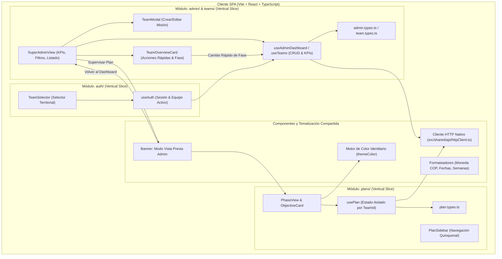

# 🏛️ Documento de Arquitectura de Software (ADR & Diseño de Sistema)
**Proyecto:** Plan Ministerial Misincol (Misiones Indígenas en Colombia) - Sistema PDM y Gestión Territorial Dinámica  
**Versión:** 2.0.0  
**Autor:** Agente 2 (Staff Software Architect) & Agente 1 (Chief Architect)  
**Estado:** Aprobado

---

## 1. Resumen Ejecutivo
El sistema **Plan Ministerial Misincol** evoluciona hacia una arquitectura multi-equipo inspirada en el patrón de gestión de proyectos y portales de clientes de alto rendimiento (`PortalClientes-`). 

Bajo este modelo, los componentes del sistema (fases PDM, fichas de objetivos, matrices de iniciativas, cálculos presupuestarios y líneas de tiempo) son modulares y reutilizables, mientras que el **Administrador Central (Super Admin)** tiene la autoridad de aprovisionar, configurar y organizar los equipos territoriales:
1. **Creación y Edición Dinámica de Misiones/Equipos**: Asignación de etnia, territorio, pastor líder, contacto directo por WhatsApp, presupuesto por fase, estado de salud operativa y paleta de color identitaria (`themeColor`).
2. **Espacio Territorial Aislado (Team Space)**: Cada equipo cuenta con su propio Plan de Desarrollo Ministerial (PDM) independiente, cálculos automatizados y cronogramas adaptativos.
3. **Modo Vista Previa Administrador (Admin Preview Mode)**: El director nacional puede inspeccionar e interactuar con el espacio operativo de cualquier equipo en terreno con un banner de retorno instantáneo al tablero central.

---

## 2. Diagrama de Componentes e Interacción (Mermaid)

---

## 3. Principios SOLID y Subcapas por Vertical Slicing

### 3.1. Estructura de Subcapas
- **`domain/`**: Entidades inmutables (`TeamSupervisionSummary`, `MissionaryTeam`, `PhasePlan`, `Activity`). Sin dependencias de terceros ni frameworks de red. *(SRP & DIP)*.
- **`application/`**: Casos de uso (`useAdminDashboard`, `usePlan`, `useAuth`). Controlan la orquestación de datos, persistencia reactiva por `teamId`, validación de reglas de negocio y cálculo de KPIs nacionales. *(OCP)*.
- **`ui/`**: Componentes visuales desacoplados (`TeamModal`, `TeamOverviewCard`, `SuperAdminView`, `PhaseView`). No ejecutan lógica directa de persistencia, sino que interactúan mediante contratos de callback y hooks de aplicación.

---

## 4. Registro de Decisiones de Arquitectura (ADR)

### ADR-005: Aprovisionamiento y Ciclo de Vida Dinámico de Equipos (Inspirado en PortalClientes)
- **Estado:** Aprobado.
- **Contexto:** Anteriormente, los equipos misioneros estaban cableados en constantes estáticas en el cliente, impidiendo añadir nuevas misiones o ajustar variables de campo.
- **Decisión:** Implementar el flujo de `PortalClientes-` adaptado al contexto misional: formulario modal completo con validación previa en cliente, selector de paleta de color (`themeColor`), teléfono para enlace directo a WhatsApp (`https://wa.me/...`), y almacenamiento reactivo.
- **Consecuencias:** Los directores pueden registrar inmediatamente misiones como "Misión Misak - Silvia" o "Misión Kogui - Sierra Nevada" sin necesidad de re-desplegar código.

### ADR-006: Espacios PDM Aislados por `teamId` (Multi-Tenancy Ligero en Cliente)
- **Estado:** Aprobado.
- **Contexto:** Cada equipo territorial tiene su propio ritmo y avances en las 5 fases del PDM.
- **Decisión:** Indexar los planes en la capa de persistencia bajo la clave `misincol_pdm_plans_[teamId]`. Si un equipo nuevo no cuenta con un plan previo, se genera dinámicamente una plantilla PDM inicial adaptada a su fase y etnia.
- **Consecuencias:** Integridad de datos garantizada; los cambios en la Misión Wayuu no afectan a la Misión Nasa ni a nuevas misiones creadas.

### ADR-007: Modo Vista Previa del Administrador con Navegación Bidireccional
- **Estado:** Aprobado.
- **Contexto:** El Super Administrador necesita supervisar o auditar el plan de cualquier misión sin perder el contexto de su sesión central.
- **Decisión:** Implementar un estado de navegación `isAdminPreview`. Al ingresar a un equipo desde el panel administrativo, se muestra un banner superior visualmente destacado que permite interactuar con el plan y regresar al tablero nacional con un solo clic.
