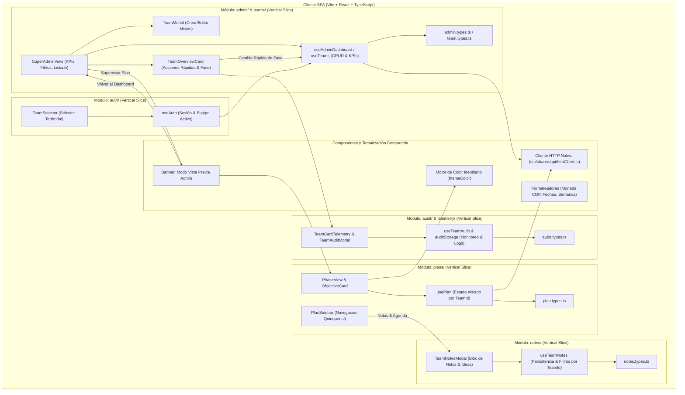

# 🏛️ Documento de Arquitectura de Software (ADR & Diseño de Sistema)
**Proyecto:** Plan Ministerial Misincol (Misiones Indígenas en Colombia) - Sistema PDM y Gestión Territorial Dinámica  
**Versión:** 2.0.0  
**Autor:** Agente 2 (Staff Software Architect) & Agente 1 (Chief Architect)  
**Estado:** Aprobado

---

## 1. Resumen Ejecutivo
El sistema **Plan Ministerial Misincol** evoluciona hacia una arquitectura multi-equipo inspirada en el patrón de gestión de proyectos y portales de clientes de alto rendimiento (`PortalClientes-`). 

Bajo este modelo, los componentes del sistema (fases PDM, fichas de objetivos, matrices de iniciativas, cálculos presupuestarios y líneas de tiempo) son modulares y reutilizables, mientras que el **Administrador Central (Super Admin)** tiene la autoridad de aprovisionar, configurar y organizar los equipos territoriales:
1. **Creación y Edición Dinámica de Misiones/Equipos**: Asignación de etnia, territorio, pastor líder, contacto directo por WhatsApp, presupuesto por fase, estado de salud operativa y paleta de color identitaria (`themeColor`).
2. **Espacio Territorial Aislado (Team Space)**: Cada equipo cuenta con su propio Plan de Desarrollo Ministerial (PDM) independiente, cálculos automatizados y cronogramas adaptativos.
3. **Modo Vista Previa Administrador (Admin Preview Mode)**: El director nacional puede inspeccionar e interactuar con el espacio operativo de cualquier equipo en terreno con un banner de retorno instantáneo al tablero central.

---

## 2. Diagrama de Componentes e Interacción (Mermaid)

---

## 3. Principios SOLID y Subcapas por Vertical Slicing

### 3.1. Estructura de Subcapas
- **`domain/`**: Entidades inmutables (`TeamSupervisionSummary`, `MissionaryTeam`, `PhasePlan`, `Activity`). Sin dependencias de terceros ni frameworks de red. *(SRP & DIP)*.
- **`application/`**: Casos de uso (`useAdminDashboard`, `usePlan`, `useAuth`). Controlan la orquestación de datos, persistencia reactiva por `teamId`, validación de reglas de negocio y cálculo de KPIs nacionales. *(OCP)*.
- **`ui/`**: Componentes visuales desacoplados (`TeamModal`, `TeamOverviewCard`, `SuperAdminView`, `PhaseView`). No ejecutan lógica directa de persistencia, sino que interactúan mediante contratos de callback y hooks de aplicación.

---

## 4. Registro de Decisiones de Arquitectura (ADR)

### ADR-005: Aprovisionamiento y Ciclo de Vida Dinámico de Equipos (Inspirado en PortalClientes)
- **Estado:** Aprobado.
- **Contexto:** Anteriormente, los equipos misioneros estaban cableados en constantes estáticas en el cliente, impidiendo añadir nuevas misiones o ajustar variables de campo.
- **Decisión:** Implementar el flujo de `PortalClientes-` adaptado al contexto misional: formulario modal completo con validación previa en cliente, selector de paleta de color (`themeColor`), teléfono para enlace directo a WhatsApp (`https://wa.me/...`), y almacenamiento reactivo.
- **Consecuencias:** Los directores pueden registrar inmediatamente misiones como "Misión Misak - Silvia" o "Misión Kogui - Sierra Nevada" sin necesidad de re-desplegar código.

### ADR-006: Espacios PDM Aislados por `teamId` (Multi-Tenancy Ligero en Cliente)
- **Estado:** Aprobado.
- **Contexto:** Cada equipo territorial tiene su propio ritmo y avances en las 5 fases del PDM.
- **Decisión:** Indexar los planes en la capa de persistencia bajo la clave `misincol_pdm_plans_[teamId]`. Si un equipo nuevo no cuenta con un plan previo, se genera dinámicamente una plantilla PDM inicial adaptada a su fase y etnia.
- **Consecuencias:** Integridad de datos garantizada; los cambios en la Misión Wayuu no afectan a la Misión Nasa ni a nuevas misiones creadas.

### ADR-007: Modo Vista Previa del Administrador con Navegación Bidireccional
- **Estado:** Aprobado.
- **Contexto:** El Super Administrador necesita supervisar o auditar el plan de cualquier misión sin perder el contexto de su sesión central.
- **Decisión:** Implementar un estado de navegación `isAdminPreview`. Al ingresar a un equipo desde el panel administrativo, se muestra un banner superior visualmente destacado que permite interactuar con el plan y regresar al tablero nacional con un solo clic.

### ADR-008: Gestión Dinámica de Objetivos Estratégicos (Cota Máxima de 4 por Fase)
- **Estado:** Aprobado.
- **Contexto:** Los equipos misioneros y supervisores requieren adaptar los objetivos estratégicos de cada fase según la realidad del pueblo indígena, permitiendo editar títulos y descripciones, y crear nuevos objetivos sin sobrepasar la estructura metodológica cuadrangular del PDM.
- **Decisión:** Habilitar creación y edición de objetivos en la capa de aplicación (`usePlan.ts`) y UI (`ObjectiveModal.tsx`, `ObjectiveCard.tsx`, `PhaseView.tsx`). Restricción estricta de negocio: $\text{cantidad de objetivos} \leq 4$. Si una fase ya cuenta con 4 objetivos, la opción de crear nuevo objetivo se deshabilita preventivamente.
- **Consecuencias:** Flexibilidad contextual total en campo respetando la arquitectura física de base de datos relacional (`chk_objective_number CHECK (1..4)`).

### ADR-009: Rediseño Visual de Alta Fidelidad del Portal de Acceso (Split-Card Hero & Matriz Predefinida)
- **Estado:** Aprobado.
- **Contexto:** El usuario solicitó modernizar el portal de autenticación adaptándolo al patrón de diseño editorial "Split-Card Hero", integrando la fotografía institucional de siembra territorial y eliminando botones de proveedores externos comerciales.
- **Decisión:** Implementar `LoginView.tsx` con arquitectura de contenedor dividido de alta fidelidad: panel izquierdo con fondo oscuro (`#0F0F11`), tipografía `Outfit`, badge institucional PDM, marco con glow sutil para la imagen de siembra y cita bíblica; panel derecho con logotipo Misincol centrado y amplio, selector fluido de roles, botón principal y matriz interactiva de acceso rápido.
- **Consecuencias:** Eleva sustancialmente el estándar estético de la aplicación, mantiene total congruencia temática y preserva la integridad de las rutas y parámetros de URL para deep-linking.

### ADR-010: Bus de Servicios de Aplicación (Service Bus) y Aceleración por Hardware (Fluidity & Caching Layer)
- **Estado:** Aprobado.
- **Contexto:** El sistema requería máxima ligereza y fluidez (60/120fps) en todas las transiciones, navegación entre misiones, despacho de notificaciones y renderizado, desacoplando los componentes para prevenir cascadas de re-renderizados en React y latencias de red.
- **Decisión:**
  1. Implementar el patrón **Service Bus** en `src/core/bus/` (`ServiceBus.ts`, `bus.types.ts`, `useServiceBus.ts`) con despacho asíncrono en cola de microtareas (`queueMicrotask`), contratos tipados (`auth:*`, `team:*`, `plan:*`, `ui:*`, `perf:*`) y aislamiento de excepciones por suscriptor.
  2. Implementar un **Service Worker nativo** (`public/sw.js` y `src/core/workers/registerServiceWorker.ts`) que pre-almacena en caché activos estáticos críticos (fuentes, logo en alta resolución, bundles JS y estilos) logrando 0ms de latencia en memoria caché sin dependencias de SDKs comerciales.
  3. Acelerar el pipeline visual con CSS GPU compositing (`src/styles/fluidity.css`: `gpu-layer`, `transform-gpu`, `will-change: transform`, `backface-visibility: hidden`) y curvas de aceleración elásticas (`cubic-bezier(0.16, 1, 0.3, 1)`).
  4. Optimizar componentes visuales de alto tráfico (`TeamOverviewCard`, `ObjectiveCard`, `LoginQuickAccessChips`) mediante `React.memo` para eliminar re-renderizados innecesarios del árbol de componentes.
- **Consecuencias:** Desacoplamiento total de módulos, transiciones táctiles ultra-fluidas, erradicación de cuellos de botella en repainting y adherencia inmaculada al Contrato de Gobernanza Técnica.

### ADR-011: Módulo Desacoplado de Notas y Agenda Territorial para Equipos Misioneros
- **Estado:** Aprobado.
- **Contexto:** Los pastores líderes y supervisores en campo requieren un espacio ágil para anotar ideas espontáneas, peticiones de oración, borradores de iniciativas y recordatorios sobre actividades sin alterar formalmente la matriz de objetivos hasta que se consoliden.
- **Decisión:**
  1. Implementar una nueva vertical slice en `src/modules/notes/` (`domain/`, `application/`, `ui/`) aislada e independiente.
  2. Persistir notas de manera segmentada por `teamId` (`misincol_team_notes_[teamId]`), con categorización (`idea`, `actividad`, `oracion`, `urgente`, `general`), pines prioritarios y marcas temporales.
  3. Integrar un acceso directo en el sidebar del equipo (`SidebarFooterActions.tsx`) con el botón "Notas & Agenda", abriendo el modal `TeamNotesModal.tsx` con soporte para creación rápida, edición, borrado y filtrado.
- **Consecuencias:** Mayor productividad en terreno, registro continuo de insights misionales y cero acoplamiento con la estructura troncal del PDM.

### ADR-012: Sistema de Telemetría y Monitoreo de Auditoría Territorial para Supervisión Nacional
- **Estado:** Aprobado.
- **Contexto:** La Dirección Nacional requería monitorear de forma regulada y transparente la actividad de cada equipo misionero en terreno (hora del último ingreso de las personas del equipo, qué modificaciones realizaron dentro del PDM, actividades agregadas, objetivos ajustados o notas creadas), optimizando los canales de comunicación entre el liderazgo nacional y los líderes de campo.
- **Decisión:**
  1. Diseñar el módulo `src/modules/audit/` estructurado en subcapas (`domain/`, `application/`, `ui/`) con persistencia segmentada `misincol_audit_logs_[teamId]`.
  2. Conectar el ciclo de eventos del sistema mediante `serviceBus.publish('audit:log', ...)` para registrar automáticamente:
     - Ingreso de sesión de usuarios de equipo (`login` con hora exacta y líder autenticado).
     - Modificaciones, adiciones o eliminaciones de actividades y presupuestos en el PDM.
     - Cambios en objetivos estratégicos.
     - Registro de notas y peticiones en la agenda territorial.
  3. Proyectar en cada tarjeta de misión (`TeamOverviewCard.tsx`) el componente `TeamCardTelemetry.tsx` con:
     - Timestamp de último ingreso con indicador de recencia (punto verde activo si ocurrió en las últimas 24 horas).
     - Resumen conciso de la última acción ejecutada.
     - Botón de inspección rápida "Ver bitácora" para abrir el modal `TeamAuditModal.tsx` con la cronología completa de actividades del equipo.
- **Consecuencias:** Supervisión regulada, transparencia total en la rendición de cuentas, comunicación oportuna del liderazgo nacional con los líderes de misión y estricto cumplimiento del Contrato de Gobernanza Técnica.

