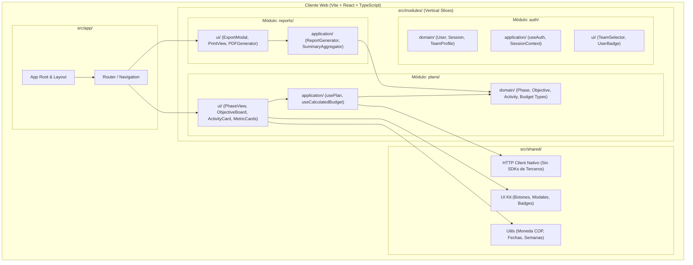

# 🏛️ Documento de Arquitectura de Software (ADR & Diseño de Sistema)
**Proyecto:** Plan Ministerial Misincol (Misiones Indígenas en Colombia) - Sistema PDM (Plan de Desarrollo Ministerial)  
**Versión:** 1.0.0  
**Autor:** Agente 2 (Staff Software Architect) & Agente 1 (Chief Architect)  
**Estado:** Aprobado

---

## 1. Resumen Ejecutivo
El sistema **Plan Ministerial Misincol** tiene como objetivo digitalizar, gestionar y dar seguimiento operativo y presupuestario a las iniciativas y actividades del Plan de Desarrollo Ministerial (PDM) en comunidades indígenas de Colombia.

El diseño del frontend adopta los principios de **Vertical Slicing Architecture (VSA)** combinados con **Domain-Driven Design (DDD)** táctico y **Clean Architecture simplificada**. Esto asegura una alta cohesión dentro de cada contexto delimitado (*Bounded Context*) y un bajo acoplamiento entre características independientes (Planes, Autenticación, Reportes).

La interfaz de usuario implementa la identidad visual auténtica de **MISINCOL** (Misiones Indígenas en Colombia): una paleta cálida basada en tonos tierra, terracota (`#8B251E` / `#A33025`), ocre/ámbar (`#E67324`), dorados y texturas naturales que evocan el arraigo cultural colombiano, combinados con una ergonomía de interacción rápida ("optimización de clics", edición inline, autocalculado de presupuestos y semanas).

---

## 2. Diagrama de Arquitectura Modular y Flujo de Datos

---

## 3. Decisiones de Arquitectura de Software (ADR)

### ADR 001: Adopción de Vertical Slicing + DDD frente a Capas Técnicas Tradicionales
* **Contexto:** Las arquitecturas tradicionales basadas en capas globales (`/components`, `/services`, `/hooks`) fragmentan la lógica de negocio y dificultan el mantenimiento cuando un módulo (ej. Presupuesto o Fases del Plan) evoluciona.
* **Decisión:** Implementar Rebanadas Verticales dentro de `src/modules/[nombre_modulo]/` conteniendo sus subcapas `domain/`, `application/` y `ui/`.
* **Consecuencias:**
  * Cohesión máxima: Todo lo referente a los Planes de Desarrollo se encuentra encapsulado en `src/modules/plans/`.
  * Desacoplamiento: Si se requiere agregar un nuevo módulo (ej. inventario o salud comunitaria), no impacta el módulo de planes.

### ADR 002: Ergonomía de "Cero Fricción" / Edición Rápida Inline
* **Contexto:** Los coordinadores ministeriales y misioneros en territorio requieren registrar avances rápidamente sin llenar formularios largos modales para cada cambio menor.
* **Decisión:** Estado optimista y reactivo en el hook `usePlan`. Al cambiar un select (ej. de "Pendiente" a "En Proceso") o editar presupuestos unitarios y frecuencia anual, el sistema recalcula en tiempo de ejecución:
  $$\text{Presupuesto Total} = \text{Presupuesto Unitario} \times \text{Veces al Año}$$
  $$\text{Semanas Restantes} = \text{Cálculo basado en fechas y estado}$$
* **Consecuencias:** Mayor velocidad de captura de datos, mejor experiencia de usuario en campo y menor tasa de abandono de registro.

### ADR 003: Prohibición de SDKs Propietarios y Consumo HTTP Nativo
* **Contexto:** Se exige neutralidad de infraestructura y cero dependencia de librerías vendor-lockin (Supabase SDK, Firebase SDK, etc.).
* **Decisión:** Se implementa un cliente HTTP nativo basado en la API estándar `fetch()` en `src/shared/api/httpClient.ts` con tipado estricto, inyección de headers, manejo centralizado de respuestas HTTP y mapeo de errores de dominio.
* **Consecuencias:** Portabilidad absoluta entre diferentes motores de backend (Node/Express, Go, Python o PostgreSQL REST directo).

### ADR 004: Sistema de Diseño Misincol (Identidad Misionera Indígena de Colombia)
* **Contexto:** El cliente adjuntó el logotipo oficial de MISINCOL con tipografía orgánica, íconos circulares/espiralados autóctonos y colores tierra.
* **Decisión:** Crear un tema extendido en Tailwind CSS con tokens semánticos:
  * `misincol-terracotta`: `#8B251E` / `#A33025` (Fuerza, liderazgo, objetivos primarios).
  * `misincol-ochre`: `#E67324` / `#EA7A24` (Energía, evangelización, dinamismo).
  * `misincol-amber`: `#F59E0B` / `#D97706` (Fases de investigación y desarrollo).
  * `misincol-earth`: `#3E1810` / `#23100B` (Textos de contraste, identidad ancestral).
  * `misincol-cream`: `#FAF7F2` / `#F5EFE6` (Fondos cálidos y confort visual prolongado).
