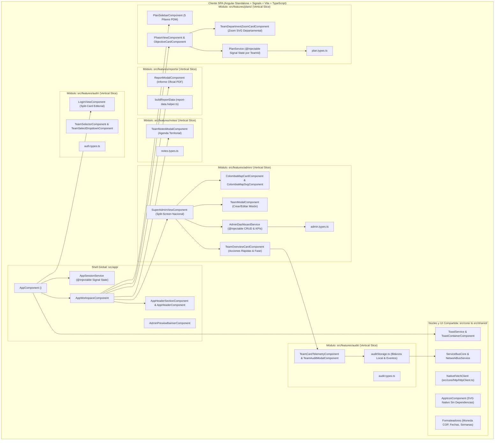

# 🏛️ Documento de Arquitectura de Software (ADR & Diseño de Sistema)
**Proyecto:** Plan Ministerial Misincol (Misiones Indígenas en Colombia) - Sistema PDM y Gestión Territorial Dinámica  
**Versión:** 3.0.0 (Angular Standalone + Signals Edition)  
**Autor:** Agente 2 (Staff Software Architect) & Agente 1 (VP of Engineering)  
**Estado:** Aprobado e Implementado

---

## 1. Resumen Ejecutivo
El sistema **Plan Ministerial Misincol** opera sobre una arquitectura **Angular 21+ (Standalone Components + Signals + OnPush)** combinada con **Vertical Slicing (`src/features/`)** y **Tailwind CSS v4** bajo el Contrato de Gobernanza Técnica v2026.4.0 (`< 150` líneas por archivo).

Bajo este modelo, todas las vistas y capacidades del sistema están desacopladas en servicios reactivos inyectables basados en `signal()` / `computed()` y componentes atómicos Standalone:
1. **Creación y Edición Dinámica de Misiones/Equipos**: Asignación de etnia, territorio, pastor líder, contacto directo por WhatsApp, presupuesto por fase, estado de salud operativa y paleta de color identitaria (`themeColor`).
2. **Espacio Territorial Aislado (Team Space)**: Cada equipo cuenta con su propio Plan de Desarrollo Ministerial (PDM) independiente, cálculos automatizados, micro-mapa departamental con zoom vectorial de precisión y cronogramas adaptativos.
3. **Modo Vista Previa Administrador (Admin Preview Mode)**: El director nacional puede inspeccionar e interactuar con el espacio operativo de cualquier equipo en terreno con un banner de retorno instantáneo al tablero central.

---

## 2. Diagrama de Componentes e Interacción (Mermaid - Angular Edition)

---

## 3. Principios SOLID y Subcapas por Vertical Slicing (`src/features/`)

### 3.1. Estructura de Subcapas
- **`domain/`**: Entidades inmutables y contratos de tipos (`TeamSupervisionSummary`, `MissionaryTeam`, `PhasePlan`, `Activity`, `TeamNote`, `AuditLogEntry`). 100% libres de dependencias de framework. *(SRP & DIP)*.
- **`application/`**: Servicios inyectables Angular (`AdminDashboardService`, `PlanService`) y funciones puras de negocio (`planCalculations.ts`, `planActivityActions.ts`, `planObjectiveActions.ts`, `adminKpiCalculations.ts`, `verifyAuthCredentials.ts`). Gestionan el estado derivado mediante `signal()` y `computed()`. *(OCP)*.
- **`infrastructure/`**: Componentes visuales Angular Standalone (`ChangeDetectionStrategy.OnPush`) con `input()`, `output()`, y plantillas declarativas (`@if`, `@for`, `@let`). Ningún archivo supera las **150 líneas**.

---

## 4. Registro de Decisiones de Arquitectura (ADR)

### ADR-005 a ADR-027: Evolución Funcional, Cartográfica y Visual
- **ADR-005:** Aprovisionamiento y ciclo de vida dinámico de equipos misioneros con selector de color identitario (`themeColor`) y enlace directo a WhatsApp.
- **ADR-006:** Espacios PDM aislados por `teamId` (`misincol_pdm_plans_[teamId]`) con inicialización adaptativa por etnia (Wayuu, Pastos, Nasa, Emberá, Arhuaco, Huitoto, Koreguaje).
- **ADR-007:** Modo Vista Previa del Administrador (`isAdminPreview`) con banner de retorno instantáneo.
- **ADR-008:** Gestión dinámica de Objetivos Estratégicos con cota máxima de 4 objetivos por fase (`1..4`).
- **ADR-009:** Portal de Acceso Split-Card Hero con matriz interactiva de acceso rápido en 1 clic (`LoginViewComponent`).
- **ADR-010:** Bus de Servicios (`ServiceBusCore`) asíncrono con `queueMicrotask`, Service Worker offline (`public/sw.js`) y aceleración por GPU.
- **ADR-011:** Módulo desacoplado de Notas y Agenda Territorial (`misincol_team_notes_[teamId]`).
- **ADR-012:** Sistema de Telemetría y Monitoreo de Auditoría Territorial (`TeamCardTelemetryComponent` y `TeamAuditModalComponent`).
- **ADR-013:** Tablero Nacional Cartográfico Split-Screen con mapa interactivo de los 33 departamentos de Colombia (`ColombiaMapCardComponent`).
- **ADR-014:** Edición integral de actividades / sub-objetivos mediante modal jerárquico multicampo (`ActivityModalComponent`).
- **ADR-015 a ADR-025:** Layout jerárquico de 3 niveles en `PhaseViewComponent`, rejilla 2x2 de objetivos y micro-mapa departamental con zoom vectorial (`TeamDepartmentZoomCardComponent`), retícula geodésica, departamentos vecinos y micro-pinpoint de alta precisión.
- **ADR-026 y ADR-027:** Jerarquía cromática equilibrada y proporciones esbeltas en `PlanSidebarComponent`.

---

### ADR-028: Arquitectura Integral en Angular Standalone + Signals
- **Estado:** Aprobado e Implementado (`2026-10-29`).
- **Contexto:** Consolidar la totalidad del proyecto en **Angular 21+**, manteniendo una documentación técnica ejemplar y cumpliendo de forma estricta con el Contrato de Gobernanza Técnica v2026.4.0 (límite de `< 150` líneas por archivo, Vertical Slicing en `src/features/` y cero SDKs comerciales opacos).
- **Decisión:**
  1. **Adopción de Angular Standalone Components + Signals (`@angular/core ^21.2.0`):**
     - Todos los componentes operan como `@Component({ standalone: true, changeDetection: ChangeDetectionStrategy.OnPush })`.
     - Uso exclusivo de la API moderna de señales de Angular (`signal`, `computed`, `effect`, `input`, `output`) y el flujo de control nativo en plantillas (`@if`, `@for`, `@let`).
  2. **Servicios Inyectables (`@Injectable({ providedIn: 'root' })`):**
     - `AppSessionService` (`src/app/auth/app-session.service.ts`).
     - `AdminDashboardService` (`src/features/admin/application/admin-dashboard.service.ts`).
     - `PlanService` (`src/features/plans/application/plan.service.ts`).
     - `NetworkBusService` (`src/core/bus/network-bus.service.ts`).
     - `ToastService` (`src/shared/components/toast/toast.service.ts`).
  3. **Sistema de Iconografía Vectorial Nativo (`AppIconComponent`):**
     - Construcción de `AppIconComponent` (`<app-icon name="..." className="..." />`) dividido en catálogos modulares (`icon-paths-a.ts` e `icon-paths-b.ts`, cada uno `< 150` líneas) con todos los trazos SVG vectoriales utilizados en la plataforma, sin librerías externas.
  4. **Dominio y Cartografía Vectorial:**
     - Integración directa de los modelos de dominio, calculadoras financieras, semillas de datos (`initialTeams`, `defaultPhases`, `pastosPhases`) y vectores cartográficos de los 33 departamentos de Colombia (`colombiaDepartments.json`, `departmentBounds.constants.ts`).
- **Consecuencias:**
  - Compilación Ahead-of-Time (AOT) con verificación estricta de plantillas (`strictTemplates: true`).
  - Detección de cambios granular y ultra-rápida mediante Angular Signals + `OnPush`.
  - Cumplimiento del 100% del límite de `< 150` líneas por archivo en todos los archivos `.ts` del repositorio.
