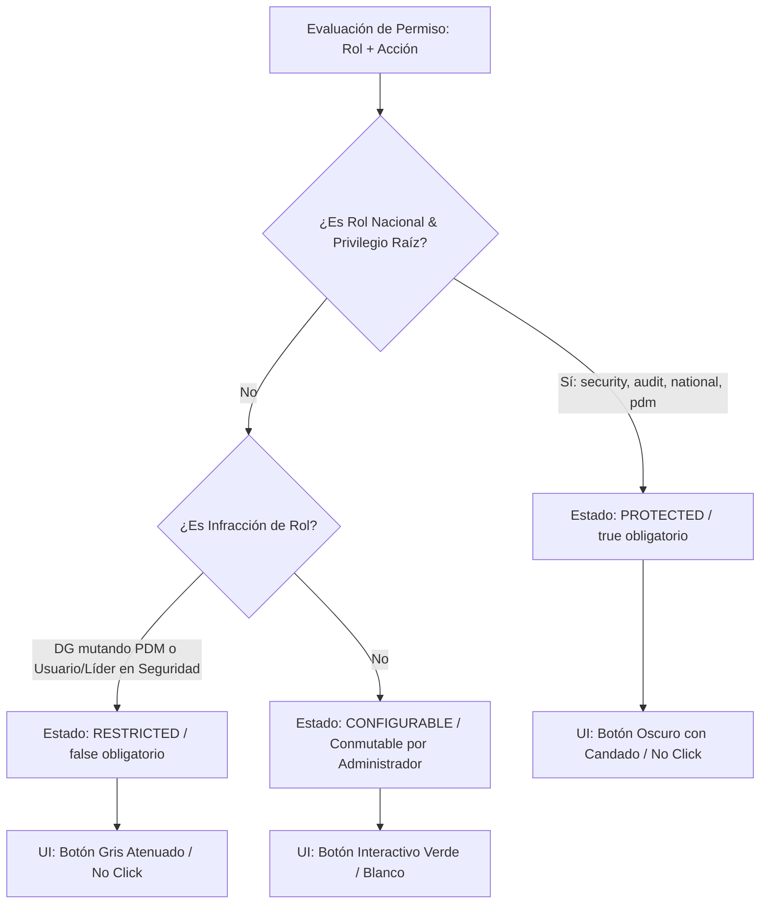

# ADR-058: Restricciones Específicas vs Generalidades en la Matriz de Roles y Permisos (RBAC)

## Estado
Aceptado e Implementado (2026.4.0)

## Contexto
El usuario solicitó establecer una distinción rigurosa en la matriz de roles y permisos entre:
1. **Generalidades Conmutables:** Permisos operacionales que la Coordinación de Equipos puede conceder o retirar libremente para adaptar la dinámica de trabajo de los equipos misioneros (ej. notas territoriales, asignación de tareas, exportación de informes locales).
2. **Restricciones Específicas de Gobernanza:** Privilegios protegidos o permanentemente denegados según el rol institucional:
   - **Coordinador de Equipos (`national_director`):** Debe poseer permanentemente protegidos los permisos de administración de seguridad (`security.roles.manage`), auditoría (`audit.history.view`), reportes nacionales (`reports.national.view`) y visualización de planes PDM (`pdm.view`).
   - **Director General (`director_general`):** Perfil de supervisión pasiva y auditoría sin facultades de mutación en campo (`pdm.activities.edit`, `pdm.activities.delete`, `pdm.objectives.manage`, `team.members.manage`, `security.roles.manage` restringidos permanentemente a `false`).
   - **Usuario de Equipo (`team_member`):** Rol operativo de campo restringido de acceso a seguridad, auditoría, reportes nacionales y objetivos estratégicos.
   - **Líder de Equipo (`team_leader`):** Pastor territorial con facultades locales, pero restringido de administración de roles, auditoría global y métricas nacionales.

## Decisiones de Arquitectura

### 1. Función Pura de Gobernanza (`security-constraints.helper.ts`)
Se implementó `getRolePermissionConstraint(roleId, permKey, configuredValue)` que categoriza cada intersección rol-permiso en tres estados:
- **`protected`**: Privilegio mandatorio del rol. Siempre evalúa a `true` y no puede ser deshabilitado.
- **`restricted`**: Restricción estructural institucional. Siempre evalúa a `false` y no puede ser habilitado.
- **`configurable`**: Generalidad adaptable. Su valor es conmutable interactivamente por el administrador.

Adicionalmente, se incluyó `normalizeRolePermissions(matrix)` para sanear cualquier estado cargado desde almacenamiento local o peticiones HTTP.

### 2. Representación Visual Clara en la Tabla (`app-security-matrix-table`)
- **Protegido (✓):** Fondo oscuro (`bg-stone-900 text-[#E67324]`), deshabilitado para edición, con tooltip explicativo de privilegio institucional obligatorio.
- **Restringido (✕):** Fondo gris atenuado (`bg-stone-100 text-stone-300`), deshabilitado para interacción, con tooltip explicativo de restricción de perfil.
- **Configurable (✓ / ✕):** Botón verde/blanco interactivo conmutable con un clic y animación táctil.
- Encabezado con leyenda explicativa de estados de gobernanza.

### 3. Sanitización y Salvaguarda en Servidor (`SecurityService.updateMatrix`)
El backend (`backend/src/security/security.service.ts`) aplica el método privado `sanitizeGovernanceMatrix` antes de persistir cualquier actualización recibida en `PUT /api/security/matrix`, garantizando que ninguna solicitud HTTP pueda corromper los privilegios protegidos ni conceder escaladas no autorizadas.

## Diagrama de Flujo de Decisión RBAC

## Consecuencias y Beneficios
- **Integridad del Sistema:** Imposible que un administrador se bloquee a sí mismo desactivando la gestión de roles o la auditoría para el Coordinador Nacional.
- **Separación de Responsabilidades:** El Director General mantiene su rol de observador pasivo sin riesgos de mutaciones accidentales en los planes de los pastores de campo.
- **Ergonomía:** El usuario distingue inmediatamente qué permisos son conmutables y cuáles son reglas institucionales fijas.
- **Cumplimiento Estricto:** Todos los archivos permanecen por debajo del umbral de 150 líneas de código y con 100% de pruebas automáticas exitosas.

