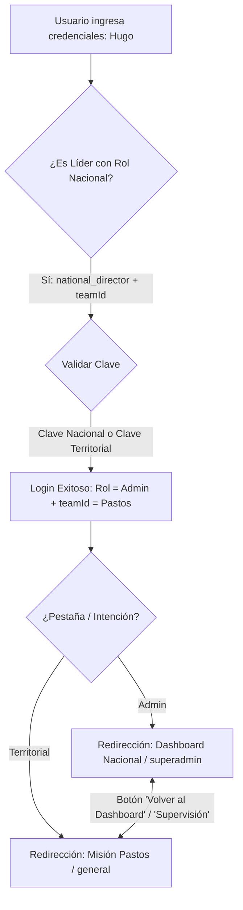

# ADR-059: Soporte de Rol Dual (Líder Nacional con Equipo Local) y Autenticación Bivalente

## Estado
Aceptado e Implementado (2026.4.0)

## Contexto
El usuario detectó que al cambiar el rol de un pastor/líder (ej. Hugo en Misión Pastos) a "Coordinador de equipos" (`national_director`), el sistema lo revertía de forma destructiva a `team_leader`.
Se requirió:
1. Establecer una relación formal donde un Líder Nacional puede estar a cargo de un equipo misionero local simultáneamente.
2. Seleccionar y preservar permanentemente el rol de mayor jerarquía (`national_director`) sin que las inicializaciones o sincronizaciones de equipos degraden el estatus a `team_leader`.
3. Permitir autenticación bivalente: el usuario puede ingresar tanto con la contraseña de su equipo (`pastos2026`) como con la contraseña nacional (`director2026` / `admin2026`).
4. Proveer navegación bidireccional inmediata para que el usuario pueda alternar libremente entre el Dashboard Nacional (`superadmin`) y la gestión de su misión territorial (`general` / `plans`).

## Decisiones de Arquitectura

### 1. Jerarquía de Roles y Protección de Rango Máximo (`security-users-provision.helper.ts`)
Se implementó un ranking jerárquico estricto:
- `national_director` (Rango 4)
- `director_general` (Rango 3)
- `team_leader` (Rango 2)
- `team_member` (Rango 1)

En `resolveTeamUsersToProvision()`, al sincronizar un equipo con los usuarios del sistema:
- Si el líder ya existe con un rol de rango $\ge$ 2 (como `national_director`), **se preserva su rol superior** y se actualizan únicamente sus datos de vinculación (`teamId`, `teamName`, territorio y teléfono).
- Se elimina la asignación incondicional de `existingLeader.role = 'team_leader'`.

### 2. Autenticación Bivalente (`verifyAuthCredentials.ts`)
- Al procesar el login de un líder que ostenta el rol de `national_director` y tiene un equipo asignado:
  - Se valida como exitoso el acceso si ingresa la clave de su equipo (PIN territorial) **o** la clave maestra de administración nacional (`director2026`, etc.).
  - Si ingresa por la pestaña de Administración o con clave nacional, se genera sesión de administrador con contexto de equipo y se le ubica en el Dashboard Nacional (`superadmin`).
  - Si ingresa por la pestaña de Equipo Territorial o con clave de equipo, se genera sesión de administrador y se le ubica en la vista de su Misión (`general`), manteniendo todas las facultades de administración nacional.

### 3. Navegación Fluida en Barra Lateral y Cabecera (`plan-sidebar.component.ts`, `app-workspace.component.ts`)
- El botón de retorno `[Volver a Supervisión]` / `[Tablero Nacional]` ahora se muestra permanentemente si `userRole() === 'admin'`, permitiendo al coordinador saltar entre la vista de su propio equipo y el panel nacional sin fricción ni necesidad de reingresar credenciales.

## Diagrama de Flujo de Autenticación y Navegación Dual

## Consecuencias y Beneficios
- **Cero Reversión de Roles:** Hugo permanece como Coordinador de Equipos de forma permanente.
- **Flexibilidad de Acceso:** No hay bloqueos si el líder olvida cuál de las dos contraseñas usar.
- **Cumplimiento Estricto:** Todos los archivos permanecen $\le 135$ líneas de código, con 100% de pruebas unitarias exitosas.

