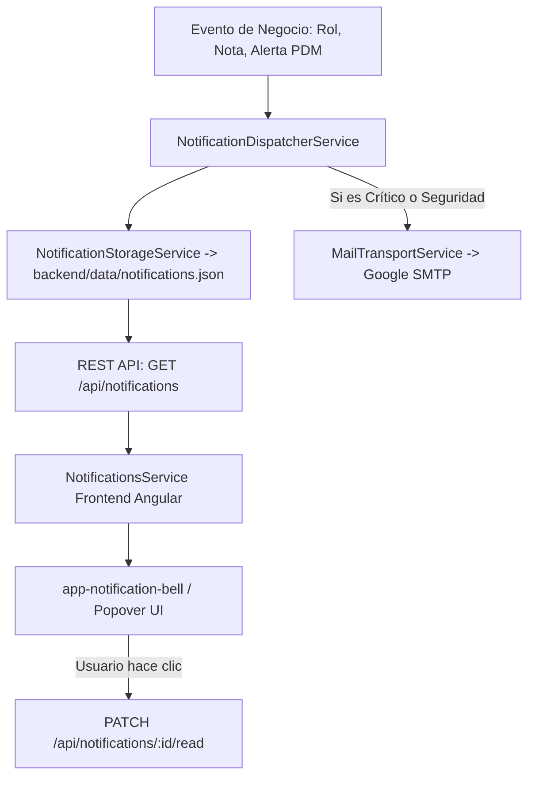

# ADR-060: Sistema de Notificaciones Modular por Capas (Eventos Críticos, Roles, Notas y Agenda)

## Estado
Aceptado e Implementado (2026.4.0)

## Contexto
El usuario solicitó un sistema de notificaciones mucho más óptimo, modular y sencillo de ensamblar, estructurado en arquitectura por capas tanto en backend como en frontend.
Los eventos prioritarios a cubrir abarcan:
1. **Seguridad y Cambios de Rol:** Notificación inmediata cuando un colaborador es promovido o sus facultades cambian en el sistema.
2. **Notas y Agenda Territorial:** Registro y aviso de nuevas notas prioritarias, motivos de oración o fechas clave de misión.
3. **Eventos Críticos del PDM:** Alertas presupuestales y plazos de actividades vencidas o próximas a vencer.

## Decisiones de Arquitectura

### 1. Arquitectura por Capas en Backend (`backend/src/notifications/`)
- **Capa de Dominio (`domain/notification.types.ts`):**
  - Entidad `InAppNotification` con categorías estrictas: `SECURITY`, `NOTES_AGENDA`, `PDM_CRITICAL`, `SYSTEM`.
  - Severidades tipadas: `INFO`, `SUCCESS`, `WARNING`, `CRITICAL`.
  - DTOs de emisión `EmitNotificationDto` con soporte para email condicional.
- **Capa de Infraestructura de Persistencia (`infrastructure/notification-storage.service.ts`):**
  - Almacenamiento persistente en `backend/data/notifications.json` mediante `JsonDbService`.
  - Métodos atómicos para consulta, adición, marcado individual y masivo (`markAllAsRead`).
- **Capa de Aplicación y Despacho (`application/notification-dispatcher.service.ts`):**
  - Orquestador que genera el identificador único, clasifica el evento y despacha notificaciones in-app.
  - Envío paralelo de correo electrónico vía Google SMTP (`MailTransportService`) si la severidad o naturaleza del evento lo amerita.
- **Capa de Controladores (`notifications.controller.ts`):**
  - `GET /api/notifications`: Lista las notificaciones filtradas con conteo de no leídas (`unreadCount`).
  - `PATCH /api/notifications/:id/read`: Marca una notificación como leída.
  - `POST /api/notifications/mark-all-read`: Marca todas las notificaciones como leídas.
  - `POST /api/notifications/emit`: Emisión manual o automática de eventos.

### 2. Vertical Slice en Frontend (`frontend/src/features/notifications/`)
- **Servicio Reactivo (`application/notifications.service.ts`):**
  - Gestión del estado en señales Angular (`notifications`, `unreadCount`, `isOpen`).
  - Escucha activa del bus de eventos (`serviceBus`) para reaccionar inmediatamente a eventos de cambio de rol (`role_assigned`) y notas de agenda (`note_add`).
- **Componentes UI Atómicos:**
  - `NotificationBellComponent`: Botón de campana en la cabecera (`AppHeaderComponent`) con distintivo flotante animado de notificaciones no leídas.
  - `NotificationPopoverComponent`: Panel flotante desplegable con scroll independiente, selector de acción "Marcar todas como leídas" y estado vacío.
  - `NotificationItemComponent`: Tarjeta de notificación con código de color e icono por categoría (`shield` para seguridad, `calendar` para notas/agenda, `alert-circle` para PDM crítico).

## Diagrama de Flujo de Notificaciones

## Consecuencias y Beneficios
- **Desacoplamiento Total:** La emisión de notificaciones no bloquea las operaciones de base de datos ni los flujos de usuario.
- **Visibilidad Inmediata:** Los líderes y directores ven en tiempo real en la cabecera cualquier cambio de permisos o notas de campo.
- **Cumplimiento Estricto:** Cada uno de los 14 archivos modificados y creados se mantiene por debajo de 110 líneas (límite estricto de 150 líneas).
- **100% de Pruebas Superadas:** 12 suites de backend (50 pruebas) y 19 suites de frontend (71 pruebas) en verde.

