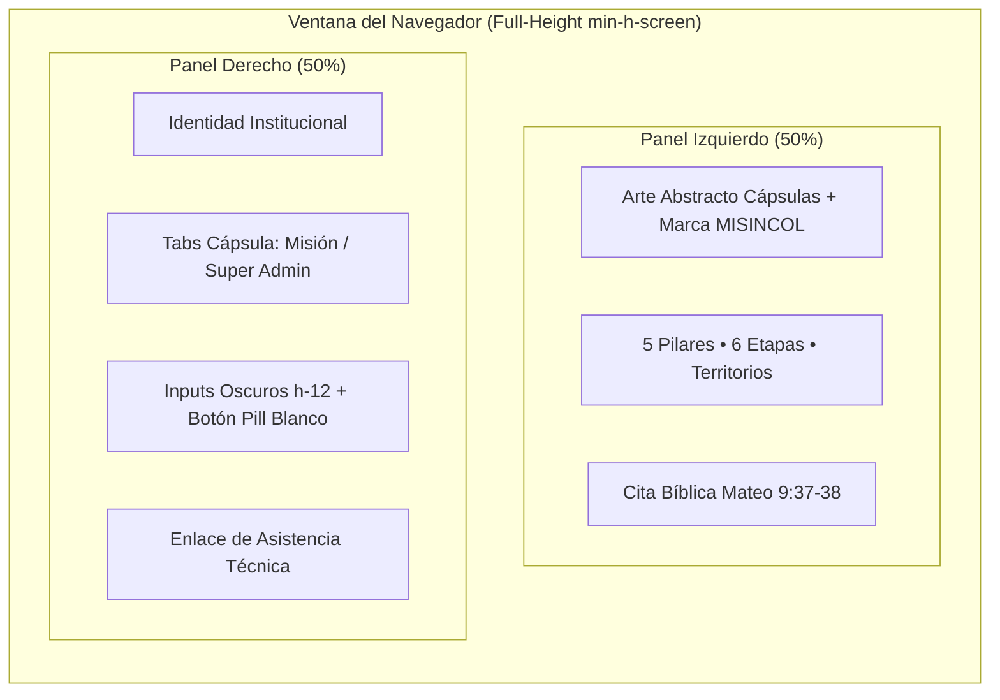

# ADR-064: Arquitectura de Login Split-Screen 50/50 Full-Height en Estética Dark Minimalista

**Estado:** Propuesto  
**Fecha:** 2026-11-13  
**Decisores:** Orquestador Técnico, Staff Software Architect, Lead Frontend Engineer  

---

## 1. Contexto
El usuario ha presentado una referencia visual de alta calidad (*Gratafy UI*) caracterizada por fondos oscuros profundos (Navy/Slate), cápsulas geométricas superpuestas, diseño minimalista y una distribución de dos paneles a pantalla completa (50/50 full-height). Se requiere implementar esta visión manteniendo la gobernanza técnica de MISINCOL:
- Submódulos independientes en Angular Standalone.
- Límite inviolable de 150 líneas por archivo.
- Cero SDKs opacos de terceros.

---

## 2. Decisión de Diseño

### 2.1. Layout Split-Screen 50/50
Se estructurará el contenedor principal con Flexbox / Grid responsivo:
- En pantallas móviles (`< md`): Formulario centrado con cabecera de marca compacta.
- En pantallas medianas y grandes (`>= md`): Dos mitades de 50% de ancho con `min-h-screen`:
  - **Izquierda (50%):** Panel de marca, arte con formas tipo píldora/cápsula geométrica rotada en tonos oscuros, estrellas decorativas, insignias y texto ministerial.
  - **Derecha (50%):** Formulario de acceso centrado en tarjeta oscura traslúcida con inputs `h-12` y botón pill de alto contraste.

---

## 3. Consecuencias y Beneficios
- **Experiencia de Usuario de Primer Nivel:** Proporciona un impacto visual moderno, limpio y profesional, alineado exactamente con la referencia visual solicitada.
- **Responsividad:** En dispositivos móviles colapsa fluidamente sin saturar la pantalla.
- **Mantenibilidad:** Cada componente mantiene su responsabilidad única y se sitúa holgadamente por debajo del umbral de 150 líneas.

