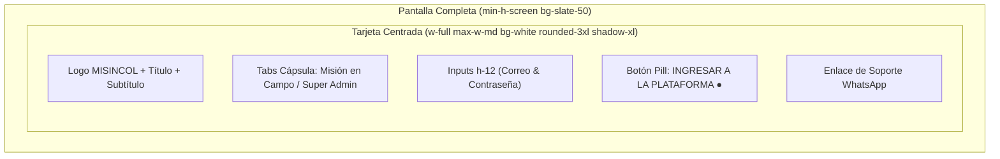

# ADR-065: Arquitectura de Login Centrado Único en Modo Claro (Light Minimalista)

**Estado:** Propuesto  
**Fecha:** 2026-11-13  
**Decisores:** Orquestador Técnico, Staff Software Architect, Lead Frontend Engineer  

---

## 1. Contexto
Tras evaluar el diseño Split-Screen con panel hero lateral, el usuario determinó una simplificación de la interfaz:
- Centrar exclusivamente el bloque de formulario y acceso.
- Migrar de la estética oscura a una paleta clara y luminosa (`slate-50` / blanco / `slate-900`).
- Conservar la ergonomía de inputs `h-12`, botón pill y tabs de roles institucionales.

---

## 2. Decisión de Diseño

### 2.1. Desacoplamiento del Hero Lateral
Se remueve la dependencia de `LoginHeroCardComponent` en `LoginViewComponent`, permitiendo que el contenedor centre perfectamente la tarjeta de autenticación en cualquier resolución (móvil, tablet, escritorio).

### 2.2. Paleta Cromática Clara y Accesible
- Cumple con WCAG AAA de contraste: texto `slate-900` sobre fondos `white`/`slate-50`.
- Bordes definidos en `slate-200/90` para separar la tarjeta del fondo sutil.

---

## 3. Consecuencias y Beneficios
- **Enfoque Total:** Cero distracciones; el usuario accede de inmediato con un formulario limpio y directo.
- **Rendimiento:** Menor peso de renderizado y menor complejidad en el árbol DOM.
- **Cumplimiento de Gobernanza:** Código atómico, desacoplado y con archivos $\le 150$ líneas.

