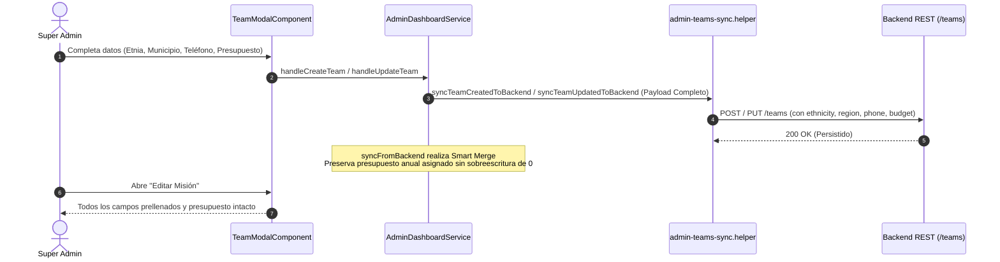

# ADR-066: Persistencia Bidireccional de Misiones y Blindaje del Presupuesto Anual

**Estado:** Propuesto  
**Fecha:** 2026-11-14  
**Decisores:** Orquestador Técnico, Staff Software Architect, Principal Database Administrator  

---

## 1. Contexto
La creación y edición de misiones territoriales presentaba una desconexión entre el modelo de datos frontend (`TeamSupervisionSummary`) y el backend (`Team`), causando que campos territoriales obligatorios (`ethnicity`, `region`, `leaderPhone`) se borraran al recargar la vista, y que el presupuesto anual se sobreescribiera con 0 debido al cálculo de actividades vacías de la fase.

---

## 2. Decisión de Diseño

### 2.1. Regla de Prioridad de Presupuesto
El presupuesto anual asignado a la misión (`team.totalBudget`) es un parámetro soberano de la entidad. Las métricas de fase (`phaseMetrics.totalBudget`, que calculan la suma de costos de actividades) no deben sobreescribir el presupuesto anual general de la misión.

### 2.2. Smart Merge en Sincronización Remota
Ante cualquier inconsistencia temporal o respuesta parcial del servidor, el estado reactivo local consolida los atributos existentes para evitar que el usuario deba reescribir información previamente ingresada.

---

## 3. Consecuencias
- Flujo de creación y edición 100% fluido y libre de validaciones bloqueantes no deseadas.
- Visualización exacta del presupuesto asignado, gastado y restante en tarjetas y reportes.

