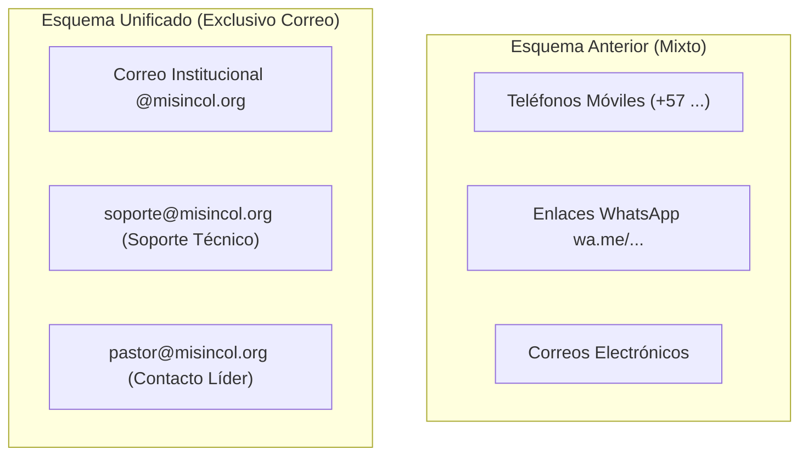

# ADR-067: Unificación Exclusiva por Correo Institucional y Retiro de Teléfonos y WhatsApp

**Estado:** Propuesto  
**Fecha:** 2026-11-14  
**Decisores:** Orquestador Técnico, Staff Software Architect  

---

## 1. Contexto
La plataforma requería anteriormente números de teléfono móvil para los líderes de misiones y desplegaba accesos directos hacia WhatsApp. Por decisión operativa y de seguridad institucional, se descarta el uso de números telefónicos y se estandariza el correo electrónico como único canal formal de comunicación, acceso y soporte.

---

## 2. Decisión de Diseño

### 2.1. Eliminación de Inputs Telefónicos
- En el modal de creación y edición de misiones, se retira el campo de entrada `leaderPhone` y su condición `required`.
- Las fichas de información general de equipo muestran el correo institucional en lugar de teléfono/WhatsApp.

### 2.2. Migración de Canales de Asistencia
- En el pie de login, el enlace de WhatsApp se reemplaza por `mailto:soporte@misincol.org`.
- En la barra lateral de planes, se retira el botón de WhatsApp, dejando Notas de Campo e Informe Ejecutivo.

---

## 3. Consecuencias
- Flujo de creación de misiones simplificado y más rápido (un campo menos que llenar).
- Cero fallos por validación de formatos telefónicos o prefijos `+57`.
- Comunicación formalizada bajo el dominio institucional `misincol.org`.

