# 📐 Propuesta Técnica: Arquitectura Angular 21+ (Standalone & Signals) para MISINCOL PDM

**ID de Propuesta:** `PROP-2026-001`  
**Fecha:** 29 de Octubre de 2026  
**Rama Activa:** `featurePrueba`  
**Autores:**  
- **Agente 1 (VP of Engineering):** Gobernanza técnica y cumplimiento del límite de `< 150` líneas por archivo.  
- **Agente 2 (Staff Software Architect):** Diseño de arquitectura Angular Standalone, Signals y Vertical Slicing.  
- **Agente 5 (Technical Writer & QA):** Estandarización de documentación viva (`docs/proposals/`, `docs/architecture/`, `docs/database/`, `docs/api/`).  
**Estado:** ✅ Aprobada y Ejecutada

---

## 1. El Qué y el Por Qué (Justificación Técnica)

### 1.1. ¿Qué implementamos?
Consolidar el 100% del ecosistema frontend de **MISINCOL | Plan de Desarrollo Ministerial (PDM)** sobre **Angular 21+ (Standalone Components + Signals + OnPush)** + **Vite** + **Tailwind CSS v4**, con capacidades cartográficas SVG de los 33 departamentos de Colombia, gestión de las 5 fases del PDM, telemetría de auditoría, bloc de notas territorial y reportes ejecutivos imprimibles.

### 1.2. ¿Por qué Angular 21+ con Signals?
1. **Reactividad Fina con Angular Signals (`signal`, `computed`, `effect`):** Provee un grafo reactivo determinista que garantiza actualizaciones quirúrgicas en el DOM con `ChangeDetectionStrategy.OnPush`.
2. **Inyección de Dependencias (DI) Nativa y POO Pura:** Servicios orientados a objetos `@Injectable({ providedIn: 'root' })` (`PlanService`, `AdminDashboardService`, `AppSessionService`, `ToastService`, `NetworkBusService`) con contratos tipados.
3. **Arquitectura Standalone (Cero `NgModules`):** Cada componente visual en `infrastructure/` es un componente autónomo (`standalone: true`) de menos de 150 líneas, maximizando la cohesión por *Vertical Slicing*.
4. **Cero Dependencias Comerciales Opacas:** Notificaciones e iconografía vectorial (`AppIconComponent`) nativas en Angular conectadas directamente al `ServiceBusCore` (`src/core/bus/ServiceBus.ts`).

---

## 2. Arquitectura en Angular (Vertical Slicing)

```mermaid
flowchart TD
    subgraph Core ["src/core/ (Núcleo Nativo)"]
        EnvConfig["config/env.config.ts"]
        AppErrors["errors/AppError.ts"]
        NativeHttp["http/httpClient.ts (Fetch + AbortController)"]
        ServiceBus["bus/ServiceBus.ts & network-bus.service.ts"]
        OfflineSW["workers/registerServiceWorker.ts"]
    end

    subgraph Shared ["src/shared/ (UI Atómica & Utilidades)"]
        Formatters["utils/formatters.ts (COP, Fechas, Semanas)"]
        SharedUI["components/ (Modal, Badge, MisincolLogo, Toast, NetworkStatus, AppIcon)"]
    end

    subgraph AppShell ["src/app/ (Orquestador Principal Angular)"]
        AppComp["app.component.ts (<app-root>)"]
        SessionSvc["auth/app-session.service.ts (Signals)"]
        WorkspaceComp["ui/app-workspace.component.ts"]
        HeaderComp["ui/app-header.component.ts"]
    end

    subgraph Features ["src/features/ (Rebanadas Verticales de Negocio < 150 líneas)"]
        AuthFeature["auth/ (LoginViewComponent, TeamSelectorComponent)"]
        AdminFeature["admin/ (AdminDashboardService, SuperAdminViewComponent, ColombiaMapCardComponent)"]
        PlansFeature["plans/ (PlanService, PhaseViewComponent, PlanSidebarComponent, TeamDepartmentZoomCardComponent)"]
        NotesFeature["notes/ (TeamNotesModalComponent)"]
        AuditFeature["audit/ (TeamAuditModalComponent, TeamCardTelemetryComponent)"]
        ReportsFeature["reports/ (ReportModalComponent)"]
    end

    AppComp --> SessionSvc
    AppComp --> WorkspaceComp
    WorkspaceComp --> HeaderComp
    WorkspaceComp --> AdminFeature
    WorkspaceComp --> PlansFeature
    WorkspaceComp --> NotesFeature
    WorkspaceComp --> ReportsFeature

    AdminFeature --> NativeHttp
    PlansFeature --> NativeHttp
    PlansFeature --> ServiceBus
    AuditFeature --> ServiceBus
    SharedUI --> ServiceBus
```



---

## 3. Estructura de Documentación Viva (`docs/`)

```plaintext
docs/
├── proposals/
│   └── 001-migracion-angular.md      # Propuesta formal y arquitectura ejecutada
├── architecture/
│   ├── 1_architecture.md             # Arquitectura general, Diagramas Mermaid y ADRs
│   └── angular-guide.md              # Guía técnica de patrones Angular (Signals, Standalone, DI y <150 líneas)
├── database/
│   └── 2_database.md                 # Esquema DDL PostgreSQL 16+ (3NF) y mapeo localStorage
└── api/
    └── 3_api_spec.md                 # Contratos RESTful (/api/v1) y cliente HTTP nativo
```
