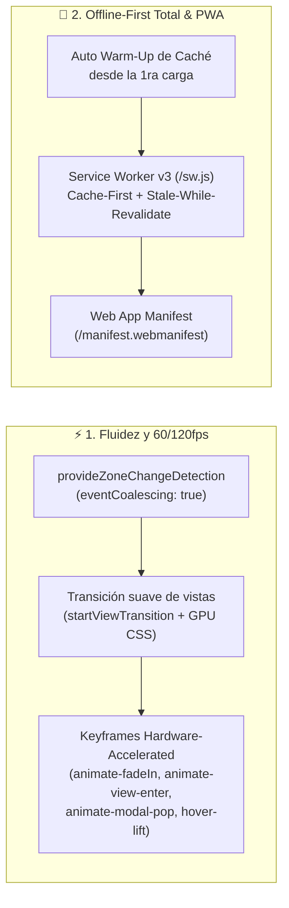

# 🚀 Propuesta Técnica 002: Optimización de Rendimiento, Animaciones Fluidas (60/120fps) y Modo Offline-First Total (PWA)
**Proyecto:** MISINCOL | Plan de Desarrollo Ministerial (PDM)  
**Rama:** `featurePrueba`  
**Contrato de Gobernanza:** v2026.4.0 (`< 150` líneas por archivo, Vertical Slicing, Cero SDKs opacos)  
**Estado:** PENDIENTE DE APROBACIÓN DEL USUARIO

---

## 1. Diagnóstico Técnico (El Qué y el Por Qué)

Al auditar el comportamiento actual de renderizado, transiciones y carga sin conexión se identificaron **4 oportunidades clave de mejora**:

1. **Clases de animación huérfanas y cambios bruscos de vista:**
   - Múltiples componentes utilizan `animate-fadeIn`, pero dicho keyframe no estaba definido en `src/styles/fluidity.css`.
   - El cambio entre **Login ↔ Workspace**, **Super Admin ↔ Planes PDM**, cambio de **Pilar (Investigación..Autocuidado)** y cambio de **Objetivo (1..4)** ocurre en seco sin micro-transición acelerada por GPU ni uso de la API nativa `document.startViewTransition`.
2. **Event Coalescing en el motor de Angular (`main.ts`):**
   - Actualmente `bootstrapApplication(AppComponent)` se ejecuta con la configuración por defecto de Zone.js. Activar `provideZoneChangeDetection({ eventCoalescing: true })` agrupa eventos múltiples del DOM (scroll, mousemove en el mapa, inputs) en un único ciclo de renderizado por frame, reduciendo el trabajo de CPU.
3. **Caché Offline en la primera visita (`sw.js` + `registerServiceWorker.ts`):**
   - Cuando el usuario abre la aplicación por primera vez, los archivos `.js` y `.css` principales se descargan *antes* de que el Service Worker tome el control. Si el misionero pierde señal en el campo sin haber recargado la página una segunda vez, esos bundles no estaban en `CacheStorage`.
   - Solución: Al activarse el Service Worker, `registerServiceWorker.ts` le enviará automáticamente las URLs de todos los scripts, hojas de estilo, fuentes e imágenes ya cargados en la sesión actual (`WARM_UP_CACHE`) para que **desde la primera visita quede 100% disponible sin internet**.
4. **Instalabilidad Universal (PWA Manifest):**
   - Falta el archivo `public/manifest.webmanifest` y las etiquetas meta PWA en `index.html` para que la aplicación pueda instalarse y abrirse como app nativa en celulares (Android/iOS) y computadores en campo sin conexión.

---

## 2. Arquitectura de la Solución Propuesta

---

## 3. Plan de Archivos a Crear / Modificar (Todos `< 150` líneas)

| Archivo | Acción | Propósito |
| :--- | :--- | :--- |
| `src/main.ts` | Modificar | Habilitar `provideZoneChangeDetection({ eventCoalescing: true })` para máxima velocidad de respuesta en UI. |
| `src/styles/fluidity.css` | Modificar | Agregar keyframes acelerados por GPU (`animate-fadeIn`, `animate-view-enter`, `animate-modal-pop`, `animate-card-enter`, soporte para `::view-transition-*` y `prefers-reduced-motion`). |
| `src/core/workers/viewTransition.ts` | Crear | Helper ligero (`runViewTransition`) que usa `document.startViewTransition` cuando el navegador lo soporta (con fallback instantáneo). |
| `src/core/workers/registerServiceWorker.ts` | Modificar | Enviar mensaje `WARM_CACHE` al Service Worker con todos los recursos actuales (`scripts`, `styles`, `images`, `fonts`) para garantizar funcionamiento offline desde la primera visita. |
| `public/sw.js` | Modificar | Actualizar a `misincol-pdm-cache-v3` con soporte de pre-calentamiento dinámico (`WARM_CACHE`), estrategia *Stale-While-Revalidate* y respuesta offline garantizada. |
| `public/manifest.webmanifest` | Crear | Manifiesto PWA oficial de MISINCOL PDM (`standalone`, colores institucionales `#8B251E` / `#FAF7F2`, íconos). |
| `index.html` | Modificar | Enlazar `manifest.webmanifest`, `theme-color`, `apple-mobile-web-app-capable` y precarga de imagen principal. |
| `src/app/ui/app-workspace.component.ts` | Modificar | Integrar transiciones fluidas al cambiar de pilar, objetivo, equipo o vista Super Admin. |
| `src/shared/components/modal.component.ts` | Modificar | Aplicar animación `animate-modal-pop` en la ventana y `animate-fadeIn` en el backdrop. |

---

## 4. Beneficios Esperados

- **Fluidez visual inmediata (60/120 fps):** Cada cambio de pilar, objetivo, apertura de modal o alternancia con el mapa tendrá una micro-animación suave (`180ms–240ms` con curva `cubic-bezier(0.16, 1, 0.3, 1)`).
- **100% Offline desde el primer ingreso:** Incluso si el usuario abre la app una sola vez y se queda sin internet en territorio indígena, puede recargar la página, cerrar y volver a abrir el navegador, iniciar sesión con cualquier equipo y gestionar todo el PDM sin conexión.
- **Instalable en cualquier dispositivo:** Funciona como aplicación instalable (PWA) en Android, iOS, Windows y Mac.

