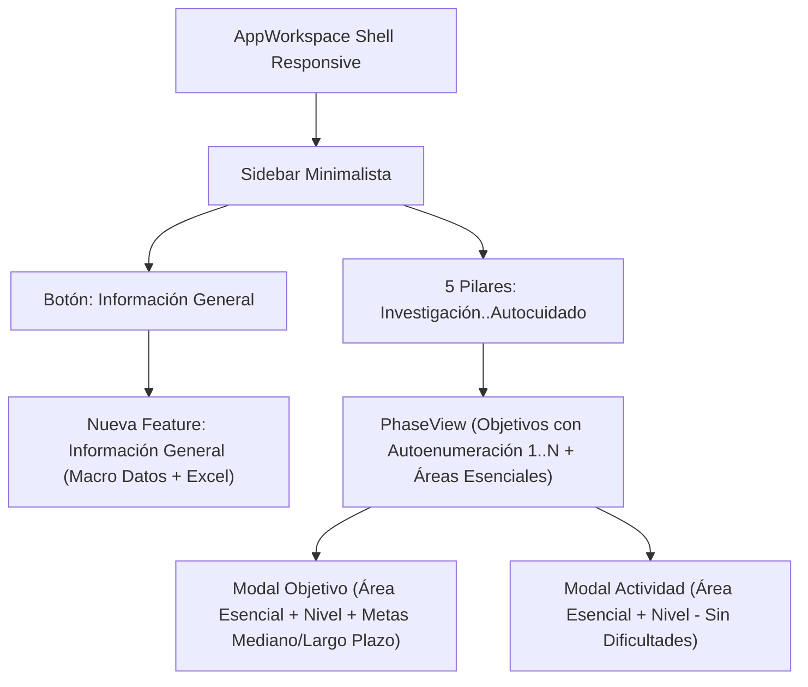

# 📑 Propuesta Técnica 003: Reestructuración Funcional, Vista "Información General", Áreas Esenciales y Autoenumeración Dinámica
**Proyecto:** MISINCOL | Plan de Desarrollo Ministerial (PDM)  
**Rama:** `featurePrueba`  
**Contrato de Gobernanza:** v2026.4.0 (`< 150` líneas por archivo, Vertical Slicing, Cero SDKs Comerciales)  
**Estado:** PENDIENTE DE REVISIÓN Y APROBACIÓN DEL USUARIO

---

## 1. Alcance y Diagnóstico de la Propuesta

Alineado con los 5 puntos solicitados por el usuario, se estructurará la siguiente implementación en Angular 21+:

1. **Diseño Responsive Integral:**
   - Auditoría y ajuste de layouts de `AppWorkspaceComponent`, `PhaseViewComponent`, `PlanSidebarComponent` y la nueva vista macro para garantizar usabilidad fluida en tablets y celulares (menú hamburguesa móvil, cero desbordamiento horizontal).
2. **Reemplazo del botón "Plan PDM" por "Información General" y Nueva Vista:**
   - En el Sidebar ([`SidebarSegmentedControlComponent`](file:///c:/Users/Usuario/Desktop/personales/planMinisterial/src/features/plans/infrastructure/sidebar/sidebar-segmented-control.component.ts)), cambiar el botón a **"Información General"**.
   - Crear la rebanada vertical `src/features/general-info/` con:
     - Formulario y visor de **Datos del Equipo** (año, población, congregaciones, líderes, integrantes).
     - Métricas de **Información de Campo y Contacto** (evangelismo, bautismos, estudios bíblicos, grupos, desarrollo eclesial y discipulado).
     - Consolidado y desglose de **Presupuesto por Pilares**.
3. **Áreas Esenciales, Niveles y Autoenumeración Dinámica en Objetivos:**
   - Incorporar casillas y selección de **Área Esencial** y **Nivel** en la creación/edición de objetivos y actividades.
   - Reemplazar numeraciones fijas quemadas (`OBJETIVO #1`, `OBJETIVO #2`) por enumeración dinámica calculada en base al índice real del arreglo (`$index + 1`).
   - Incorporación de **Metas Proyectadas (Mediano y Largo Plazo)** dentro de los objetivos.
   - Confirmación de exclusión del mapa en la vista de objetivos/pilares para optimizar el espacio útil.
4. **Limpieza del Formulario de Actividades:**
   - Eliminar por completo el campo/sección de dificultades y obstáculos del modal y tarjetas de actividades.
   - Añadir la selección de Área Esencial y Nivel a las actividades.
5. **Alineación de Rol Administrativo:**
   - Confirmar en todas las vistas y modelos que el rol y texto es **"Coordinador de Equipos"**.

---

## 2. Diagrama de Flujo de Navegación y Vistas

---

## 3. Plan de Archivos a Crear y Modificar (Todos estrictamente `< 150` líneas)

| Módulo / Archivo | Tipo de Cambio | Responsabilidad |
| :--- | :--- | :--- |
| `src/features/general-info/domain/general-info.types.ts` | **Crear** | Contratos de datos del equipo, campo, discipulado y presupuesto macro. |
| `src/features/general-info/application/general-info.service.ts` | **Crear** | Servicio reactivo de almacenamiento y cálculo de métricas generales. |
| `src/features/general-info/infrastructure/general-info-view.component.ts` | **Crear** | Vista principal de Información General (Responsive). |
| `src/features/general-info/infrastructure/components/*` | **Crear** | Subcomponentes modulares (< 150 líneas) de equipo, campo y presupuesto. |
| `src/features/plans/domain/plan.types.ts` | **Modificar** | Incorporar Área Esencial, Niveles y Metas (mediano/largo plazo); remover campo de dificultades. |
| `src/features/plans/infrastructure/sidebar/sidebar-segmented-control.component.ts` | **Modificar** | Cambiar botón "PLAN PDM" por "INFORMACIÓN GENERAL". |
| `src/features/plans/infrastructure/objectiveModal/*` | **Modificar** | Selectores de Área Esencial, Nivel y Metas a mediano/largo plazo. |
| `src/features/plans/infrastructure/objectiveCard/*` | **Modificar** | Renderizar etiquetas de Área Esencial y numeración dinámica `$index + 1`. |
| `src/features/plans/infrastructure/activityModal/*` | **Modificar** | Selector de Área Esencial y supresión definitiva de dificultades/obstáculos. |
| `src/app/ui/app-workspace.component.ts` | **Modificar** | Integrar la nueva vista de Información General en el flujo del workspace. |

