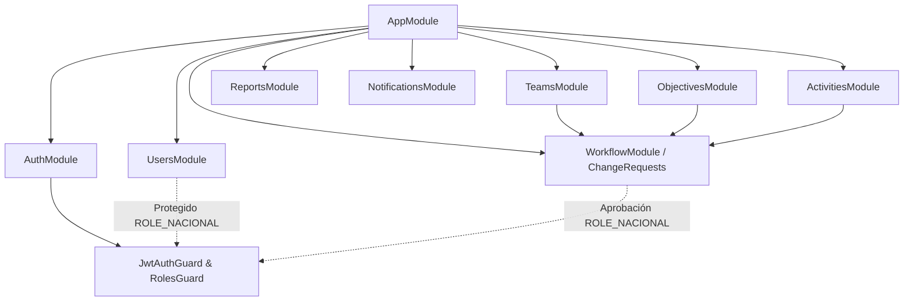
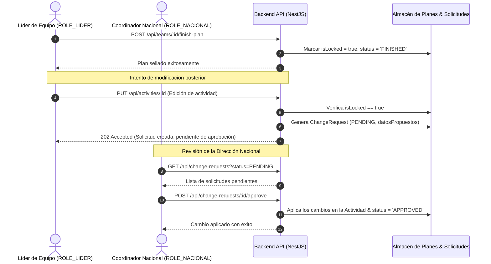

# Propuesta Técnica 007: Implementación de Gobernanza Backend (RBAC, LockWorkflow, Notificaciones y Sincronización Frontend)

**Estado:** PENDIENTE DE APROBACIÓN  
**Versión:** 2026.4.0  
**Fecha:** 04 de Noviembre de 2026  
**Autor:** Antigravity Engineering Team  

---

## 1. Introducción y Justificación

### 1.1. Qué
Esta propuesta define la implementación completa de la **Guía de Implementación del Backend - Proyecto Misincol**, incorporando:
1. **Control de Acceso Basado en Roles (RBAC):** Roles oficiales `ROLE_NACIONAL` (Coordinador de Equipos / Director Nacional) y `ROLE_LIDER` (Líder Territorial), decorador `@Roles(...)`, guardia de seguridad `RolesGuard` y creación de usuarios (`POST /api/users`) exclusiva para el rol nacional con contraseñas seguras y campos de auditoría (`createdBy`, `updatedBy`).
2. **Flujo de Bloqueo y Aprobación de Planes (`LockWorkflow`):**
   - Estado de planeación por equipo (`isLocked: boolean`, `status: 'DRAFT' | 'FINISHED'`).
   - Sellado del plan mediante el botón "Terminado" (`POST /api/teams/:id/finish-plan`).
   - Interceptación de modificaciones posteriores: si el plan está sellado, cualquier intento de crear, editar o eliminar objetivos/actividades genera una **Solicitud de Cambio (`ChangeRequest`)** que solo el `ROLE_NACIONAL` puede revisar, aprobar o rechazar.
3. **Módulo de Notificaciones y Alertas Programadas (`NotificationsModule`):**
   - Tareas automáticas en segundo plano con `@nestjs/schedule` (Cron).
   - Detección de actividades próximas a vencer, fechas expiradas y faltantes de reporte en el periodo actual.
   - Emisión de alertas centralizadas enviadas al líder territorial, responsable de la actividad y al coordinador nacional.
4. **Histórico Anual y Reportes:**
   - Persistencia histórica multi-anual por equipo (`year: number`: 2025, 2026, 2027...) sin sobreescritura de datos pasados.
   - Exportación de respaldos masivos estructurados (JSON / Excel) y generación de reportes estructurados para PDF.
5. **Alineación con el Frontend (Cero Cuellos de Botella):**
   - Sincronización de roles en la sesión activa.
   - Habilitación del botón "Terminado" en la interfaz del líder.
   - Estado de solo lectura visual e indicador de bloqueo cuando el plan está sellado.
   - Bandeja de solicitudes de cambio en la vista del Coordinador Nacional.

### 1.2. Por qué
- **Integridad del PDM:** Una vez concluido y presentado el plan territorial para el año operativo, este debe ser inmutable a menos que la dirección nacional apruebe formalmente una modificación.
- **Trazabilidad y Auditoría:** Todo cambio debe registrar quién lo realizó y en qué fecha (`createdBy`, `updatedBy`).
- **Seguimiento Proactivo:** Las tareas cron eliminan la necesidad de seguimiento manual por parte del equipo nacional para detectar retrasos de campo.

---

## 2. Arquitectura de Software y Diagramas de Flujo

### 2.1. Diagrama de Módulos Backend (NestJS)



### 2.2. Diagrama de Flujo del LockWorkflow (Sellado y Solicitudes de Cambio)



---

## 3. Especificación Detallada de Módulos

### 3.1. Seguridad y RBAC (`backend/src/common/` y `backend/src/users/`)
- **Roles:**
  ```typescript
  export enum UserRole {
    ROLE_NACIONAL = 'ROLE_NACIONAL',
    ROLE_LIDER = 'ROLE_LIDER',
  }
  ```
- **Decorador `@Roles(...)`:** `backend/src/common/decorators/roles.decorator.ts` (< 30 líneas).
- **Guardia `RolesGuard`:** `backend/src/common/guards/roles.guard.ts` (< 50 líneas).
- **Módulo de Usuarios (`UsersModule`):**
  - Entidad `User`: `id`, `email`, `passwordHash`, `role`, `teamId`, `fullName`, `createdAt`, `updatedAt`, `createdBy`.
  - `POST /api/users`: Creación de usuarios con hash seguro (restringido a `ROLE_NACIONAL`).
  - `GET /api/users`: Consulta de usuarios con filtro por rol o equipo.

### 3.2. Módulo de Flujo de Bloqueo (`backend/src/workflow/`)
- **Entidades:**
  - `TeamPlanningStatus`: `teamId`, `year`, `status: 'DRAFT' | 'FINISHED'`, `isLocked: boolean`, `lockedAt`, `lockedBy`.
  - `ChangeRequest`: `id`, `teamId`, `entityType: 'OBJECTIVE' | 'ACTIVITY'`, `entityId`, `action: 'CREATE' | 'UPDATE' | 'DELETE'`, `proposedData: any`, `reason: string`, `status: 'PENDING' | 'APPROVED' | 'REJECTED'`, `requestedBy`, `resolvedBy`, `createdAt`, `resolvedAt`.
- **Servicio y Controlador:**
  - `POST /api/teams/:id/finish-plan`: Sella el plan del equipo para el año activo.
  - `POST /api/change-requests`: Registro automático o manual de solicitud de cambio en plan sellado.
  - `GET /api/change-requests`: Listado filtrado para el Coordinador Nacional.
  - `POST /api/change-requests/:id/approve`: Ejecución del cambio propuesto.
  - `POST /api/change-requests/:id/reject`: Rechazo con justificación.

### 3.3. Metas Proyectadas en Actividades (`ActivitiesModule`)
- Se garantiza la estructura temporal exigida:
  - `shortTermGoal`: Meta a corto plazo (2 meses).
  - `mediumTermGoal`: Meta a mediano plazo (6 meses).
  - `longTermGoal`: Meta a largo plazo (1 año).
- Exclusión total y absoluta de campos de obstáculos.
- Validación DTO estricta de etapas por área esencial.

### 3.4. Notificaciones y Tareas Programadas (`backend/src/notifications/`)
- Integración de `@nestjs/schedule`.
- Tarea periódica `@Cron('0 8 * * 1-5')` (días laborables a las 8:00 AM):
  - Consulta actividades con `endDate` dentro de los próximos 7 días con estado `Pendiente`.
  - Consulta equipos con planes en borrador sin reporte de campo del año en curso.
  - Genera alertas en memoria / log del sistema y despacho estructurado (notificación interna + preparación para SMTP).
- Endpoint `GET /api/notifications` para consultar alertas activas del usuario autenticado.

---

## 4. Matriz de Archivos a Crear y Modificar (Estricto < 150 Líneas)

| Archivo | Responsabilidad | Líneas Estimadas |
| :--- | :--- | :--- |
| `backend/src/common/enums/user-role.enum.ts` | Enum de roles `ROLE_NACIONAL` y `ROLE_LIDER` | ~15 |
| `backend/src/common/decorators/roles.decorator.ts` | Decorador `@Roles(...)` | ~15 |
| `backend/src/common/guards/roles.guard.ts` | Verificación de roles en el token JWT | ~45 |
| `backend/src/users/entities/user.entity.ts` | Entidad de usuario con auditoría | ~25 |
| `backend/src/users/dto/create-user.dto.ts` | DTO con validaciones para registro | ~35 |
| `backend/src/users/users.service.ts` | Lógica de creación con hashing | ~70 |
| `backend/src/users/users.controller.ts` | Endpoints protegidos con `ROLE_NACIONAL` | ~40 |
| `backend/src/users/users.module.ts` | Registro del módulo de usuarios | ~20 |
| `backend/src/workflow/entities/change-request.entity.ts` | Modelo de solicitud de cambio | ~30 |
| `backend/src/workflow/dto/create-change-request.dto.ts` | DTO de solicitud de cambio | ~40 |
| `backend/src/workflow/workflow.service.ts` | Lógica de sellado y aprobación de cambios | ~110 |
| `backend/src/workflow/workflow.controller.ts` | Endpoints de sellado y solicitudes | ~60 |
| `backend/src/workflow/workflow.module.ts` | Módulo de workflow de aprobación | ~25 |
| `backend/src/notifications/notifications.service.ts` | Tarea Cron y generación de alertas | ~90 |
| `backend/src/notifications/notifications.controller.ts` | Consulta de notificaciones por usuario | ~35 |
| `backend/src/notifications/notifications.module.ts` | Módulo con ScheduleModule de NestJS | ~20 |
| `backend/src/app.module.ts` | Importación centralizada de nuevos módulos | ~40 |

---

## 5. Prevención de Cuellos de Botella en el Frontend

Para asegurar fluidez absoluta y evitar bloqueos:
1. **Contratos Idénticos:** Los tipos `UserRole` en frontend coincidirán exactamente con `ROLE_NACIONAL` y `ROLE_LIDER`.
2. **Desacoplamiento Operativo:** Si un plan está sellado, el frontend lo refleja inmediatamente en su estado local (`isLocked`), ofreciendo al líder un diálogo claro: *"Este plan se encuentra sellado. Los cambios se enviarán como Solicitud de Modificación a la Coordinación Nacional"*.
3. **No Bloqueo en Red:** Las peticiones al backend continúan utilizando el cliente HTTP nativo con timeout de 15s y soporte offline en caché local cuando no hay conexión.

---

## 6. Siguientes Pasos
Esperamos tu visto bueno u observaciones sobre esta propuesta técnica para proceder con la ejecución controlada respetando el límite estricto de 150 líneas por archivo.

