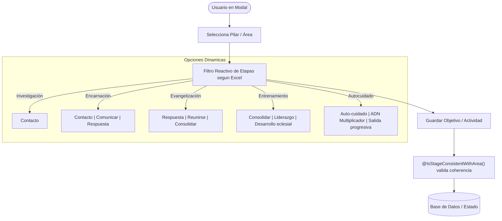

# Propuesta Técnica 008: Mapeo de Etapas según Matriz Excel y Eliminación del Campo Nivel (Backend y Frontend)

**Estado:** PENDIENTE DE APROBACIÓN  
**Versión:** 2026.4.0  
**Fecha:** 05 de Noviembre de 2026  
**Autor:** Antigravity Engineering Team  
**Documento Fuente:** `docs/otros/relacion pilar-etapa.xlsx`  

---

## 1. Contexto y Justificación

### 1.1. Qué
Ajustar de manera definitiva la lógica de asociación de **Etapas por Pilar** al crear y editar tanto **Objetivos** como **Actividades**, aplicando fielmente la matriz oficial provista en `docs/otros/relacion pilar-etapa.xlsx`, y **eliminar por completo el selector y campo "Nivel"** (`Nivel 1`, `Nivel 2`, etc.) en toda la plataforma:
1. **En Backend (NestJS):**
   - Actualizar el validador `@IsStageConsistentWithArea()` y la matriz `STAGES_BY_AREA_MAP` para alinearse a las etapas oficiales del Excel.
   - Desprender el campo obligatorio `level` / `areaLevel` de `CreateObjectiveDto`, `UpdateObjectiveDto`, `CreateActivityDto`, `UpdateActivityDto` y de las entidades correspondientes.
2. **En Frontend (Angular):**
   - Actualizar el catálogo `STAGES_BY_AREA` y tipos en `plan.types.ts`.
   - Eliminar el desplegable **"Nivel"** de los formularios modales:
     - Formulario de Objetivo: [`objective-form-fields.component.ts`](file:///c:/Users/Usuario/Desktop/personales/planMinisterial/frontend/src/features/plans/infrastructure/objectiveModal/objective-form-fields.component.ts) y [`objective-modal.component.ts`](file:///c:/Users/Usuario/Desktop/personales/planMinisterial/frontend/src/features/plans/infrastructure/objective-modal.component.ts).
     - Formulario de Actividad: [`activity-basic-fields.component.ts`](file:///c:/Users/Usuario/Desktop/personales/planMinisterial/frontend/src/features/plans/infrastructure/activityModal/activity-basic-fields.component.ts) y [`activity-modal.component.ts`](file:///c:/Users/Usuario/Desktop/personales/planMinisterial/frontend/src/features/plans/infrastructure/activity-modal.component.ts).
   - Reorganizar la grilla de selección a **2 columnas limpias**: `[ Pilar / Área ]` y `[ Etapa del Pilar ]`.
   - Actualizar las tarjetas y badges de visualización para mostrar la **Etapa** de forma destacada en lugar del nivel numérico.

### 1.2. Matriz Oficial de Pilares y Etapas (`relacion pilar-etapa.xlsx`)

| Pilar / Área Esencial | Etapas Oficiales Permitidas | Descripción de Propósito |
| :--- | :--- | :--- |
| **Investigación** | • `Contacto` | Diagnóstico de campo, mapeo y primeros oyentes. |
| **Encarnación** | • `Contacto` • `Comunicar` • `Respuesta` | Inmersión cultural, comunicación del mensaje y apertura espiritual. |
| **Evangelización** | • `Respuesta` • `Reunirse` • `Consolidar` | Decisión de fe, conformación de grupos de reunión y afirmación de creyentes. |
| **Entrenamiento** | • `Consolidar` • `Liderazgo` • `Desarrollo eclesial` | Formación de discípulos, multiplicación de líderes y establecimiento de iglesia. |
| **Autocuidado** (Transversal) | • `Auto-cuidado` • `ADN Multiplicador` • `Salida progresiva` | Sostenibilidad integral del misionero y autonomía territorial. |

---

## 2. Arquitectura de la Solución y Flujo en Cascada

---

## 3. Plan de Modificaciones Detallado

### 3.1. Backend (`backend/`)
- [`is-stage-consistent.validator.ts`](file:///c:/Users/Usuario/Desktop/personales/planMinisterial/backend/src/common/validators/is-stage-consistent.validator.ts):
  - Actualizar `STAGES_BY_AREA_MAP` con las etapas exactas del Excel (manteniendo compatibilidad con etiquetas extendidas anteriores).
- [`create-objective.dto.ts`](file:///c:/Users/Usuario/Desktop/personales/planMinisterial/backend/src/objectives/dto/create-objective.dto.ts) y [`objective.entity.ts`](file:///c:/Users/Usuario/Desktop/personales/planMinisterial/backend/src/objectives/entities/objective.entity.ts):
  - Hacer opcional / descontinuar `level`.
  - Asegurar que `stage` sea validado con `@IsStageConsistentWithArea()`.
- [`create-activity.dto.ts`](file:///c:/Users/Usuario/Desktop/personales/planMinisterial/backend/src/activities/dto/create-activity.dto.ts) y [`activity.entity.ts`](file:///c:/Users/Usuario/Desktop/personales/planMinisterial/backend/src/activities/entities/activity.entity.ts):
  - Hacer opcional / descontinuar `areaLevel`.
  - Validar `stage` estrictamente contra el pilar seleccionado.

### 3.2. Frontend (`frontend/`)
- [`plan.types.ts`](file:///c:/Users/Usuario/Desktop/personales/planMinisterial/frontend/src/features/plans/domain/plan.types.ts):
  - Actualizar `STAGES_BY_AREA` con las cadenas exactas del Excel.
  - Marcar `areaLevel` como opcional y priorizar `stage`.
- [`objective-form-fields.component.ts`](file:///c:/Users/Usuario/Desktop/personales/planMinisterial/frontend/src/features/plans/infrastructure/objectiveModal/objective-form-fields.component.ts):
  - Eliminar el `
` con `<label>Nivel</label>`.
  - Cambiar el layout `grid-cols-1 sm:grid-cols-3` a `grid-cols-1 sm:grid-cols-2` para que "Pilar / Área" y "Etapa del Pilar" ocupen armoniosamente el 50% cada uno.
- [`objective-modal.component.ts`](file:///c:/Users/Usuario/Desktop/personales/planMinisterial/frontend/src/features/plans/infrastructure/objective-modal.component.ts):
  - Quitar `areaLevel` de los métodos y bindings del formulario.
- [`activity-basic-fields.component.ts`](file:///c:/Users/Usuario/Desktop/personales/planMinisterial/frontend/src/features/plans/infrastructure/activityModal/activity-basic-fields.component.ts):
  - Eliminar el bloque con el selector `<select>` de "Nivel".
  - Ajustar la grilla superior a 2 columnas (`Pilar / Área` y `Etapa del Pilar`).
- [`activity-modal.component.ts`](file:///c:/Users/Usuario/Desktop/personales/planMinisterial/frontend/src/features/plans/infrastructure/activity-modal.component.ts):
  - Quitar `areaLevel` del estado inicial y payload de guardado.
- [`objective-card-header.component.ts`](file:///c:/Users/Usuario/Desktop/personales/planMinisterial/frontend/src/features/plans/infrastructure/objectiveCard/objective-card-header.component.ts) y [`activity-header-tags.component.ts`](file:///c:/Users/Usuario/Desktop/personales/planMinisterial/frontend/src/features/plans/infrastructure/activityItem/activity-header-tags.component.ts):
  - Mostrar la etiqueta de la **Etapa** en lugar de mostrar `Nivel X`.

---

## 4. Garantía de Calidad y Reglas de Gobernanza
- **Límite de Líneas:** Todos los archivos modificados o creados se mantendrán estrictamente por debajo de las 150 líneas.
- **Pruebas Automatizadas:** Se ejecutará la suite de pruebas del backend verificando que la creación de objetivos y actividades con las etapas del Excel sea exitosa y que etapas incongruentes sigan siendo rechazadas con `400 Bad Request`.
- **Compilación Limpia:** Se verificará `npm run build` en backend y frontend.

