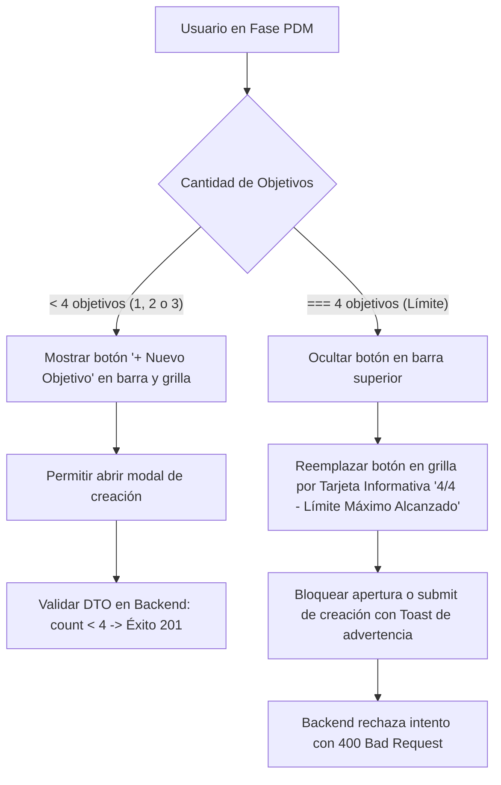

# Propuesta Técnica #010: Restricción Estricta de Máximo 4 Objetivos Estratégicos por Fase (Backend y Frontend)

## 1. Contexto y Requerimiento del Usuario

El usuario ha solicitado establecer e indicar de forma transparente la restricción metodológica de objetivos en la plataforma ministerial:
> *"oye el maximo de objetivos que pueden es 4 vale apenas lleguen a 4 objetivos no se puede crear mas, aplica esa logica en el back y muestralo en el fornt"*

### Justificación Metodológica y Arquitectónica
- En la metodología de gestión territorial de MISINCOL, cada una de las 5 fases/pilares del PDM admite un rango de **1 a 4 objetivos estratégicos** con auto-numeración fija (1..4).
- Permitir más de 4 objetivos dispersa el foco misionero, genera desbalance en la asignación presupuestal y sobrecarga la cuadrícula visual de trabajo.
- Actualmente, aunque el backend cuenta con una verificación previa en `objectives.service.ts` y la función pura `applyAddObjective` valida la longitud en el frontend, la interfaz gráfica en `phase-objective-cards-grid.component.ts` aún permitía renderizar la tarjeta de "Nuevo Objetivo" cuando `objectives.length < 6`, generando inconsistencias visuales e intentos de creación fallidos al llegar al 4to objetivo.

---

## 2. Plan de Implementación Técnica



### A. Frontend (Angular 2026 / Signals)
1. **Grilla de Objetivos (`phase-objective-cards-grid.component.ts`)**:
   - Cambiar la condición `@if (objectives().length < 6)` por `@if (objectives().length < 4)`.
   - Cuando `objectives().length < 4`, se muestra la tarjeta punteada para agregar con el indicador de avance `(X/4 registrados)`.
   - Cuando `objectives().length >= 4`, se renderiza una tarjeta de estado no clickeable con borde sutil y estilo calmado:
     - Indicador `4/4`.
     - Título: *"Límite Máximo Alcanzado"*.
     - Subtítulo: *"Esta fase ya cuenta con los 4 objetivos estratégicos permitidos por la metodología."*

2. **Barra Superior de Fase (`phase-header-bar.component.ts`)**:
   - Ajustar el contador de texto a: `• {{ objectivesCount() }}/4 Objetivos Estratégicos`.
   - Mantener oculto el botón `Nuevo Objetivo` mediante `@if (!hasMaxObjectives())` cuando `objectivesCount >= 4`.

3. **Guarda en Modal de Objetivos (`objective-modal.component.ts` y `phase-view.component.ts`)**:
   - En `phase-view.component.ts`: si se intenta disparar la apertura en modo creación teniendo ya 4 objetivos, no abrir el modal y disparar un toast preventivo:
     `"Esta fase ya cuenta con el máximo permitido de 4 objetivos estratégicos."`
   - En `objective-modal.component.ts`: en `handleSubmit`, validar defensivamente:
     `if (this.mode() === 'create' && this.totalObjectivesCount() >= 4)` deteniendo el envío y alertando al usuario.

4. **Capa de Aplicación y Acciones Puras (`planObjectiveActions.ts` y `plan.service.ts`)**:
   - Ratificar en `applyAddObjective` la verificación `if (currentPlan.objectives.length >= 4) return null;`.
   - En `plan.service.ts`: si `addObjective` retorna `null`, emitir alerta visual mediante `toastService.warning` informando el límite alcanzado.

### B. Backend (NestJS / TypeScript)
1. **Servicio de Objetivos (`backend/src/objectives/objectives.service.ts`)**:
   - Validar y asegurar la regla en `create()`:
     ```typescript
     const existing = this.findByTeamAndPillar(dto.teamId, dto.pillarId);
     if (existing.length >= 4) {
       throw new BadRequestException('Regla Ministerial: Toda fase admite como máximo 4 objetivos estratégicos.');
     }
     ```
2. **Controlador y Pruebas**:
   - Asegurar que cualquier intento HTTP `POST /objectives` que exceda los 4 objetivos retorne código HTTP estándar `400 Bad Request` con mensaje tipificado, según el estándar de gobernanza técnica.

---

## 3. Gobernanza y Calidad (RULE[user_global] v2026.4.0)

- **Límite de líneas**: Cada archivo `.ts` modificado mantendrá su extensión estrictamente por debajo de **150 líneas**.
- **Cero SDKs comerciales**: Operación directa con NestJS y Angular nativo.
- **Entorno Local**: Todos los cambios se aplicarán y compilarán en local en la rama `featurePrueba` sin realizar push remoto.

