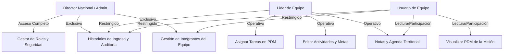

# Propuesta Técnica #011: Gestor de Roles y Seguridad con Matriz Interactiva de Permisos y Restricción de Historiales de Ingreso

## 1. Contexto y Requerimiento del Usuario

El usuario ha solicitado formalmente implementar la funcionalidad del **Gestor de Roles y Seguridad** con dos componentes prioritarios:
1. **Vista de Gestión de Roles con Matriz de Permisos**:
   - Interfaz dedicada exclusivamente a la administración de roles y permisos.
   - Matriz interactiva (tabla de doble entrada) que cruza los roles del sistema con sus acciones y permisos.
   - Roles requeridos:
     - **Usuario equipo** (`ROLE_USUARIO` / `team_member`)
     - **Líder equipo** (`ROLE_LIDER` / `team_leader`)
     - **Director nacional** (`ROLE_NACIONAL` / `national_director`)
2. **Restricción de Historiales de Ingreso**:
   - Control de acceso estricto sobre las bitácoras e historiales de ingreso de los usuarios.
   - Regla de seguridad: Disponible y visible **únicamente** para el rol de **Administrador / Director Nacional**.

---

## 2. Definición del Modelo de Roles y Permisos (RBAC)

### 2.1. Definición de Roles del Negocio
- **Usuario equipo**: Obrero de campo o misionero local. Acceso limitado a visualizar las metas de su equipo territorial, registrar apuntes de campo y gestionar las actividades que le han sido asignadas directamente.
- **Líder equipo**: Pastor o responsable principal del equipo territorial. Supervisa el PDM territorial, asigna tareas a sus miembros, actualiza estados y formula solicitudes formales de cambio de objetivos. No puede alterar la composición institucional de integrantes ni acceder a telemetría global.
- **Director nacional (Administrador)**: Coordinador general de MISINCOL. Acceso total a supervisión cartográfica, aprobación de solicitudes de cambio, configuración de equipos e integrantes, bitácoras de auditoría/ingresos y gestión de la matriz de roles.

### 2.2. Matriz Interactiva de Permisos


| Módulo / Acción del Sistema | Clave de Permiso | Usuario Equipo | Líder Equipo | Director Nacional |
| :--- | :--- | :---: | :---: | :---: |
| **Visualizar Planes PDM** | `pdm.view` | ✅ | ✅ | ✅ |
| **Editar Actividades y Estados** | `pdm.activities.edit` | ❌ *(Solo asignadas)* | ✅ | ✅ |
| **Eliminar Actividades** | `pdm.activities.delete` | ❌ | ✅ | ✅ |
| **Gestionar Objetivos (Máx. 4)** | `pdm.objectives.manage` | ❌ | ❌ *(Vía Solicitud)* | ✅ |
| **Asignar Tareas a Integrantes** | `team.tasks.assign` | ❌ | ✅ | ✅ |
| **Gestionar Integrantes (Crear/Eliminar)** | `team.members.manage` | ❌ | ❌ | ✅ |
| **Notas y Agenda Territorial** | `notes.manage` | ✅ | ✅ | ✅ |
| **Generar Informe Territorial** | `reports.team.export` | ❌ | ✅ | ✅ |
| **Supervisión Nacional y KPIs** | `reports.national.view` | ❌ | ❌ | ✅ |
| **Historial de Ingresos y Auditoría** | `audit.history.view` | ❌ *(Bloqueado)* | ❌ *(Bloqueado)* | ✅ |
| **Gestión de Roles y Seguridad** | `security.roles.manage` | ❌ *(Bloqueado)* | ❌ *(Bloqueado)* | ✅ |

---

## 3. Arquitectura e Implementación Técnica

### 3.1. Frontend (Angular 21+ / Signals / Vertical Slicing)
1. **Nueva Rebanada Vertical (`src/features/security/`)**:
   - `domain/security.types.ts`: Modelos de roles (`SystemRole`), permisos (`SystemPermission`) y matriz configurable (`RolePermissionsMatrix`).
   - `application/security-matrix.service.ts`: Servicio reactivo con Signals para persistir en almacenamiento local (`misincol_security_matrix_v1`), validar permisos con `hasPermission(role, permissionKey)` y conmutar checkboxes en tiempo real.
   - `infrastructure/security-roles-view.component.ts`: Vista principal del gestor de roles con resumen de roles, selector interactivo y la matriz tabular.
   - `infrastructure/components/security-matrix-table.component.ts`: Tabla interactiva con cabeceras fijas, badges de roles y switches/toggles accesibles.
2. **Integración en Navegación y Shell (`app-workspace.component.ts` y Header)**:
   - Vista `'security'` activable desde el header / menú del Administrador.
   - Guarda estricta: Solo renderizable si `isSuperAdmin()` es verdadero.
3. **Restricción de Historiales de Ingreso (`team-audit-modal.component.ts`)**:
   - La pestaña `Ingresos` y los registros con `actionType === 'login'` solo son accesibles si el usuario cuenta con el permiso `audit.history.view` (rol Administrador).
   - Para roles no autorizados, el filtro y las tarjetas de inicio de sesión quedan completamente ocultos.

### 3.2. Backend (NestJS / TypeScript)
1. **Actualización del Enum de Roles (`backend/src/common/enums/user-role.enum.ts`)**:
   ```typescript
   export enum UserRole {
     ROLE_NACIONAL = 'ROLE_NACIONAL', // Director nacional / Coordinador
     ROLE_LIDER = 'ROLE_LIDER',       // Líder de equipo territorial
     ROLE_USUARIO = 'ROLE_USUARIO',   // Usuario equipo de campo
   }
   ```
2. **Controlador y Servicio de Seguridad (`backend/src/security/`)**:
   - `GET /security/matrix`: Retorna la matriz oficial de permisos.
   - `PUT /security/matrix`: Actualiza la matriz con persistencia y control de concurrencia (protegido con `@Roles(UserRole.ROLE_NACIONAL)`).
   - `GET /audit/login-history`: Endpoint protegido exclusivamente para el Director Nacional.

---

## 4. Gobernanza y Calidad (`RULE[user_global]` v2026.4.0)

- **Límite Estricto de 150 Líneas**: Cada nuevo componente y servicio (`security-roles-view`, `security-matrix-table`, `security-matrix.service`, etc.) se estructurará modularmente bajo SRP manteniéndose estrictamente por debajo de las 150 líneas.
- **Cero SDKs Comerciales**: Operación con APIs REST nativas y Angular Signals puro.
- **Entorno Local**: Ejecución y compilación garantizada en la rama local `featurePrueba`.

