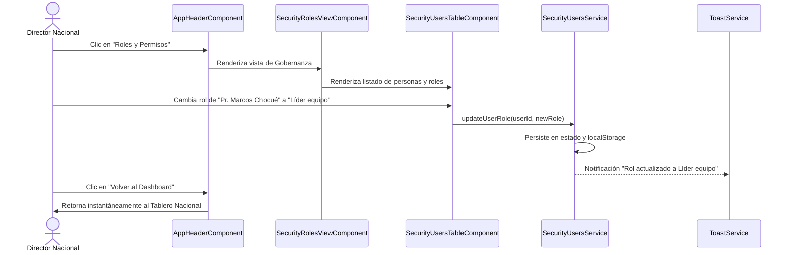

# 📋 Propuesta Técnica 012: Asignación Directa de Roles a Usuarios en Gestor de Seguridad y Renombrado de Botón "Volver al Dashboard"

**Fecha:** 2026-11-06  
**Autor:** Agente 1 (Orquestador Técnico) & Agente 2 (Staff Software Architect)  
**Estado:** PENDIENTE DE APROBACIÓN (Fase 2 de Gobernanza)

---

## 1. Resumen Ejecutivo y Necesidad del Negocio
El usuario solicita dos adiciones operativas clave a la experiencia de gobernanza y navegación del sistema:
1. **Asignación y Cambio de Rol de Personas en la Vista de Seguridad:**
   - En la misma interfaz de **Roles y Permisos**, incorporar un módulo/tabla interactiva que liste a los colaboradores y directivos del sistema, mostrando su nombre, equipo o jurisdicción territorial, correo o contacto y rol actual.
   - Permitir al Administrador / Director Nacional cambiar de rol a cualquier persona directamente (`Usuario equipo`, `Líder equipo`, `Director nacional`) con retroalimentación inmediata, badges de color y persistencia reactiva.
2. **Reemplazo del Botón "Super Admin" por "Volver al Dashboard":**
   - En la cabecera global ([`AppHeaderComponent`](file:///c:/Users/Usuario/Desktop/personales/planMinisterial/frontend/src/app/ui/app-header.component.ts)), cambiar la etiqueta del botón `"Super Admin"` (mostrado cuando el director nacional está en la vista de roles o en el PDM de una misión) por **"Volver al Dashboard"**, garantizando claridad en el flujo de retorno al mapa y tablero nacional.

---

## 2. Arquitectura de Componentes y Diseño de la Solución

### 2.1. Frontend (`src/features/security/`)
Para respetar de forma estricta el límite inviolable de **150 líneas por archivo**, la vista de seguridad se fragmentará de la siguiente manera:

```text
frontend/src/features/security/
├── domain/
│   ├── security.types.ts               # Contratos existentes + interfaces de Usuario de Sistema (< 150 líneas)
│   └── security-users.types.ts         # Tipos específicos de usuarios de sistema y asignación de rol (< 80 líneas)
├── application/
│   ├── security-matrix.service.ts      # Gestión de la matriz de privilegios
│   ├── securityDefaults.ts             # Matriz predeterminada de permisos
│   └── security-users.service.ts       # Servicio reactivo (@Injectable) para listar y cambiar roles (< 120 líneas)
└── infrastructure/
    ├── security-roles-view.component.ts            # Contenedor orquestador con pestañas o vista dual (< 70 líneas)
    ├── components/
    │   ├── security-roles-header.component.ts      # Encabezado con selector de vista (Matriz vs Usuarios) (< 80 líneas)
    │   ├── security-matrix-table.component.ts      # Tabla de doble entrada rol x permiso (< 85 líneas)
    │   └── security-users-table.component.ts       # Nueva tabla interactiva para cambio de rol de personas (< 130 líneas)
```

### 2.2. Diseño de la Tabla de Asignación de Roles (`SecurityUsersTableComponent`)
- **Columnas:**
  1. **Colaborador / Usuario:** Nombre, correo institucional y avatar vectorial.
  2. **Misión / Asignación:** Territorio indígena asignado (ej. *Nasa - Tierradentro*, *Wayúu - Alta Guajira*, o *Coordinación Nacional*).
  3. **Rol Actual:** Badge con estilo visual distintivo (`Director nacional` en carbón/naranja, `Líder equipo` en ámbar/marrón, `Usuario equipo` en esmeralda).
  4. **Cambiar Rol:** Selector desplegable / selector en 1 clic que permite reasignar el rol entre los 3 roles oficiales (`ROLE_USUARIO`, `ROLE_LIDER`, `ROLE_NACIONAL`).
  5. **Acción / Estado:** Indicador de guardado reactivo y confirmación visual con `ToastService`.

### 2.3. Renombrado y Ergonomía del Botón en `AppHeaderComponent`
- **Antes:**
  ```html
  <button (click)="goToSuperAdmin.emit()" ...>
    <app-icon name="shield-check" className="w-3.5 h-3.5 text-[#E67324]" />
    <span class="hidden sm:inline">Super Admin</span>
  </button>
  ```
- **Después:**
  ```html
  <button (click)="goToSuperAdmin.emit()" ... title="Volver al panel general de supervisión">
    <app-icon name="arrow-left" className="w-3.5 h-3.5 text-[#E67324]" />
    <span class="hidden sm:inline">Volver al Dashboard</span>
  </button>
  ```

### 2.4. Backend (`backend/src/users/`)
- Adición del endpoint `PATCH /users/:id/role` con DTO validado (`UpdateUserRoleDto`) protegido por `@Roles(UserRole.ROLE_NACIONAL)`.
- Método en `UsersService.updateRole(id: string, newRole: UserRole)`.

---

## 3. Diagrama de Flujo (Mermaid)



---

## 4. Compromisos de Gobernanza y Calidad

1. **Límite de 150 líneas:** Ningún archivo superará las 150 líneas de código.
2. **Entorno Estrictamente Local:** Todos los cambios quedarán en la rama `featurePrueba` sin realizar ningún push remoto.
3. **Cero SDKs Opcionales:** TypeScript puro, Angular Standalone, Signals y NestJS nativo.
4. **Documentación Sincronizada:** Actualización de `docs/architecture/1_architecture.md`, `frontend/README.md` y `backend/README.md`.

---

## 5. Próximo Paso (Espera de Feedback)
Conforme a la regla 2.2 del Contrato de Gobernanza Técnica, quedamos a la espera de tu aprobación explícita o ajustes a esta propuesta para iniciar la ejecución.

