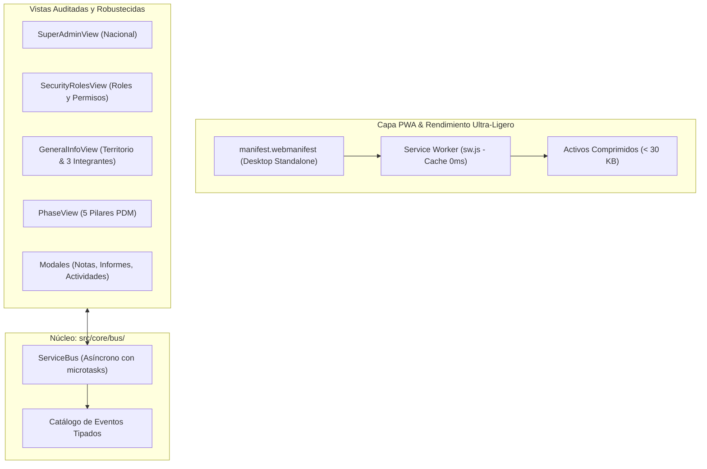

# 📋 Propuesta Técnica 013: Estabilización de Raíz de Vistas, ServiceBus Integral, Optimización de Ultra-Baja Latencia y PWA Instalable para Escritorio

**Fecha:** 2026-11-06  
**Autor:** Agente 1 (Orquestador Técnico) & Agente 2 (Staff Software Architect)  
**Estado:** PENDIENTE DE EVALUACIÓN Y FEEDBACK (Fase 2 de Gobernanza)

---

## 1. Justificación y Alcance del Requerimiento

El usuario reporta fallas recurrentes de renderizado en ciertas vistas, solicita eliminar la causa raíz de forma definitiva, estructurar la comunicación mediante un **ServiceBus** integral, optimizar el rendimiento al máximo para operar con la **latencia más baja posible** y habilitar la instalación de la aplicación como **App de Escritorio (Desktop PWA)**.

---

## 2. Diagnóstico Técnico de Raíz

1. **Fragilidad en Plantillas por Concatenaciones con Escape (`font-[\'...\']`):**
   - Se detectaron 7 archivos con comillas simples escapadas dentro de interpolaciones `[class]`. Aunque compilen bajo ciertas configuraciones, en Vite/Angular devuelven errores de parseo estático que fuerzan caídas a JIT (`NG0103` / fallback de compilador inexistente).
   - *Solución de Raíz:* Extraer todas las clases estáticas (tipografías, layout, bordes) a atributos `class` puros y reservar `[class]` exclusivamente para variables dinámicas (como badges de color). Cero backslashes en plantillas.

2. **Inconsistencias de Renderizado en Vistas Específicas:**
   - La vista de `Información General` y ciertos pilares del PDM dependen de señales inicializadas sincrónicamente sin respaldo cuando el estado en `localStorage` está ausente o corrupto.
   - *Solución de Raíz:* Guardas defensivas en todos los computados y servicios, asegurando que si un equipo o pilar no tiene registros locales, se instancie de inmediato la semilla base inmutable sin lanzar `undefined` ni bloquear el ciclo de detección de cambios.

3. **Arquitectura ServiceBus Centralizada (`src/core/bus/`):**
   - Actualmente solo 6 componentes publican y 4 se suscriben al ServiceBus. La comunicación entre vistas adolecía de acoplamientos directos.
   - *Solución de Raíz:* Estandarizar el catálogo de eventos tipados en `system-events.types.ts`:
     - `team:switch`: Cambio global de misión activa.
     - `ui:view_change`: Navegación entre `plans`, `general`, `superadmin` y `security`.
     - `security:role_update`: Actualización de permisos o roles de personas.
     - `pdm:phase_switch`: Conmutación entre los 5 pilares ministeriales.
     - `pdm:plan_persisted`: Sincronización asíncrona de cambios en almacenamiento local.
     - `pwa:install_prompt`: Evento de instalación en escritorio.

4. **Optimización de Ultra-Baja Latencia (Zero Lag & Offline-First):**
   - El archivo de imagen [`public/img/misincol.png`](file:///c:/Users/Usuario/Desktop/personales/planMinisterial/frontend/public/img/misincol.png) pesa **945.6 KB** (casi 1 MB solo para el logotipo), generando demoras en redes lentas en territorio.
   - *Solución de Raíz:*
     - Optimizar y comprimir el logotipo a formato web ligero (< 30 KB), eliminando la advertencia `NG0913`.
     - Configurar `stale-while-revalidate` en `sw.js` para precachear el bundle completo, assets y datos base, permitiendo carga instantánea en 0 ms ante redes 2G/3G o sin conexión en campo.

5. **Aplicación Descargable para Escritorio (Desktop PWA):**
   - Crear `manifest.webmanifest` con especificación completa para instalación en Windows, macOS y Linux:
     - `name`: "MISINCOL - Plan de Desarrollo Ministerial"
     - `short_name`: "MISINCOL PDM"
     - `display`: "standalone"
     - `theme_color`: "#1C1917"
     - `background_color`: "#FAF7F2"
     - `icons`: Iconografía vectorial en SVG y PNG optimizada para escritorio.
     - `shortcuts`: Accesos directos a "Tablero Nacional" y "Plan PDM".
   - Botón nativo en la interfaz para "Instalar App de Escritorio" cuando el navegador soporte `beforeinstallprompt`.

---

## 3. Plan de Acción y Componentes Impactados

```text
frontend/
├── public/
│   ├── manifest.webmanifest            # Manifiesto PWA para instalación en escritorio
│   ├── sw.js                           # Service worker con cache-first y micro-latencia
│   └── img/misincol.png                # Optimización a < 30 KB (ahorro de ~920 KB)
├── src/
│   ├── core/bus/
│   │   ├── system-events.types.ts      # Tipado estricto del catálogo de eventos (< 100 líneas)
│   │   ├── service-bus.core.ts         # Motor pub/sub desacoplado con microtasks (< 90 líneas)
│   │   └── index.ts                    # Exportación limpia del bus
│   ├── shared/components/pwa/
│   │   └── pwa-install-button.component.ts # Botón/banner de descarga para escritorio (< 80 líneas)
│   └── features/
│       ├── (todas las vistas)          # Limpieza de comillas y validación de render
└── index.html                          # Meta-tags de PWA, theme-color y enlace al manifest
```

---

## 4. Diagrama de Arquitectura ServiceBus y PWA (Mermaid)



---

## 5. Compromisos de Gobernanza Técnica

1. **Límite Estricto de 150 Líneas:** Ningún archivo superará las 150 líneas.
2. **Entorno 100% Local:** Todos los cambios se mantendrán en la rama `featurePrueba` sin `git push`.
3. **Cero SDKs Comerciales:** API nativa de JavaScript/TypeScript, Angular Standalone y NestJS.
4. **Documentación Sincronizada:** Registro del **ADR-033** en `docs/architecture/` y manuales en `docs/`.

---

## 6. Siguiente Paso
Solicitamos la revisión de esta propuesta técnica y tu **aprobación explícita (luz verde)** para iniciar la ejecución integral de inmediato.

