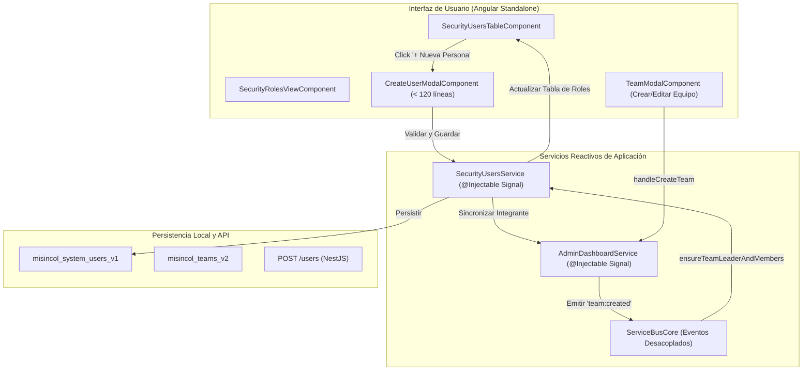

# 🏛️ Propuesta Técnica 016: Creación de Personas desde Roles y Sincronización Automática con Equipos Misioneros

**Fecha:** 2026-11-06  
**Autor:** Agente 1 (VP of Engineering) & Agente 2 (Staff Software Architect)  
**Estado:** PENDIENTE DE REVISIÓN Y FEEDBACK (Fase de Pausa)  

---

## 1. Contexto y Requerimiento del Negocio

El Director Nacional de Misincol necesita gestionar integralmente el ciclo de vida de los colaboradores y sus roles institucionales:
1. **Creación directa desde la vista de Roles de Personas**:
   - En la pestaña *"Roles de Personas"* (`SecurityUsersTableComponent`), debe existir un botón para registrar una nueva persona.
   - Debe solicitar obligatoriamente:
     - **Nombre Completo**
     - **Correo Electrónico**
     - **Rol** (`Usuario de equipo`, `Líder de equipo`, `Director nacional`)
     - **A qué equipo pertenece** (Selector dinámico de misiones: Misión Nasa, Wayúu, Pastos, Emberá, Nukak, Arhuaco, o Coordinación Nacional).
2. **Sincronización bidireccional automática**:
   - Cuando se cree una nueva persona asociada a un equipo, debe reflejarse tanto en la tabla de roles como en la lista de integrantes del equipo respectivo.
   - Cuando el Director Nacional cree un nuevo equipo misionero (o asigne un líder/integrantes en `TeamModalComponent`), estos deben aparecer automáticamente en la tabla de asignación de roles de personas sin necesidad de crearlos dos veces.

---

## 2. Arquitectura de la Solución

---

## 3. Especificación de Componentes e Impacto Modular

### 3.1. Nuevo Componente Modal: `CreateUserModalComponent`
- **Ubicación:** `frontend/src/features/security/infrastructure/components/create-user-modal.component.ts`
- **Líneas estimadas:** ~115 líneas (`< 150` líneas, SRP estricto).
- **Campos del formulario:**
  1. `Nombre Completo` (input texto requerido).
  2. `Correo Electrónico` (input email institucional requerido).
  3. `Rol en el Sistema` (select: `Usuario de equipo`, `Líder de equipo`, `Director nacional`).
  4. `Misión / Territorio` (select alimentado por `adminDashboardService.allTeams()` + opción `Coordinación Nacional`).
- **Comportamiento:**
  - Validación de campos vacíos y formato de correo.
  - Cierre con tecla Escape o botón cancelar.
  - Al confirmar, emite el DTO `CreateUserPayload`.

### 3.2. Actualización de `SecurityUsersTableComponent`
- **Ubicación:** `frontend/src/features/security/infrastructure/components/security-users-table.component.ts`
- **Líneas actuales:** 141 líneas.
- **Acción:**
  - Incorporar el botón `+ Nueva Persona` en la cabecera junto a los filtros.
  - Extraer estilos o condensar métodos auxiliares para mantener el archivo estrictamente por debajo de **150 líneas**.

### 3.3. Servicio `SecurityUsersService`
- **Ubicación:** `frontend/src/features/security/application/security-users.service.ts`
- **Líneas actuales:** 137 líneas.
- **Métodos a incorporar:**
  - `createUser(payload: CreateSystemUserDto): SystemUser`: Agrega la persona, persiste en `misincol_system_users_v1` y notifica con Toast.
  - `ensureTeamLeaderAndMembers(team: TeamSupervisionSummary): void`: Revisa si el líder o miembros del equipo existen en la lista de usuarios; si no existen, los crea automáticamente con rol `team_leader` o `team_member`.
  - Refactorizar funciones utilitarias en submódulo (`security-users.helpers.ts`) para mantener `security-users.service.ts` en `<= 125` líneas.

### 3.4. Sincronización en `AdminDashboardService`
- **Ubicación:** `frontend/src/features/admin/application/admin-dashboard.service.ts`
- Cuando se ejecuta `handleCreateTeam(dto)` o se agregan miembros a un equipo, se invoca la sincronización en `SecurityUsersService` para garantizar que todo nuevo líder y colaborador aparezca de inmediato en la tabla de asignación de roles.

---

## 4. Plan de Ejecución Paso a Paso

1. **Crear DTOs y tipos:** Extender `security-users.types.ts` con `CreateSystemUserDto`.
2. **Crear helper desacoplado:** `security-users.helpers.ts` para mapeo de avatares, IDs y validaciones, asegurando que `security-users.service.ts` se mantenga `<= 120` líneas.
3. **Actualizar `SecurityUsersService`:** Métodos `createUser` y `syncWithTeams`.
4. **Crear `CreateUserModalComponent`:** Modal atómico `<app-create-user-modal>` con selector de roles y misiones.
5. **Integrar en `SecurityUsersTableComponent`:** Botón `+ Nueva Persona` y apertura de modal.
6. **Conectar Sincronización en `AdminDashboardService`:** Cada vez que se crea un equipo misionero, su líder y miembros quedan registrados en la tabla de roles.
7. **Verificación Estricta:**
   - Compilación completa de frontend (`npm --prefix frontend run build`).
   - Compilación completa de backend (`npm --prefix backend run build`).
   - Auditoría automatizada de líneas (`<= 150` líneas por archivo en 100% de archivos).
   - Commit local en la rama `featurePrueba`.

