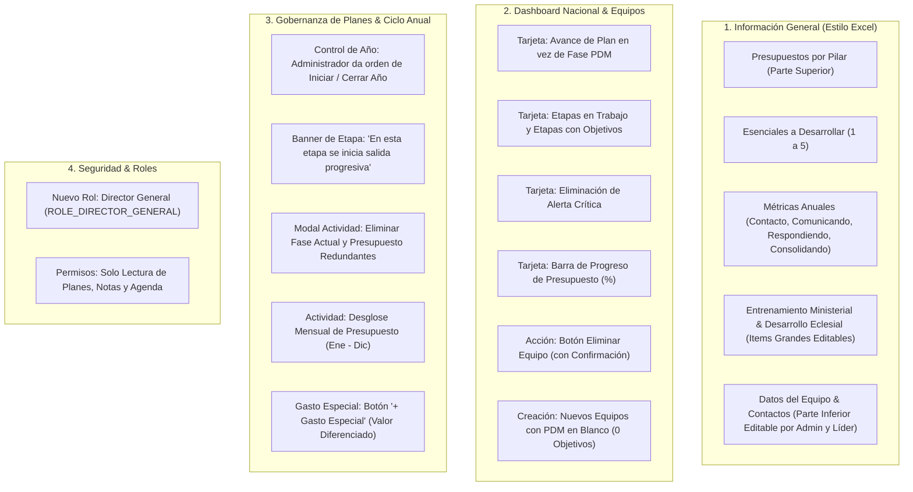

# 🏛️ Propuesta Técnica 019: Suite Integral de Mejoras PDM, Información General Estilo Excel, Gestión de Ciclo Anual y Gobernanza del Dashboard

**Fecha:** 2026-11-07  
**Autor:** Agente 1 (VP of Engineering) & Agente 2 (Staff Software Architect)  
**Estado:** PENDIENTE DE APROBACIÓN POR EL USUARIO (Gatekeeper Rule)  

---

## 1. Resumen Ejecutivo (El Qué y El Por Qué)

A partir del requerimiento operativo del Director Nacional y la revisión del documento oficial de trabajo (*PDM 2026 Pastos Vr1.xlsx* y manuales de plantación), se requiere implementar una suite de **16 optimizaciones funcionales y de gobernanza** sobre el sistema web MISINCOL.

El objetivo es alinear la experiencia digital de los equipos misioneros y la dirección nacional con la realidad de campo:
1. Una **Vista General estructurada en tabla comparativa multianual** idéntica a la hoja oficial de Excel con sus áreas de Liderazgo, Desarrollo Eclesial y Esenciales a Desarrollar.
2. **Capacidad de edición de información de campo y contacto** tanto para el Administrador Nacional como para el Líder de Equipo.
3. **Gobierno de Ciclo Anual** centralizado donde el Administrador Nacional formaliza la apertura y cierre de cada año ministerial antes de asignar nuevos objetivos.
4. **Optimización visual y métricas del Dashboard Nacional**: visualización de etapas con objetivos activos, indicador "Avance de Plan", eliminación de alertas críticas obsoletas y barra porcentual de presupuesto.
5. **Nuevo rol de auditoría y supervisión pasiva (`director_general`)** con acceso exclusivo de lectura a planes, notas y agenda sin permisos de mutación.
6. **Desglose mensual de presupuesto** por actividad, botón y gestión de **Gastos Especiales** (no acumulativos al presupuesto general) y **eliminación de equipos**.
7. **Equipos nuevos con PDM completamente limpio (en blanco)** para iniciar su planeación sin plantillas contaminadas.

---

## 2. Desglose Detallado de los 16 Puntos

---

### Módulo 1: Información General (`src/features/general-info/`)
- **Presupuestos en la parte superior**: Los 5 pilares (`Investigación`, `Encarnación`, `Evangelización`, `Entrenamiento`, `Auto Cuidado`) y el Presupuesto Total se sitúan en la cabecera superior con barras porcentuales de ejecución.
- **Tabla Comparativa Anual (Modelo Excel)**: Columnas multianuales (`Año: 2025 | 2026 | 2027...`) desglosadas en las secciones oficiales:
  - *Contacto*: personas contactadas, interesadas, expuestas al evangelio.
  - *Comunicando*: buscadores de Dios, oportunidades de responder.
  - *Respondiendo*: creyeron al mensaje, bautizados.
  - *Consolidando*: estudios bíblicos regulares, mentoreados personalmente, grupos nuevos.
- **Entrenamiento Ministerial y Desarrollo Eclesial**: Ítems destacados con métricas cuantitativas clave (discípulos en entrenamiento pastoral, práctico, plantación de iglesias, iglesias de 1ra, 2da y 3ra generación), editables en línea.
- **Esenciales a Desarrollar**: Lista de 1 a 5 áreas esenciales seleccionadas (Liderazgo, Desarrollo Eclesial, etc.) con selección y guardado.
- **Edición para Admin y Líder**: El Director Nacional y el Líder del Equipo tienen habilitada la edición de información de campo y contacto territorial. Los usuarios de equipo mantienen visualización de solo lectura.
- **Datos de equipo en la parte inferior**: Integrantes, roles y canales de contacto ubicados en el pie de la vista.

### Módulo 2: Tablero Nacional (`src/features/admin/`)
- **Tarjeta de Equipo (`TeamOverviewCardComponent`)**:
  - Reemplazo del texto "Fase PDM" por **"Avance de Plan"** acompañado del porcentaje de cumplimiento.
  - Despliegue de las etapas activas en las que se está trabajando y aquellas donde existen objetivos registrados.
  - **Eliminación completa del badge de "Alerta crítica"**.
  - **Barra de Presupuesto (%)**: Indicador gráfico visual de porcentaje de presupuesto ejecutado frente al asignado.
  - **Botón "Eliminar Equipo"**: Con confirmación defensiva modal (`ToastService.confirmAction`) que remueve la misión, sus miembros vinculados y su PDM asociado.
- **Creación Limpia de Equipos (`AdminDashboardService`)**:
  - Al registrar una nueva misión, sus pilares se inicializan con **0 objetivos y 0 actividades**, permitiendo al líder y equipo comenzar desde una pizarra limpia.

### Módulo 3: Ciclo Anual, Actividades y Gastos Especiales (`src/features/plans/`)
- **Gobierno del Ciclo Anual**:
  - El Administrador Nacional dispone de controles para **"Cerrar Año"** e **"Iniciar Nuevo Año"**, formalizando el paso del período y evitando modificaciones no autorizadas en años concluidos.
- **Mensaje de Salida Progresiva**:
  - En la etapa `Salida progresiva` (y/o `Desarrollo eclesial` según pilar), se presenta un banner contextual destacado:
    > ℹ️ *En esta etapa se inicia la salida progresiva del equipo misionero y la consolidación de la autonomía local.*
- **Simplificación del Modal de Actividad (`ActivityModalComponent`)**:
  - Eliminación de los campos "Fase actual" y "Presupuesto" redundantes del formulario.
  - **Uso Mensual del Presupuesto**: Selector o tabla de distribución mensual de presupuesto (Enero a Diciembre) para cada actividad.
- **Gastos Especiales**:
  - Botón `+ Gasto Especial` ubicado debajo de `+ Nueva Actividad`.
  - Campos: Nombre, Descripción, Presupuesto estimado y Área de aplicación.
  - **Regla contable estricta**: Este monto **no se suma al presupuesto general del plan**, sino que se reporta de forma independiente en un renglón inferior como gasto especial presupuestado para monitoreo diferenciado.

### Módulo 4: Seguridad y Nuevo Rol (`src/features/security/` y Backend)
- **Nuevo Rol `director_general` / `ROLE_DIRECTOR_GENERAL`**:
  - Etiqueta: "Director General".
  - Permisos: Visualización de Planes PDM, Notas territoriales y Agenda.
  - Sin privilegios para crear/editar actividades, objetivos, equipos o reasignar roles.
  - Configurado en `SYSTEM_ROLES`, `security.types.ts`, matriz de permisos, guardias de sesión y en los guards del backend NestJS.

---

## 3. Plan de Arquitectura y Modularización (Regla Inviolable `<= 150` Líneas)

Para cumplir estrictamente con el Contrato de Gobernanza Técnica v2026.4.0, la lógica se dividirá en componentes atómicos:

| Componente / Servicio | Ubicación | Responsabilidad | Líneas Estimadas |
|---|---|---|:---:|
| `GeneralInfoViewComponent` | `src/features/general-info/infrastructure/` | Orquestador de la vista general | ~90 líneas |
| `GeneralBudgetTopComponent` | `src/features/general-info/infrastructure/components/` | Presupuestos por pilar y barras % superiores | ~110 líneas |
| `GeneralAnnualMetricsTableComponent` | `src/features/general-info/infrastructure/components/` | Tabla estilo Excel multianual (Contacto, etc.) | ~130 líneas |
| `GeneralMinisterialTrainingComponent`| `src/features/general-info/infrastructure/components/` | Tarjetas grandes de Entrenamiento y Eclesial | ~120 líneas |
| `GeneralEssentialsCardComponent` | `src/features/general-info/infrastructure/components/` | Bloque de Esenciales a Desarrollar (1 a 5) | ~95 líneas |
| `GeneralTeamFooterComponent` | `src/features/general-info/infrastructure/components/` | Datos de equipo y contacto al pie (editable) | ~110 líneas |
| `GeneralYearCycleControlComponent` | `src/features/general-info/infrastructure/components/` | Botones de Iniciar/Cerrar Año para Admin | ~85 líneas |
| `TeamOverviewCardComponent` | `src/features/admin/infrastructure/` | Tarjeta con etapas, avance y barra % | ~125 líneas |
| `SpecialExpenseModalComponent` | `src/features/plans/infrastructure/` | Modal para registrar gastos especiales | ~110 líneas |
| `SpecialExpensesListComponent` | `src/features/plans/infrastructure/` | Renglón diferenciado de gastos especiales | ~90 líneas |
| `ActivityMonthlyBudgetComponent` | `src/features/plans/infrastructure/activityModal/` | Desglose mensual de presupuesto por actividad | ~105 líneas |

---

## 4. Criterios de Aceptación y Verificación

1. **Información General**:
   - Presupuestos arriba con porcentajes.
   - Tabla comparativa por años con todas las categorías del Excel.
   - Entrenamiento ministerial y desarrollo eclesial en tarjetas grandes y editables.
   - Lista de esenciales a desarrollar funcional.
   - Datos de equipo abajo y editables por admin y líder.
2. **Ciclo Anual**:
   - Administrador puede cerrar e iniciar nuevo año; el año actual se refleja en las vistas.
3. **Dashboard Nacional**:
   - Etapas con objetivos visibles.
   - "Avance de Plan" en reemplazo de "Fase PDM".
   - Alerta crítica removida.
   - Barra porcentual de presupuesto activa.
   - Botón de eliminar equipo con confirmación modal.
   - Equipos creados inician con 0 objetivos (en blanco).
4. **Planes & Actividades**:
   - Mensaje de "Salida progresiva" en las etapas correspondientes.
   - Modal de actividad limpio sin fase ni presupuesto redundantes.
   - Uso mensual de presupuesto disponible por actividad.
   - Botón y tabla de gastos especiales no acumulativos.
5. **Seguridad**:
   - Rol `director_general` operativo en frontend y backend en modo solo lectura.
6. **Calidad**:
   - 100% de archivos `.ts` `<= 150` líneas.
   - Compilación limpia sin errores en frontend y backend.

