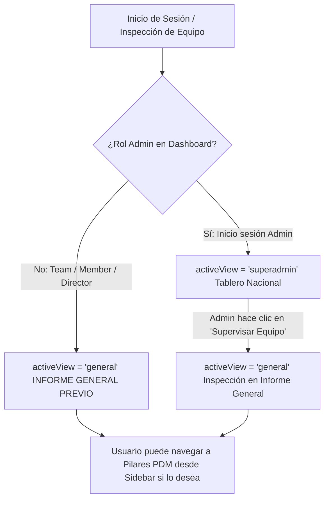

# 📑 Propuesta Técnica 031: Configuración de la Vista "Informe General" como Vista Predeterminada

**Proyecto:** MISINCOL | Plan de Desarrollo Ministerial (PDM)  
**Fecha:** 2026-11-11  
**Autor:** Agente 1 (VP of Engineering) & Agente 2 (Staff Software Architect)  
**Contrato de Gobernanza:** v2026.4.0 (`< 150` líneas por archivo, Vertical Slicing, Ciclo Estricto)  
**Estado:** APROBADO Y COMPLETADO (v2026.4.0)

---

## 1. Resumen Ejecutivo (El Qué y El Por Qué)

### El Requerimiento
El usuario ha solicitado:  
> *"oye poner como vista predetermiada la vista de informe general"*

### Diagnóstico de la Situación Actual
Actualmente, el servicio de gestión de sesión del cliente ([`AppSessionService`](file:///c:/Users/Usuario/Desktop/personales/planMinisterial/frontend/src/app/auth/app-session.service.ts)) inicializa y conmuta el estado de vista activa `activeView` bajo las siguientes reglas:
1. **Inicialización de señal**: Si el usuario no tiene rol `admin`, la vista por defecto es `'plans'` (la vista del plan por fases/pilares `PhaseViewComponent`).
2. **Inicio de sesión de equipo territorial** (`handleTeamLogin`): Asigna `this.activeView.set('plans')`.
3. **Inicio de sesión de colaborador/miembro** (`handleMemberLogin`): Asigna `this.activeView.set('plans')`.
4. **Inicio de sesión de Director General** (`handleDirectorGeneralLogin`): Asigna `this.activeView.set('plans')`.
5. **Inspección de equipo desde el Tablero Nacional** (`handleInspectTeamFromAdmin`): Cuando el Coordinador de Equipos hace clic en un equipo para supervisarlo, asigna `this.activeView.set('plans')`.

En la práctica, la vista de **Informe General** ([`GeneralInfoViewComponent`](file:///c:/Users/Usuario/Desktop/personales/planMinisterial/frontend/src/features/general-info/infrastructure/general-info-view.component.ts), ruta interna `'general'`) contiene el consolidado macro de la misión:
- Presupuestos por pilar y ejecución financiera.
- Ciclo anual ministerial.
- Esenciales a desarrollar (1 a 5).
- Tabla multianual de métricas de campo (estilo oficial Excel).
- Entrenamiento ministerial y desarrollo eclesial.
- Datos del equipo y nómina de integrantes.

Por tanto, establecerla como la **vista predeterminada** al acceder a una misión (tanto para equipos, colaboradores, directores, como para el coordinador al inspeccionar un equipo) brinda de inmediato una radiografía completa del estado de la misión antes de descender al detalle operativo de los objetivos de cada pilar.

---

## 2. Alcance Técnico y Arquitectura de la Solución

### Modificaciones Concretas en [`AppSessionService`](file:///c:/Users/Usuario/Desktop/personales/planMinisterial/frontend/src/app/auth/app-session.service.ts)
1. **Estado inicial (`activeView`)**:
   - Cambiar la condición por defecto de no-admin de `'plans'` a `'general'`.
2. **Método `handleTeamLogin`**:
   - Cambiar `this.activeView.set('plans')` por `this.activeView.set('general')`.
3. **Método `handleMemberLogin`**:
   - Cambiar `this.activeView.set('plans')` por `this.activeView.set('general')`.
4. **Método `handleDirectorGeneralLogin`**:
   - Cambiar `this.activeView.set('plans')` por `this.activeView.set('general')`.
5. **Método `handleInspectTeamFromAdmin`**:
   - Cambiar `this.activeView.set('plans')` por `this.activeView.set('general')`.
6. **Mantenimiento de Límites**:
   - [`app-session.service.ts`](file:///c:/Users/Usuario/Desktop/personales/planMinisterial/frontend/src/app/auth/app-session.service.ts) cuenta actualmente con 116 líneas, manteniéndose cómodamente bajo la restricción de las 150 líneas.

### Persistencia y Base de Datos (DBA Check)
- **Impacto en BD:** Ninguno. Se trata de un ajuste puramente de navegación y estado en la capa de presentación SPA (Angular).

---

## 3. Plan de Pruebas y Validación

1. **Prueba Unitaria y de Navegación**:
   - Añadir una prueba unitaria para validar que el servicio `AppSessionService` inicializa `activeView` en `'general'` para sesiones de equipo y director general, y que `handleInspectTeamFromAdmin` conmute a `'general'`.
2. **Verificación de regresión**:
   - Ejecutar la suite completa de Vitest en el frontend (`npm test`) para garantizar cero regresiones.
3. **Validación de Líneas de Código**:
   - Confirmar que todos los archivos modificados permanezcan `< 150` líneas.

---

## 4. Espera de Aprobación
Conforme a la regla de gobernanza **2.2 (Ciclo de Propuesta y Feedback Obligatorio)**, el agente detiene su intervención a la espera de la autorización explícita del usuario para ejecutar los cambios.
