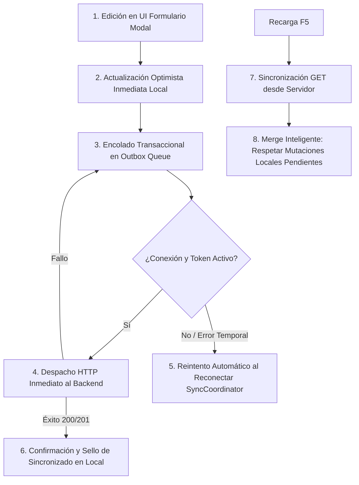

# Propuesta Técnica 060: Persistencia Offline-First Garantizada para Edición de Equipos y Usuarios

## 1. Contexto y Diagnóstico del Problema

El usuario reporta:
> *"al guardar la edicion de algun equipo o de algun usuario nose guardan recargo la pagian y nada, basate en ese proyecto para que veas como funciona el first ofline porfa porque tenemos problemas con eso"*

Tras auditar el flujo completo entre la interfaz de usuario, los servicios de aplicación, el almacenamiento local y la base de datos remota PostgreSQL (`misincol-api.servidor.blog`), se identificaron las siguientes **causas raíz exactas**:

---

### A. Diagnóstico en Edición de Misiones / Equipos
1. **Desacoplamiento del Motor Outbox:**
   - En `AdminDashboardService.handleUpdateTeam(teamId, updates)`, se invocaba `syncTeamUpdatedToBackend(teamId, updates)`.
   - Dicha función lanzaba una petición `httpClient.put(/teams/${teamId}, payload)` con `.catch(() => {})`. Si la petición fallaba por pérdida de red, token expirado o desfase de ID, el error se silenciaba completamente.
   - La mutación **no se encolaba en el sistema Outbox**, perdiéndose cualquier capacidad de reintento automático.
2. **Sobrescritura Destructiva en Recarga (`F5`):**
   - En el `constructor` de `AdminDashboardService`, se ejecuta `this.syncFromBackend()`.
   - Esta función consulta `GET /teams` y sobrescribe el signal `this.allTeams` con los datos del servidor.
   - Si el backend aún no había guardado la actualización (o la petición anterior falló en silencio), los datos remotos obsoletos borraban de inmediato los cambios locales al recargar.
3. **Estado Previo de la Base Central:**
   - La base remota tenía únicamente 1 registro incompleto. Al no existir las misiones territoriales con sus IDs oficiales, las peticiones `PUT /teams/team-pastos` o `PUT /teams/team-wayuu` rebotaban con `404 Not Found`. *(Este catálogo ya fue saneado y cuenta con los 6 equipos oficiales).*

---

### B. Diagnóstico en Edición de Usuarios y Colaboradores
1. **Cero Persistencia de `updateUser` hacia el Backend:**
   - En `SecurityUsersService.updateUser(userId, updates)`, la función actualizaba el arreglo en memoria y el `localStorage`, emitiendo el mensaje de éxito `"Datos de [nombre] actualizados"`.
   - **Nunca se realizaba ninguna llamada HTTP ni sincronización al backend.**
2. **Falta de Endpoint Universal de Usuario en Backend:**
   - La API de NestJS expone `POST /users` (creación), `GET /users` (consulta), `PATCH /users/:id/role` (cambio de rol) y `POST /security/users/sync` (sincronización en lote).
   - `updateUser` no enviaba los cambios a `POST /security/users/sync` ni a `PATCH /users/:id/role`.
3. **Sobrescritura Inevitable en Recarga:**
   - Al refrescar el navegador, `SecurityUsersService.constructor` invocaba `syncFromBackend()`, la cual ejecutaba `GET /users` y reemplazaba la lista local con los usuarios viejos del servidor.

---

## 2. Solución Arquitectónica Basada en Offline-First (Patrón Outbox)

Siguiendo el estándar analizado en el proyecto de referencia y la arquitectura de la Propuesta 046:

### Principales Componentes del Plan

1. **Integración de Equipos con el Motor Outbox (`admin-teams-sync.helper.ts`):**
   - Al editar un equipo en `handleUpdateTeam`, registrar la mutación `UPDATE` para la entidad `'team'` en `OutboxQueueService`.
   - Intentar despacho inmediato mediante `PUT /teams/:id`. Si tiene éxito, marcar resuelta la mutación en Outbox. Si hay desconexión o fallo temporal, el `SyncCoordinatorService` la despachará automáticamente cuando se restablezca la conexión.

2. **Persistencia Real de Usuarios (`security-users.service.ts` y `security-users-sync.helper.ts`):**
   - Al invocar `updateUser(userId, updates)`:
     1. Si cambia el rol, despachar `PATCH /users/:id/role`.
     2. Disparar `saveUsersToBackend()` o registrar la mutación correspondiente para actualizar los datos en `POST /security/users/sync`.
   - Almacenar el estado con marca temporal local.

3. **Fusión Inteligente en Recarga (`Merge Safe on Sync`):**
   - En `AdminDashboardService.syncFromBackend()` y `SecurityUsersService.syncFromBackend()`:
   - Antes de sobrescribir el estado local con la respuesta de `GET`, consultar si existen mutaciones pendientes en el `OutboxQueueService` para esa entidad.
   - Si un equipo o usuario tiene cambios pendientes de enviar, **se preserva la versión local más reciente**, evitando que una recarga rápida (`F5`) destruya la edición del usuario.

4. **Gobernanza y Cumplimiento:**
   - Cero dependencias comerciales externas.
   - Límite estricto de máximo 150 líneas por archivo fuente.
   - 100% de pruebas unitarias pasando.

---

## 3. Plan de Pruebas y Validación

1. **Prueba Unitaria y de Integración Local:**
   - Test en `admin-teams-sync.helper.spec.ts` validando el encolado y despacho de `PUT /teams/:id`.
   - Test en `security-users.service.spec.ts` validando que `updateUser` active la sincronización con el servidor.
2. **Prueba en Vivo contra Servidor Remoto (`https://misincol-api.servidor.blog`):**
   - Ejecución de script de prueba editando un equipo y verificando que el cambio persista en PostgreSQL tras recargar la consulta.
   - Ejecución de script de prueba editando rol y datos de usuario y confirmando persistencia.
3. **Verificación Estricta:**
   - Verificación de $\le 150$ líneas por archivo.
   - `npm --prefix frontend test -- --run` y `npm --prefix frontend run build`.
