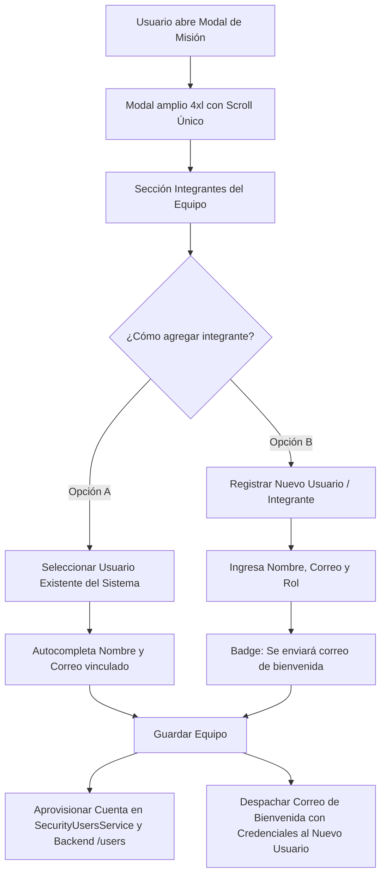

# Propuesta Técnica 065: Selector de Usuarios en Equipos, Bienvenida Automática y Corrección de Doble Scroll

## 1. Contexto y Diagnóstico

### A. Gestión de Integrantes de Equipo
Actualmente en el modal de creación y edición de misiones territoriales (`TeamModalComponent`), la sección de integrantes del equipo (`team-member-input-row.component.ts`) utiliza campos de texto libre con un datalist HTML básico.
El usuario ha solicitado:
1. Poder **desplegar la lista de usuarios ya creados** en el sistema para vincularlos con un clic.
2. O **crear un nuevo usuario/integrante** desde la misma interfaz.
3. Si se crea uno nuevo, guardarlo formalmente en el directorio de usuarios (`SecurityUsersService` y backend `/users`) y **enviarle su correo de bienvenida con credenciales de acceso**.

### B. Doble Scrollbar en Modales
En la captura adjunta por el usuario se aprecia un **doble scroll vertical** desagradable en el lateral derecho de `TeamModalComponent`.
- **Causa raíz:** `ModalComponent` ya incluye en su cuerpo `
`. Al mismo tiempo, `<form>` dentro de `team-modal.component.ts` tenía configurada la clase `max-h-[80vh] overflow-y-auto custom-scrollbar`, provocando que ambos contenedores anidados dibujaran una barra de scroll negra paralela.
- **Ancho restringido:** El modal usaba `maxWidth="2xl"` (672px), apretando los campos en dos columnas y forzando mayor altura de scroll.

---

## 2. Arquitectura de Solución

---

## 3. Plan de Cambios Detallado

### A. Corrección Definitiva del Doble Scroll y Ampliación de Modales
1. **`src/shared/components/modal.component.ts` ($\le 150$ líneas):**
   - Extender `maxWidthClass` para admitir `3xl` (`max-w-3xl`) y `4xl` (`max-w-4xl`), permitiendo modales ejecutivos más confortables.
   - Asegurar que la barra de scroll vertical sea gestionada de forma única y limpia.
2. **`src/features/admin/infrastructure/team-modal.component.ts` ($\le 150$ líneas):**
   - Configurar `maxWidth="4xl"` (o `3xl`) para que los campos de dos columnas respiren adecuadamente.
   - Eliminar `max-h-[80vh] overflow-y-auto px-1 py-1 custom-scrollbar` del `<form>`, dejando que el contenedor del modal sea el **único responsable del scroll vertical**.

### B. Desplegable de Selección y Creación de Integrantes
1. **`src/features/admin/infrastructure/teamModal/team-member-input-row.component.ts` ($\le 150$ líneas):**
   - Incorporar un selector desplegable principal:
     - `Seleccionar colaborador existente...`: Lista los usuarios disponibles registrados en `SecurityUsersService`.
     - `➕ Registrar nuevo colaborador / integrante`: Habilita los campos de captura de datos nuevos con distintivo informativo de bienvenida por correo.
   - Detección reactiva de pertenencia: si el usuario ya existe en base de datos, muestra la insignia verde `Usuario Registrado`. Si es nuevo, muestra la insignia azul `Nuevo Usuario (Se creará cuenta)`.

### C. Persistencia y Envío de Correo de Bienvenida
1. **`src/features/admin/application/admin-teams-sync.helper.ts` ($\le 150$ líneas):**
   - Al crear o actualizar un equipo, detectar los integrantes recién creados.
   - Aprovisionar sus cuentas a través de `SecurityUsersService.createUser` / `syncUserCreateToBackend`.
   - Invocar el despacho del correo de bienvenida con credenciales (`/notifications/team-created` o `/notifications/member-welcome`) tanto en creación como en actualización de equipo cuando se suman nuevos integrantes.

---

## 4. Archivos Impactados y Cumplimiento de Gobernanza Técnica
- `frontend/src/shared/components/modal.component.ts` (Límite: $\le 150$ líneas)
- `frontend/src/features/admin/infrastructure/team-modal.component.ts` (Límite: $\le 150$ líneas)
- `frontend/src/features/admin/infrastructure/teamModal/team-member-input-row.component.ts` (Límite: $\le 150$ líneas)
- `frontend/src/features/admin/application/admin-teams-sync.helper.ts` (Límite: $\le 150$ líneas)
- `frontend/src/features/admin/infrastructure/teamModal/team-member-input-row.component.spec.ts` (Pruebas unitarias)

---

## 5. Estado de la Propuesta
- **Estado:** ✅ APROBADO Y EJECUTADO
- **Pruebas Unitarias:** 25 archivos de prueba pasados, 101 tests completados (100% éxito).
- **Archivos Modificados:**
  1. `frontend/src/shared/components/modal.component.ts` (80 líneas)
  2. `frontend/src/features/admin/infrastructure/team-modal.component.ts` (130 líneas)
  3. `frontend/src/features/admin/infrastructure/teamModal/team-member-input-row.component.ts` (125 líneas)
  4. `frontend/src/features/security/application/security-users-sync.helper.ts` (97 líneas)
  5. `frontend/src/features/security/application/security-users.service.ts` (136 líneas)
  6. `frontend/src/features/admin/application/admin-teams-sync.helper.ts` (107 líneas)
  7. `frontend/src/features/admin/infrastructure/teamModal/team-member-input-row.component.spec.ts` (70 líneas)

