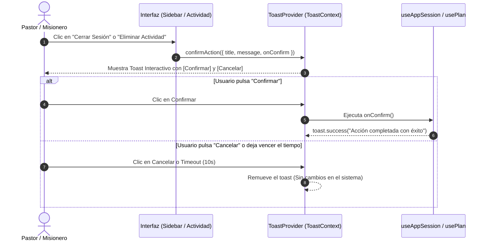

# Propuesta Técnica: Sistema de Toasts de Verificación de Acciones Críticas
**Código:** PROP-002  
**Fecha:** 2026-10-19  
**Autor:** Orquestador Técnico (VP of Engineering) & Staff Software Architect  
**Estado:** APROBADO Y EJECUTADO CON ÉXITO  

---

## 1. Resumen Ejecutivo (El Qué y El Por Qué)

### El Qué:
Implementar un **Sistema de Toasts de Verificación de Acciones Críticas** integrado en la infraestructura visual compartida (`src/shared/components/toast/`), permitiendo que acciones sensibles y destructivas (como el cierre de sesión territorial, el restablecimiento de actividades de prueba a valores de fábrica, la eliminación de actividades del plan o la eliminación de registros) no ocurran de manera inmediata ante un clic accidental ni recurran al diálogo nativo del navegador (`window.confirm()`), sino que requieran una confirmación explícita mediante un toast interactivo con botones de **"Confirmar"** y **"Cancelar"**.

### El Por Qué:
1. **Prevención de Errores Humanos y Pérdida Involuntaria de Datos:** Los pastores y líderes territoriales pueden hacer clic por error en el botón de salida (`LogOut`), en el ícono de restablecer actividades o en la papelera de una actividad. Un clic accidental causaría pérdida de datos sin posibilidad de marcha atrás.
2. **Eliminación Total de `window.confirm()` del Navegador:** Reemplazar el cuadro tosco del navegador mostrado en la captura de pantalla por un componente institucional elegante con diseño MISINCOL.
3. **Consistencia Visual con la Jerarquía Calmada:** El toast de confirmación utilizará la paleta institucional cálida (ámbar/terracota/blanco), con micro-animaciones fluidas, tiempo de auto-cancelación por seguridad y botones de alto contraste legibles para adultos mayores.
4. **Cumplimiento del Contrato de Gobernanza Técnica v2026.4.0:** Todo archivo nuevo o modificado se mantendrá estrictamente por debajo de las 150 líneas, sin librerías externas adicionales y con tipado estricto.

---

## 2. Puntos de Impacto en el Sistema

| Acción Crítica | Ubicación en el Código | Comportamiento con Toast de Verificación |
|---|---|---|
| **Restablecer Actividades (Captura Usuario)** | `PhaseHeaderBar.tsx` | Reemplaza el `confirm()` nativo por un toast elegante: *"¿Restablecer Actividades? - ¿Deseas restablecer todas las actividades de prueba a los valores originales?"* con botones [Restablecer] y [Cancelar]. |
| **Cierre de Sesión Territorial** | `SidebarUserProfileCard.tsx` y `AppHeaderUserProfile.tsx` | Al hacer clic en salir, se despliega: *"¿Cerrar Sesión Territorial? - ¿Estás seguro de que deseas salir de tu cuenta ministerial?"* con botones [Sí, Salir] y [Cancelar]. |
| **Eliminación de Actividades** | `ActivityBudgetQuickEdit.tsx` / `ActivityItem.tsx` | Reemplaza el `confirm()` nativo por: *"¿Eliminar Actividad del Plan? - Esta acción removerá el ítem y su presupuesto"* con botones [Eliminar] y [Cancelar]. |
| **Eliminación de Equipos (Supervisión)** | `SuperAdminTeamsGrid.tsx` / `useAdminDashboard.ts` | Confirmación antes de archivar o dar de baja a un equipo misionero. |

---

## 3. Plan de Arquitectura y Módulos (< 150 Líneas)

### 3.1. Extensión de Tipos (`src/shared/components/toast/toast.types.ts`)
* Se agrega la interfaz inmutable `ToastConfirmOptions`:
  ```ts
  export interface ToastConfirmOptions {
    title: string;
    message: string;
    confirmLabel?: string;
    cancelLabel?: string;
    type?: 'warning' | 'danger';
    onConfirm: () => void;
    onCancel?: () => void;
  }
  ```
* Se amplía el contrato `ToastContextValue` para exponer el método `confirmAction(options: ToastConfirmOptions)`.

### 3.2. Nuevo Componente Visual (`src/shared/components/toast/ToastConfirmView.tsx` < 95 líneas)
* Componente especializado en renderizar toasts interactivos:
  * Ícono de alerta pulsante (`AlertTriangle` / `ShieldAlert`).
  * Título y mensaje en tipografía `Outfit`.
  * Botón primario de confirmación (`bg-[#8B251E] hover:bg-[#6E1A14] text-white`).
  * Botón secundario de cancelación (`bg-stone-100 hover:bg-stone-200 text-stone-700`).
  * Barra de progreso de tiempo restante (auto-cancelación tras 10 segundos de inactividad).

### 3.3. Orquestador Toast (`src/shared/components/Toast.tsx` < 115 líneas)
* Gestión del estado reactivo de confirmaciones pendientes mediante cola no bloqueante.

### 3.4. Integración en Interfaces
* `src/features/plans/infrastructure/sidebar/SidebarUserProfileCard.tsx`: Conectar `onLogout` con `confirmAction`.
* `src/app/ui/AppHeaderUserProfile.tsx`: Conectar botón de logout con `confirmAction`.
* `src/features/plans/infrastructure/ActivityItem.tsx`: Conectar botón de eliminación con `confirmAction`.

---

## 4. Diagrama de Flujo (Mermaid)



---

## 5. Criterios de Aceptación
1. **No bloqueante:** La interfaz de usuario no se congela (cero alertas modales invasivas del navegador).
2. **Alta usabilidad:** Los botones dentro del toast tienen suficiente tamaño táctil (`p-1.5 px-3 rounded-xl`) y excelente contraste.
3. **Cumplimiento estricto de gobernanza:** Cada archivo mantendrá una extensión inferior a 150 líneas.
4. **Validación en navegador:** Verificación visual mediante subagente en caliente en `http://localhost:5173/`.

---

## 6. Solicitud de Feedback

> [!IMPORTANT]
> En cumplimiento del **Contrato de Gobernanza Técnica (Regla 2.2 y Sección 4)**, se solicita tu **aprobación explícita** para ejecutar esta solución técnica.
> 
> ¿Das tu visto bueno para implementar el componente `ToastConfirmView.tsx`, extender el `ToastProvider` e integrarlo en el cierre de sesión y la eliminación de actividades?
