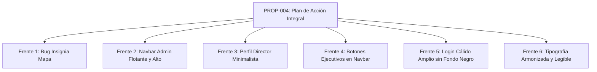

# Plan de Acción y Propuesta Técnica: Corrección de Mapa, Rediseño del Navbar Admin, Login Cálido y Tipografía
**Código:** PROP-004  
**Fecha:** 2026-10-19  
**Autor:** Orquestador Técnico (VP of Engineering) & Staff Software Architect  
**Estado:** APROBADO Y EJECUTADO CON ÉXITO  

---

## 1. Resumen Ejecutivo (El Qué y El Por Qué)

### El Qué:
Ejecutar un plan de acción integral compuesto por 6 frentes de mejora estética y corrección de inconsistencias funcionales:
1. Corrección algorítmica de la insignia flotante del mapa territorial de Colombia al hacer hover sobre departamentos sin misión.
2. Rediseño del Navbar de la vista de Administrador: eliminación de la caja redundante de la esquina izquierda y mayor altura/fluidez.
3. Fusión y simplificación del perfil del Director: visualización limpia del nombre y botón de salida sin sobrecarga de texto.
4. Integración de los botones *"Informe Consolidado"* y *"Nueva Misión"* en el Navbar, retirando la franja intermedia del cuerpo de la página.
5. Modernización del Login: eliminación del fondo negro, adopción de la paleta cálida institucional de la página (crema/arena/ámbar) y mayor amplitud visual para la fotografía misionera.
6. Armonización tipográfica global para descanso y claridad visual (evitando textos diminutos o fatiga visual para adultos mayores).

### El Por Qué:
* **Precisión Cartográfica:** La discordancia entre el departamento sobrevolado (ej: Bolívar) y el nombre de una misión ajena (ej: Misión Nasa) genera confusión geográfica en la supervisión nacional.
* **Eliminación de Ruido y Duplicidad:** El navbar actual muestra elementos repetidos ("Supervisión Nacional", dos etiquetas de director, botones de salida redundantes), restando elegancia y espacio vertical a los datos clave.
* **Cohesión Visual de Marca:** El login actual con fondo negro crea una desconexión abrupta con el resto de la plataforma, que es luminosa, cálida e institucional.
* **Gobernanza Técnica v2026.4.0:** Todo cambio mantendrá cada archivo estrictamente por debajo de las 150 líneas, con tipado estricto y cero regresiones.

---

## 2. Detalle de los 6 Frentes de Acción

### 🎯 Frente 1: Corrección de Inconsistencia en el Mapa Territorial
* **Archivo afectado:** `src/features/admin/infrastructure/map/ColombiaMapCard.tsx`
* **Diagnóstico del Error:**
  * Al hacer clic en un departamento con misión (ej: Cauca con Misión Nasa), `selectedDept` toma ese valor.
  * Al pasar el cursor (hover) sobre otro departamento sin misión (ej: Bolívar), `hoveredDept` es `'Bolívar'`, pero `hoveredDeptTeam` es `null`.
  * La línea `currentBadgeTeam = hoveredDeptTeam || (selectedDept !== 'ALL' ? ... : null)` caía en el fallback y tomaba la misión del departamento seleccionado, mostrando erróneamente: *"Bolívar | Misión Nasa - Tierradentro"*.
* **Solución Técnica:**
  * Si `hoveredDept` existe, `currentBadgeTeam` será **estrictamente** el equipo de ese departamento sobrevolado. Si dicho departamento no tiene misión, no se mostrará ninguna cápsula de misión ajena.
  * Solo si `hoveredDept` es `null`, se muestra el equipo del departamento seleccionado.

---

### 🏛️ Frente 2: Rediseño y Elevación del Navbar de Administración
* **Archivo afectado:** `src/app/ui/AppHeader.tsx` y `src/app/ui/appHeader.types.ts`
* **Acciones:**
  * Incrementar la altura del navbar a `h-[76px]` / `h-20` para dar respiro visual y separación con el contenido principal.
  * Eliminar el recuadro grisáceo de la esquina izquierda que dice *"Supervisión Nacional / Dirección General • PDM"*.
  * Colocar en su lugar el logotipo oficial de MISINCOL en la izquierda de forma limpia y protagonista.

---

### 👤 Frente 3: Fusión y Simplificación del Perfil del Director
* **Archivo afectado:** `src/app/ui/AppHeaderUserProfile.tsx`
* **Acciones:**
  * Retirar etiquetas redundantes como *"Super Administrador"*, subtítulos extensos y estados dobles.
  * Crear un bloque integrado y sofisticado:
    * Avatar circular o rounded-xl con degradado terracota institucional.
    * Nombre: **Director Nacional** (tipografía `Outfit font-black text-stone-900 text-sm`).
    * Botón de salida (`LogOut`) minimalista integrado a su lado con micro-interacción suave, conectado al toast interactivo de verificación (`confirmAction`).

---

### ⚡ Frente 4: Reubicación de Botones de Informe y Nueva Misión en el Navbar
* **Archivos afectados:**
  * `src/app/ui/AppHeader.tsx`
  * `src/features/admin/infrastructure/SuperAdminView.tsx`
  * `src/features/admin/infrastructure/superAdmin/SuperAdminHeader.tsx`
* **Acciones:**
  * Suprimir la franja intermedia `SuperAdminHeader.tsx` del cuerpo del dashboard (eliminando la caja *"Dirección Nacional Misincol • Supervisión Estratégica PDM"* y el título duplicado).
  * Reubicar en el Navbar (entre el logo y el perfil) los dos botones ejecutivos:
    1. **Informe Consolidado:** Botón blanco con borde arena, ícono ámbar `FileDown` y tipografía nítida.
    2. **Nueva Misión / Equipo:** Botón con gradiente terracota institucional (`bg-[#8B251E]`), ícono `Plus` y relieve sutil.
  * Esto permite que el dashboard de administración aproveche de inmediato la parte superior de la pantalla para sus métricas y mapas sin scroll innecesario.

---

### 🌅 Frente 5: Modernización del Login (Cálido, Luminoso y sin Fondo Negro)
* **Archivos afectados:**
  * `src/features/auth/infrastructure/login/LoginHeroCard.tsx`
  * `src/features/auth/infrastructure/LoginView.tsx`
* **Acciones:**
  * **Eliminar el fondo negro (`#0F0F11` y `bg-stone-950`):** Reemplazarlo por la paleta institucional de MISINCOL: fondo arena/crema suave (`bg-[#FAF7F2]` o `bg-[#FDF8F0]`), con degradados sutiles hacia tonos ámbar muy suaves (`#FDF0E8`).
  * **Mayor amplitud para la fotografía misionera:** Ampliar el contenedor de la imagen (`aspect-[4/5]` o mayor ancho relativo), eliminando bordes oscuros para que la fotografía de las manos con la semilla respire y destaque con luminosidad natural.
  * **Tipografía del Hero:** Título en `text-stone-900 font-extrabold`, versículo de Mateo 9:37-38 en `text-stone-600 italic` de alta legibilidad sobre fondo claro.

---

### ✍️ Frente 6: Armonización Global de la Tipografía
* **Archivos afectados:** `src/index.css`, `index.html` y componentes UI principales.
* **Acciones:**
  * Homogeneizar las fuentes:
    * `Outfit`: Títulos principales, cifras monetarias, métricas de KPI y badges de navegación.
    * `Plus Jakarta Sans`: Párrafos, tablas descriptivas, etiquetas de formularios y modales.
  * Elevar tamaños mínimos: Ningún texto descriptivo será menor a `text-xs` (12px), mejorando significativamente la lectura para personas mayores.
  * Ajuste de contraste: Uso de `text-stone-900` para títulos y `text-stone-700/800` para lectura regular, eliminando contrastes desvanecidos.

---

## 3. Matriz de Cumplimiento de Gobernanza Técnica v2026.4.0

| Requisito de Gobernanza | Estrategia de Cumplimiento |
|---|---|
| **Límite de 150 líneas por archivo** | Se auditarán todos los archivos modificados. Cada componente (`AppHeader.tsx`, `LoginHeroCard.tsx`, `ColombiaMapCard.tsx`, etc.) mantendrá menos de 120 líneas. |
| **Cero SDKs Comerciales** | Uso exclusivo de CSS nativo, Tailwind y React puro sin dependencias opacas. |
| **Vertical Slicing** | Toda la lógica residirá en `src/features/admin/`, `src/features/auth/` y `src/app/`. |
| **Verificación en Navegador** | Captura de pantallas y auditoría visual de cada pantalla modificada antes de la entrega final. |

---

## 4. Próximo Paso

> [!IMPORTANT]
> Este documento representa el plan de acción formal requerido por el Contrato de Gobernanza Técnica.
> 
> Revisa los 6 puntos propuestos y confírmame si estás de acuerdo con la estrategia o si deseas ajustar algún detalle visual antes de proceder con la ejecución.
