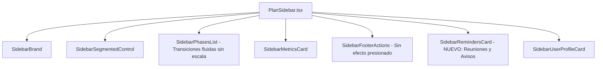

# Propuesta Técnica: Módulo de Recordatorios en Sidebar y Suavizado de Transiciones
**Código:** PROP-005  
**Fecha:** 2026-10-19  
**Autor:** Orquestador Técnico (VP of Engineering) & Staff Software Architect  
**Estado:** APROBADO Y EJECUTADO CON ÉXITO  

---

## 1. Resumen Ejecutivo (El Qué y El Por Qué)

### El Qué:
1. **Aprovechar el espacio libre del sidebar:** Crear un nuevo componente [`SidebarRemindersCard.tsx`](file:///c:/Users/Usuario/Desktop/planMinisterial/src/features/plans/infrastructure/sidebar/SidebarRemindersCard.tsx) en el espacio inferior disponible entre las acciones y la tarjeta del líder misionero. Este módulo mostrará de manera concisa:
   * **Próximas Reuniones de Equipo:** Fechas y horas de enlace ministerial o reuniones de intercesión.
   * **Mensajes / Comunicados de Supervisión Nacional:** Directrices institucionales emitidas por la Dirección Nacional de MISINCOL.
2. **Erradicación del efecto de presionado tosco:** Modificar [`SidebarPhasesList.tsx`](file:///c:/Users/Usuario/Desktop/planMinisterial/src/features/plans/infrastructure/sidebar/SidebarPhasesList.tsx) y [`SidebarFooterActions.tsx`](file:///c:/Users/Usuario/Desktop/planMinisterial/src/features/plans/infrastructure/sidebar/SidebarFooterActions.tsx) para eliminar las transformaciones `hover:scale-[1.015]` y `active:scale-[0.985]`, sustituyéndolas por transiciones fluidas de color, relieve sutil y bordes luminosos sin saltos ni deformaciones en el clic.

### El Por Qué:
* **Optimización Ergonómica del Espacio:** El área inferior del sidebar actualmente queda vacía en pantallas de escritorio y tablets, desperdiciando un punto de atención privilegiado para la comunicación pastoral entre la Dirección Nacional y los misioneros de campo.
* **Fluidez y Calidad Visual:** Los efectos de escala (`scale-[...]`) provocan vibración en textos pequeños y bordes en pantallas de alta densidad. Su eliminación brindará una sensación de solidez nativa y suavidad premium.

---

## 2. Arquitectura de Componentes y Diseño

### Especificaciones de `SidebarRemindersCard.tsx`
* **Cápsula contenedora:** Fondo blanco cálido (`bg-white/95`), borde suave arena (`border-stone-200/90`), esquinas redondeadas (`rounded-2xl`), sombra sutil `shadow-2xs`.
* **Encabezado:** Ícono `BellRing` / `CalendarClock` ámbar institucional con título *"Avisos y Agenda"* y badge *"Nacional"*.
* **Ítem 1 (Próxima Reunión):**
  * Ícono de calendario con fecha (ej. *"Jueves 7:00 PM"*).
  * Título: *"Reunión de Enlace Ministerial"*.
* **Ítem 2 (Aviso del Administrador Nacional):**
  * Ícono de supervisión o mensaje.
  * Texto: *"Reporte de avances del pilar activo antes del cierre mensual."*
* **Acceso rápido:** Botón o enlace discreto a *"Notas y Agenda"*.
* **Comportamiento colapsado:** En modo compacto (`isCollapsed`), se muestra un ícono discreto con indicador de notificación.

### Especificaciones de Suavizado de Botones
* En [`SidebarPhasesList.tsx`](file:///c:/Users/Usuario/Desktop/planMinisterial/src/features/plans/infrastructure/sidebar/SidebarPhasesList.tsx):
  * Se retira `hover:scale-[1.01]` y `scale-[1.01]`.
  * Se utiliza `transition-all duration-200 ease-out` enfocado en color de fondo, relieve de sombra (`hover:shadow-xs`) y acento de borde naranja.
* En [`SidebarFooterActions.tsx`](file:///c:/Users/Usuario/Desktop/planMinisterial/src/features/plans/infrastructure/sidebar/SidebarFooterActions.tsx):
  * Se retiran `active:scale-[0.985]` y `hover:scale-[1.015]`.
  * Se sustituyen por transiciones puras de borde y tonalidad `transition-colors duration-200`.

---

## 3. Matriz de Cumplimiento de Gobernanza Técnica v2026.4.0

| Archivo | Acción | Líneas Estimadas | Límite (< 150) |
|---|---|:---:|:---:|
| [`SidebarRemindersCard.tsx`](file:///c:/Users/Usuario/Desktop/planMinisterial/src/features/plans/infrastructure/sidebar/SidebarRemindersCard.tsx) | Nuevo componente de agenda y avisos | ~80 | ✅ Cumple |
| [`PlanSidebar.tsx`](file:///c:/Users/Usuario/Desktop/planMinisterial/src/features/plans/infrastructure/PlanSidebar.tsx) | Integración del nuevo componente | ~80 | ✅ Cumple |
| [`SidebarPhasesList.tsx`](file:///c:/Users/Usuario/Desktop/planMinisterial/src/features/plans/infrastructure/sidebar/SidebarPhasesList.tsx) | Suavizado de botones de pilares | ~95 | ✅ Cumple |
| [`SidebarFooterActions.tsx`](file:///c:/Users/Usuario/Desktop/planMinisterial/src/features/plans/infrastructure/sidebar/SidebarFooterActions.tsx) | Eliminación de rebote de presionado | ~115 | ✅ Cumple |

---

## 4. Próximo Paso y Solicitud de Aprobación

> [!IMPORTANT]
> En concordancia con la **Regla 2.2 del Contrato de Gobernanza Técnica**, el sistema se encuentra en pausa esperando tu confirmación.
> 
> ¿Apruebas este plan de acción para proceder con la creación de la tarjeta de recordatorios y el suavizado de las transiciones en el sidebar?
